# MOSFET → RISC-V

An interactive journey from a single transistor to a multi-core RISC-V processor laid out on
silicon, and on to a GPU, a memory system and Doom, as a static website.
**[Open it →](https://orelmag.github.io/MOSFETtoRISCV/)**

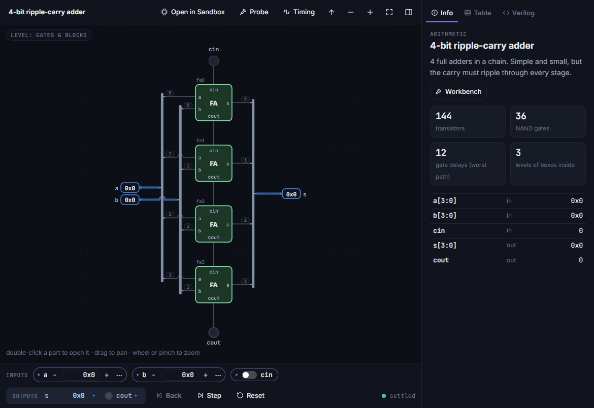

Every level is built only from the level below it, and **every box is transparent**: double-click
any part to look inside, all the way down to the MOSFETs. Wire values are computed live by an
event-driven gate-level simulator (one delay unit per NAND, so glitches and races are visible) and
a switch-level transistor solver. Transistor counts, gate counts and critical paths are measured
from the circuits themselves, every CPU is co-simulated against a RISC-V golden model, and the
dual-core and the RV32IM system core are exported as Verilog and taken through Yosys and OpenROAD to
sky130 layouts, whose reports stand beside the site's own area and timing estimates. Verilog goes
both ways: any circuit exports as Verilog, and Verilog written in the sandbox is synthesized by Yosys
in the page into chips that open down to the transistors like everything else.

Four ways in: the **[journey](https://orelmag.github.io/MOSFETtoRISCV/#/c/map/0)** (38 chapters,
three prologue chapters and two appendices), the **[campaign](https://orelmag.github.io/MOSFETtoRISCV/#/campaign)**
(127 levels: build it to unlock it), the **[workbench](https://orelmag.github.io/MOSFETtoRISCV/#/workbench/rca4)**
(any component on its own, with statistics, benchmarks and the out-of-order lab) and the
**[sandbox](https://orelmag.github.io/MOSFETtoRISCV/#/sandbox)** (your own circuits, up to whole computers).

## The journey

**38 chapters**, from the MOSFET, the CMOS inverter and NAND, through gates, binary numbers,
adders, multiplexers, latches, registers and memory arrays, to the ALU, the register file, RV32I
assembly and a single-cycle CPU. Then Python compiled to RV32I by the site's own compiler and run on
those gates, faster adders, pipelining (hazards, forwarding, branch prediction), bytes and
memory-mapped I/O, traps and interrupts, multiply / divide, caches, multicycle and microcoded control,
floating point (RV32F), the C extension (an expander in gates in front of the decoder) and RV64 (the
same core at 64 bits, the W instructions, what width costs block by block), a gate-level out-of-order
core (renaming, a reorder buffer, speculation) and a lab to reshape it (width, ports, window sizes, on
the benchmarks, your assembly or your Python, each commit slot accounted for, the window sizes priced
from the gates), many cores (atomics, coherence) and place and route on
silicon. Two tracks follow: a **GPU** (a lane core,
SIMT warps with divergence, latency hiding, coalescing and banked shared memory, a rasterizer with
depth and blending, and a graphics pipeline whose vertex kernel runs on the warp core) and **memory in
depth** (a DRAM at switch level, a DDR-style controller, flash with its translation layer, a bus with
DMA that boots a computer from flash).

Before chapter 1, an optional **prologue** builds the same logic from relays, from vacuum tubes and
from punched cards. After chapter 38, two **appendices**: the MOS 6502 rebuilt at transistor level, and
Doom compiled for the site's RV32IM. Each chapter opens with its goals, closes with a recap and Check
yourself questions, and has optional challenges, each with a revealable answer.

<table>
<tr>
<td width="50%">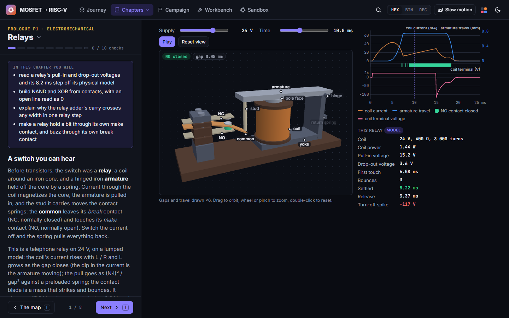<br><sub><b>P1</b>: a relay in 3D on a physical model: pull-in, contact bounce, the 8 ms step a relay computer runs at.</sub></td>
<td width="50%">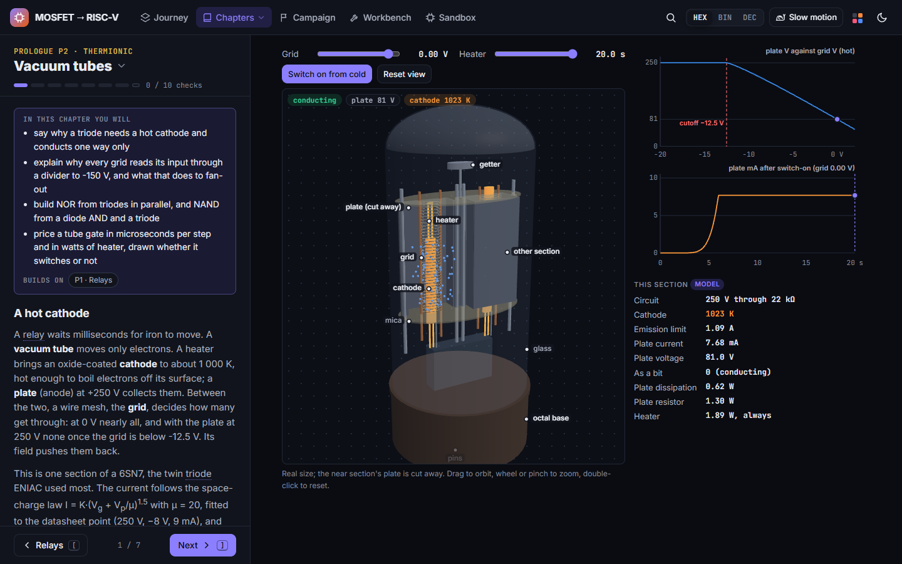<br><sub><b>P2</b>: a 6SN7 triode warming up, its grid deciding the plate current; tube gates follow.</sub></td>
</tr>
<tr>
<td>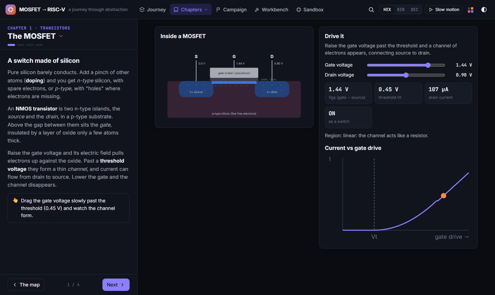<br><sub><b>Ch. 1</b>: the MOSFET. Raise the gate past the threshold and the channel forms.</sub></td>
<td>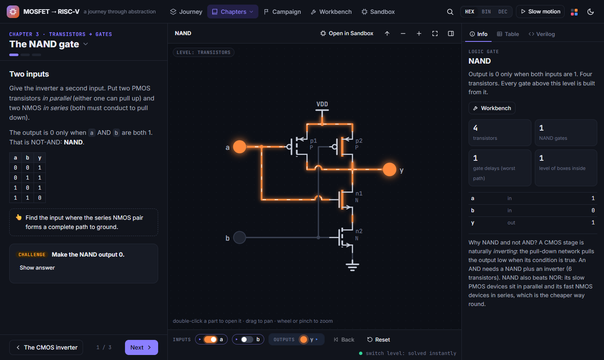<br><sub><b>Ch. 3</b>: the NAND, solved at switch level. Every gate above it is built from this one.</sub></td>
</tr>
<tr>
<td>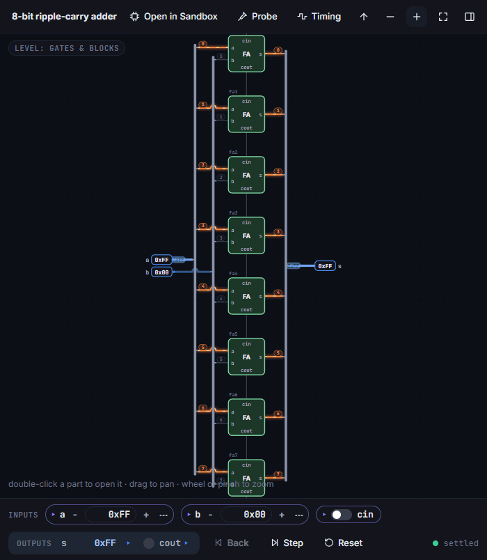<br><sub><b>Ch. 6</b>: toggle <code>cin</code> on 0xFF + 0 and watch the carry ripple, one gate delay at a time.</sub></td>
<td>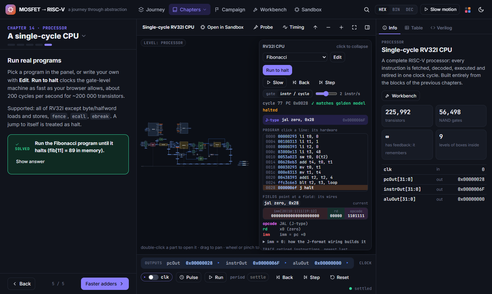<br><sub><b>Ch. 14</b>: a single-cycle RV32I CPU running Fibonacci, every instruction checked against the golden model.</sub></td>
</tr>
<tr>
<td>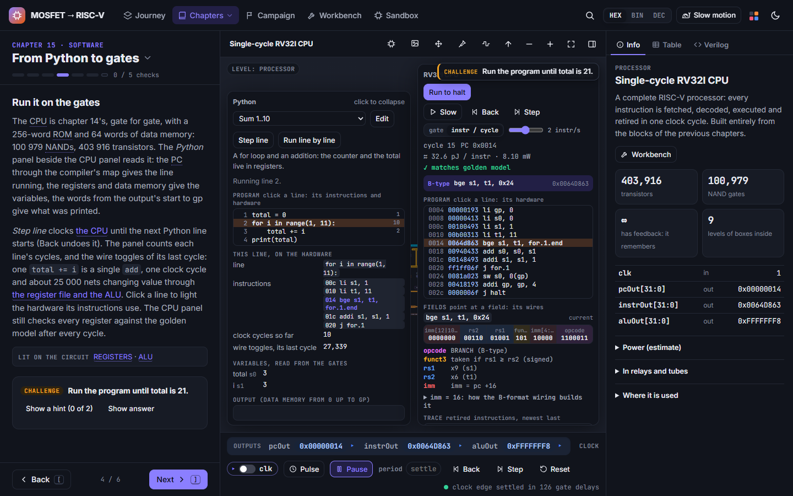<br><sub><b>Ch. 15</b>: Python on the gates: the line running, its instructions, cycles and wire toggles, the variables read from the registers.</sub></td>
<td>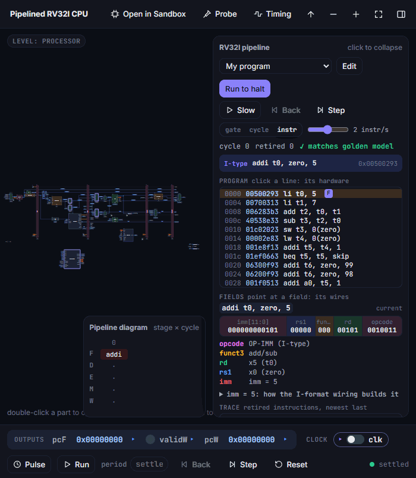<br><sub><b>Ch. 17</b>: a gate-level five-stage pipeline, its diagram marking forwarding, stalls and flushes.</sub></td>
</tr>
<tr>
<td>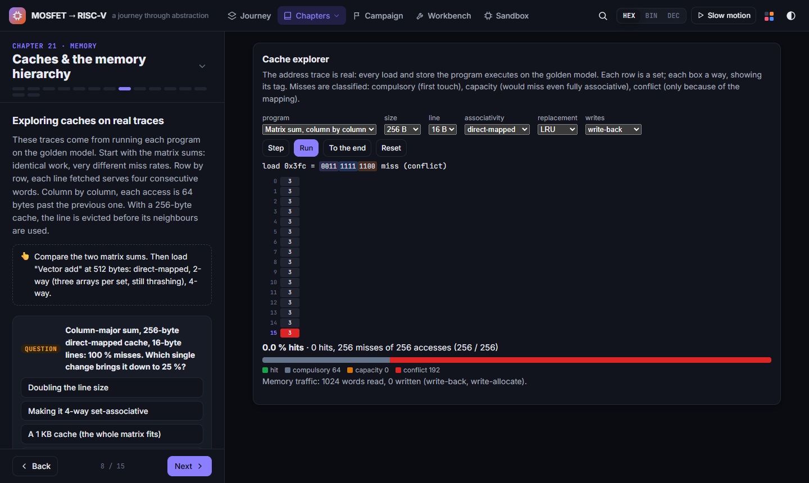<br><sub><b>Ch. 22</b>: caches on real address traces: size, line, ways, replacement, write policy, 3C misses.</sub></td>
<td>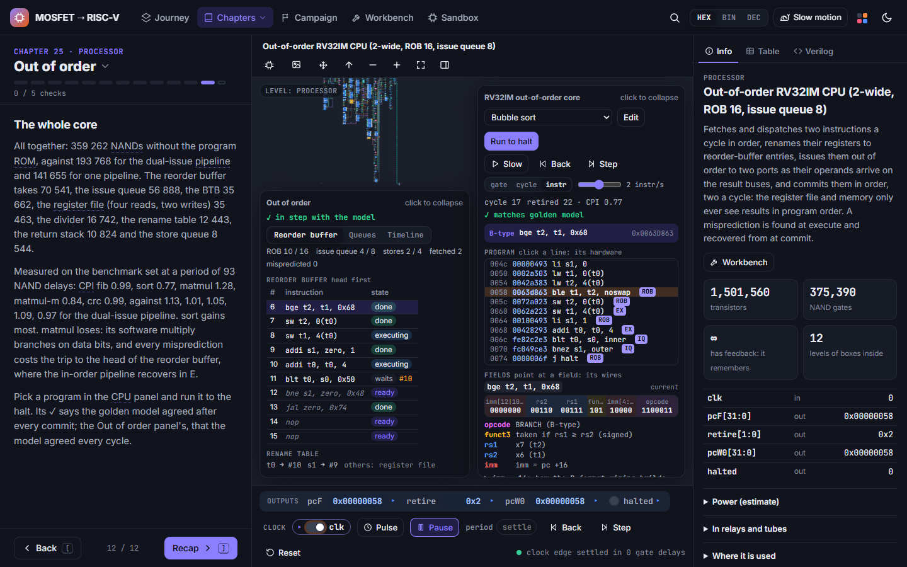<br><sub><b>Ch. 26</b>: a 359k-NAND out-of-order core; its reorder buffer, issue queue and rename table read from the gates.</sub></td>
</tr>
<tr>
<td>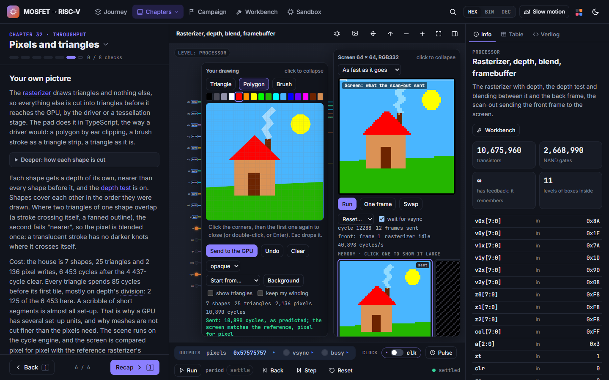<br><sub><b>Ch. 33</b>: draw a picture, cut it into triangles and send it to a 2.7M-NAND rasterizer; the screen is checked pixel for pixel.</sub></td>
<td>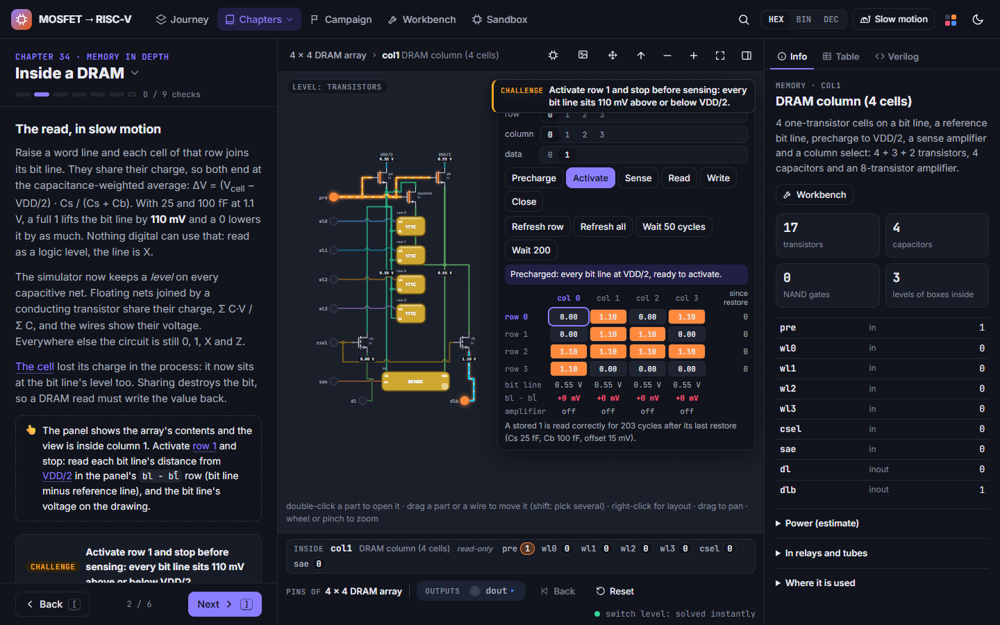<br><sub><b>Ch. 35</b>: a DRAM read in slow motion: charge sharing on the bit line, the sense amplifier, leakage and refresh.</sub></td>
</tr>
<tr>
<td>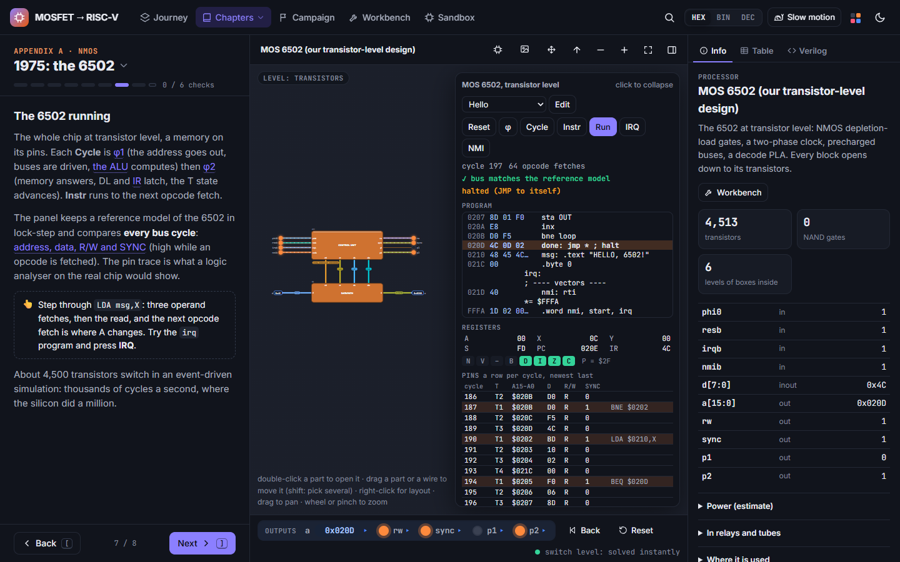<br><sub><b>Appendix A</b>: a 4,513-transistor NMOS 6502, every bus cycle in lock-step with a cycle-exact model.</sub></td>
<td>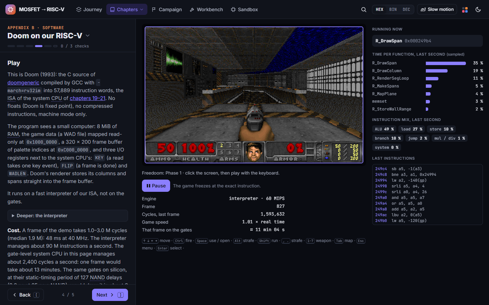<br><sub><b>Appendix B</b>: Doom compiled for RV32IM, with a live profile and instruction mix, and what each frame would cost on the gates.</sub></td>
</tr>
</table>

Every CPU has a **CPU panel**: the program with the current instruction (click a line to light up
the hardware it uses), registers, memory, Run to halt / Step / Slow (one gate delay, cycle or
instruction at a time), Back to undo, and a lock-step comparison with the golden model. The
pipelines add a pipeline diagram, the out-of-order core its reorder buffer, the GPU its warps and
frames.

## Campaign

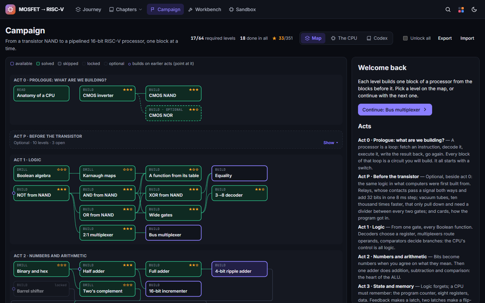

A tree of **127 levels in twelve acts**, in the spirit of *Turing Complete*, from a NAND made of
transistors to a pipelined, interrupt-capable 16-bit RISC-V-like CPU (RV16), with four optional acts:
before the transistor (relays, tubes, cards), arithmetic units (floating point, multiply, divide), a GPU
(four lanes, the active mask, a reconvergence stack, two warps, a rasterizer) and memory (a DRAM column,
a controller, a bus with DMA, a flash store). Each level is built only from parts earlier levels
unlocked, checked by a full test set and graded against par (NANDs, transistors, depth, clock period;
every level has one). The order follows use: a level comes just before the first one that needs it,
and its why reads as a thread (the problem, what it costs, where it goes next and which later levels
reuse it), closing each act with what is now within reach.

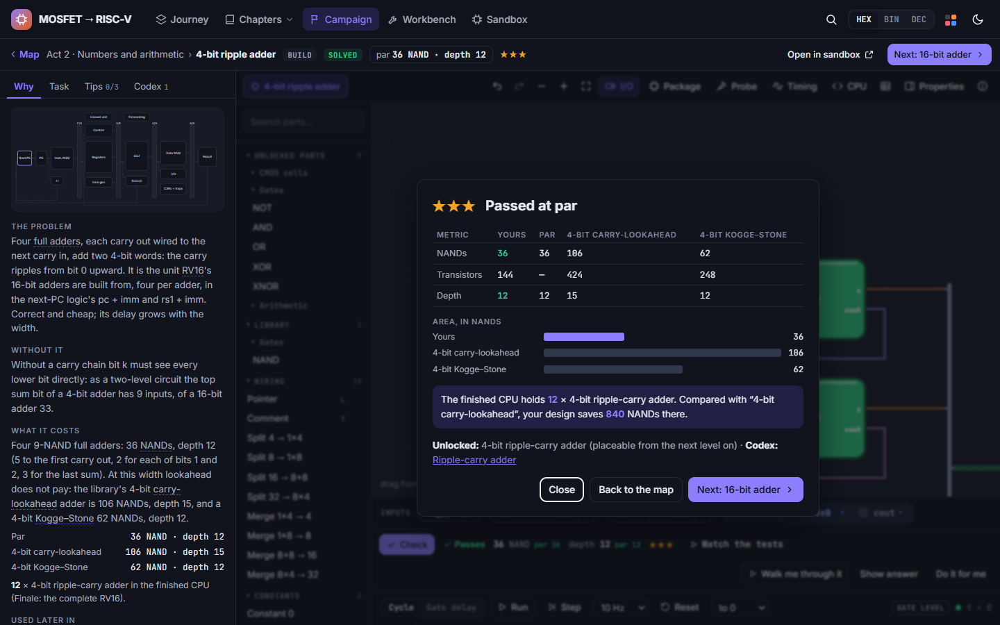

Each level plays on a screen of its own: the brief, why the CPU needs the block (its measured cost
against the alternatives and its copies in the finished CPU), the level's parts only, a hint ladder
from a nudge to the full walkthrough, and Build along (the next step's parts as outlines, the
learner's wiring checked against the reference). Number and Boolean drills (generated, with exact
checkers), assembly puzzles on the golden model and a codex of 177 entries sit alongside: each with a
live figure, a worked example, Check yourself questions and links to what it builds on and leads to,
searchable by alias, read beside the level without leaving it, and shown as hover definitions in the
chapters. Plan and status in
[docs/CAMPAIGN.md](docs/CAMPAIGN.md).

## Sandbox

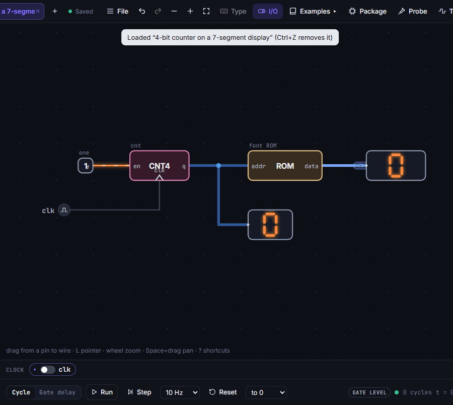

A circuit editor in the spirit of Sebastian Lague's *Digital Logic Sim*, built on the same
simulator, so whatever you build is a real component of the site. The full guide is
[docs/SANDBOX.md](docs/SANDBOX.md).

- Place parts from the whole library (a Basics group first, search by alias, or only NAND and
  transistors in *purist* mode), draw wires freehand with corners and branches, and connect distant
  nets with **pointers** (named net labels). A problems pill lists what is wrong with the circuit,
  each with how to fix it.
- Watch values live, per clock cycle or one gate delay at a time; probe wires into a timing
  diagram (VCD export), and read a chip's static timing with its critical path drawn on it, in
  NAND delays or by load (logical effort: a gate driving many inputs is slower), with the heaviest
  nets listed.
- **Package** a circuit as a chip (name, colour, pin order), use it in other circuits, nest chips
  to any depth and edit them later: every user of the chip is rebuilt. A face editor puts pins on
  any side and the chip's displays, screens and switches on its box; chips go in folders, circuits
  in separate projects, favourites on keys 1–9.
- **Look inside** any placed part, live, down to the transistors; **Open in Sandbox** turns any
  schematic from the chapters or the workbench, CPUs included, into an editable copy.
- Switch-level parts beyond the MOSFET: resistors, pull-ups / pull-downs, capacitors, transmission
  gates and tri-state drivers, so shared buses, wired-AND / wired-OR and pseudo-NMOS logic work.
- Recreate **every level** of the journey: chips built from transistors are solved at switch
  level and become gate-level bricks; latches, flip-flops (recognised by their structure), RAM with
  initial contents, and a **program ROM** written in RISC-V, RV16, 4-bit or 6502 assembly, or hex.
- I/O: LEDs and LED banks, 7-segment and hex displays, a buzzer, keys bound to your keyboard, a
  keyboard with a key queue, a pixel screen, a console, switch banks, a timer, a card reader with
  decks punched from a ROM, a halt part, random sources and cycle counters; comments on the canvas.
- The **CPU panel** for any chip that is a processor, yours included, with the golden model in
  lock-step (single core, several cores, the out-of-order core, the 6502, the 4-bit CPU).
- **Programs on your own CPU**: a custom instruction set written as a table gives its own
  assembler and disassembler; 14 program puzzles run on the gates of a ready-made CPU or your own,
  scored on cycles, NANDs and program size.
- **Verilog chips**: write a module as text and Yosys, running in the page (WebAssembly, nothing
  uploaded), draws it from the library's gates beside the text a second after you stop typing;
  every module becomes a chip that opens down to NANDs and transistors. `.v` / `.sv` files and
  Yosys JSON netlists import the same way, and File ▸ Export Verilog goes the other way: exported
  and imported back, a chip (a whole RV32I CPU among the tests) simulates equal to the original.
- **Truth-table and state-machine chips** (New chip ▾): fill a table (or paint a Karnaugh map) and get
  it minimized and built as NAND–NAND, AND–OR, a PLA or a ROM, each priced; draw a state diagram and get
  it encoded binary, Gray or one-hot around flip-flops, read back from the circuit against the diagram;
  give it registers, and states carry register transfers (`a := a − b`) and arcs tests (`a < b`), built
  as that controller over a datapath of library registers, adders and comparators (GCD to start from).
- **Digital and Logisim circuits import**: a `.dig` project or a Logisim-evolution `.circ` becomes
  chips in a folder, the file's drawing kept, each part mapped to ours (with a table of what became
  what). **Test tables** on any chip, in Digital's test syntax: a Tests pane runs them after every
  edit, fills outputs from the circuit, and opens a failing row in the test player; the imported
  files' own tests come along.
- Wide pins up to 1024 bits, exact; autosave, chip files, share links, Verilog and image export, and
  **File ▸ Export Verilog for FPGA**: a board top for a Sipeed Tang Nano 9K (clock divider, reset,
  buttons and LEDs) with its pin constraints.
- 21 optional **build challenges**, from a CMOS inverter to an instruction fetch unit, with a test
  player that steps through the failing cases.

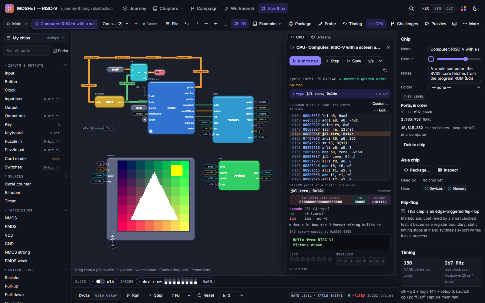

The sandbox builds **whole computers**. RAM and ROM parts go up to 64K words: one behavioural leaf
at run time over a real hierarchy of banks you can open down to the latches. A cycle engine runs
them: storage, found by its structure (library flip-flops or ones drawn from NANDs, latches,
resets), becomes verified tables and the rest is levelized, and every net equals the event-driven
simulator's after every settle. The single-cycle RV32I runs at about 9 k cycles/s in Node and
4–5 kHz in the browser. **Examples ▸** has fourteen ready-made circuits, among them:

- **Computer**: the RV32I core, a program ROM in assembly, a memory chip, a 64 × 64 screen and a
  devices chip with the console, LEDs and switches. It greets you, paints a picture and halts, with
  the golden model checking every instruction (above).
- **4-bit CPU** (4004-inspired, 3 357 NANDs), **6502 computer** (the transistor-level 6502 as a
  part, a ROM in 6502 assembly), **System on a bus** (CPU and DMA masters, RAM, flash, screen,
  keyboard, timer behind an AXI-lite-style bus) and **Boot from cards** (a loader reading a punched
  deck into RAM, then running it). **RV16: Pong** puts the campaign's RV16 core on a bench with a
  screen and switches; a passed core level offers the same game on your own core.

## Measured, not drawn

Every number on screen comes from the circuit it describes:

| Design | NAND gates | Transistors | |
|---|---:|---:|---|
| NAND | 1 | 4 | |
| Full adder (9-NAND) | 9 | 36 | 6 gate delays |
| 8-bit ripple-carry adder | 72 | 288 | 20 gate delays |
| Single-cycle RV32I | 68,339 | | period 158 NAND delays |
| Single-cycle RV32IC (compressed instructions) | 69,794 | | period 201: the expander sits in front of decode |
| Single-cycle RV64IM | 172,285 | | period 150; the same generator at 32 bits: 73,384, period 124 |
| Five-stage pipelined RV32I | 80,798 | | forwarding, load-use stall, branch flush; period 145 |
| Pipelined RV32IM, balanced, with a predictor | 141,655 | | period 79 |
| Dual-issue pipelined RV32IM | 193,768 | | period 80 |
| Out-of-order RV32IM (2-wide, ROB 16) | 359,262 | | period 93 |
| Dual-core with shared memory (per hart) | 104,293 | | period 119; 0.71 × 0.71 mm in sky130 |
| Graphics pipeline (warp core, rasterizer, two frames) | 3,061,392 | 12,245,568 | the cube spins in the page |
| MOS 6502 (our NMOS design) | | 4,513 | the real chip: 3,510 + ~1,018 loads |

The CPUs' counts are the Benchmarks tab's: the 64-word data memory included, the program ROM left out.

The chapters compare implementations on these numbers: ripple, carry-lookahead, Brent–Kung,
Sklansky, Kogge–Stone, carry-select and carry-skip adders (static depth against simulated delay,
false paths included, and in unit against load-dependent delay, where a prefix tree's fan-out stops
being free);
array, Wallace-tree and Booth multipliers; restoring, non-restoring and SRT dividers; single-cycle,
multicycle (hardwired and microcoded), pipelined, dual-issue and out-of-order CPUs on clock period ×
CPI. The workbench's Benchmarks tab runs one program set on all 28 gate-level CPUs (cycles, period,
time, NANDs, misses, energy), and dynamic power is estimated from the circuit too: the gate simulator
counts every net's toggles, glitches included, so the inspector splits a part's energy among its
blocks and the CPU panel shows the energy per instruction as the program runs. Every component can
also be priced in relays and tubes.

<table>
<tr>
<td width="50%">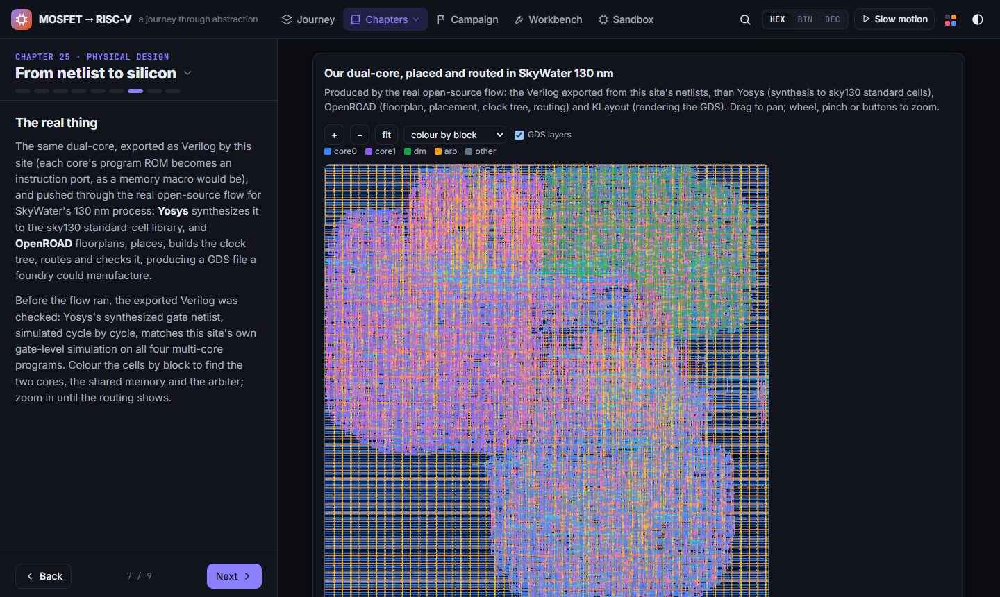<br><sub><b>Ch. 28</b>: the dual-core after Yosys and OpenROAD on sky130: 14.8k standard cells, coloured by block.</sub></td>
<td width="50%">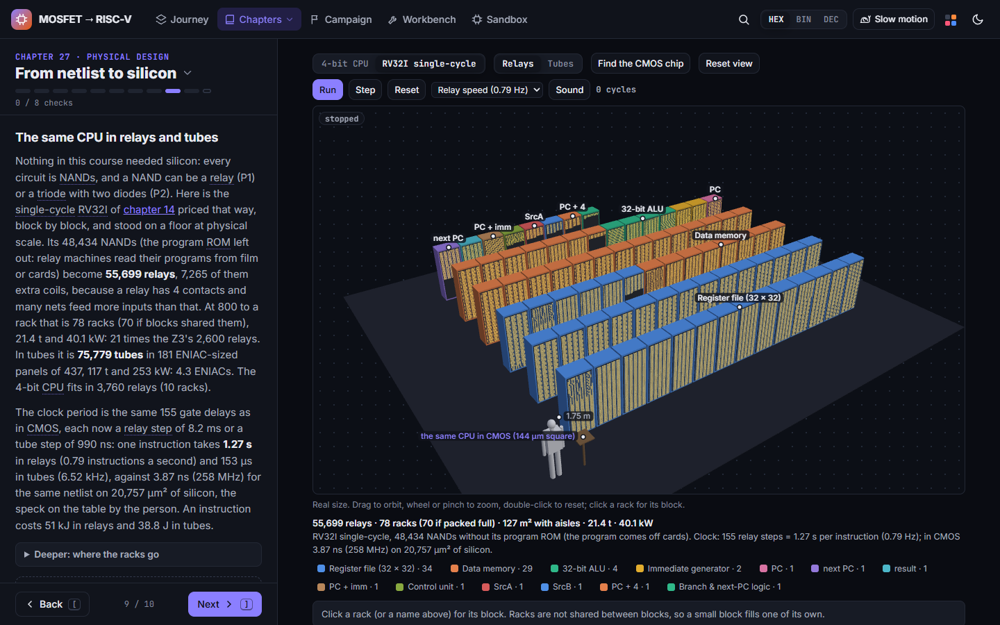<br><sub><b>Ch. 28</b>: the same RV32I as 55,699 relays in 78 racks (1.27 s an instruction), or 75,779 tubes.</sub></td>
</tr>
</table>

## How it is checked

- **Components**: every combinational component carries a specification and is tested against its
  structure, exhaustively up to 12 input bits and on random vectors above; behavioural models
  (used to keep large designs fast) are proven equal to the structure they stand for.
- **CPUs**: each of the 28 (single-cycle, multicycle, pipelined, dual-issue, out-of-order, with caches
  and a DRAM controller, system, M, F, C, dual-core) is co-simulated against the instruction-set
  simulator in `src/riscv/`, which steps in lock-step and compares registers, PC and memory at every
  retirement. Independently of that model, every RV32 CPU passes the official
  [riscv-tests](https://github.com/riscv-software-src/riscv-tests) its ISA covers at gate level
  (rv32ui, rv32um, rv32uf, rv32ua, rv32mi), runs seeded random programs against the golden model, and
  must reach every instruction and hardware event it has (forwarding paths, stalls, mispredictions,
  cache misses, traps). The out-of-order core also matches a cycle-exact model of its rules every
  cycle. Chapter 25's single-cycle core runs in lock-step with the golden model at both widths, and
  the RV64 golden model passes rv64ui and rv64um. Matrix, coverage and the bugs this found:
  [docs/VERIFICATION.md](docs/VERIFICATION.md). The campaign's RV16 cores are fuzzed too.
- **The golden model itself**: [Spike](https://github.com/riscv-software-src/riscv-isa-sim) runs in CI
  on random programs for eight ISA variants (seven RV32, the C extension among them, and RV64IM), its
  commit log compared with ours instruction by instruction: 8,000 programs on every change to the ISS,
  new seeds each night.
- **The 6502**: the cycle-exact model passes all 1.51 M SingleStepTests cases and Klaus Dormann's
  functional test; the transistor-level chip matches it on every bus cycle of both.
- **Drawings**: every registered schematic is checked for nets sharing a line, overlapping symbols
  and hidden labels.
- **HDL**: generated SystemVerilog comes with a self-checking testbench drawn from our own
  simulation; `scripts/verify-export.ts` synthesizes the dual-core and the RV32I / RV32IM system CPUs
  with Yosys, simulates each gate netlist and compares every output cycle by cycle with the site's
  simulation under the same inputs (irq pulses, switches). The deploy waits on it. Import is checked
  the same way: both of our exporters' Verilog, through Yosys and back into chips, matches the
  original every output every cycle (library parts and the single-cycle CPU), and all 74 of Yosys's
  flip-flop and latch cells match its own definitions. The FPGA export goes through Yosys's
  `synth_gowin` before every deploy.
- **Silicon**: `.github/workflows/layout.yml` runs the exported dual-core and the RV32IM system
  core (its memories outside its ports) through OpenROAD-flow-scripts on SkyWater 130 nm (synthesis,
  floorplan, placement, clock tree, routing); the GDS, tiles and reports are published into the site
  (chapter 28), each beside our estimate of the same design: area per block from the NAND count,
  the critical path in NAND delays against OpenSTA's after routing.
- **Every page**: `npm run smoke` opens every route of the built site in headless Chrome (both
  themes, a phone width for a few) and fails on any error; the deploy runs it.

## Scope and limitations

This is a teaching instrument for engineers, not a sign-off tool. What it models, exactly:

- **Transistors are switches.** The switch-level solver resolves 0 / 1 / X / Z with drive
  strengths (rails, transistors, resistors) and stored charge on capacitive nodes (charge sharing
  for DRAM, a stored threshold for flash). There is no I–V curve, sizing or analog transient: it is
  not SPICE. The relay and the triode have lumped physical models of their own, behind the prologue.
- **Timing is in NAND delays.** By default every NAND costs one unit, whatever it drives; static
  timing finds the longest register-to-register path in those units. A load mode weighs each gate by
  logical effort (d = p + g·h, its fan-out capacitance from the power estimate's per-input and
  per-branch values), in static timing only: the gate simulator still steps one unit per NAND. Clock
  rates in MHz assume an **illustrative 25 ps per NAND** (a loaded NAND2 in a 28 nm-class process),
  not timing characterized from a cell library: no slew, wire RC, skew or corners. The sky130 run's
  own reports are the real numbers.
- **Two kinds of place and route.** The placer (simulated annealing) and router (two-layer Lee) in
  `src/sim/pnr.ts` are teaching models run on small netlists; the full layout comes from OpenROAD.
- **Power is an estimate.** Dynamic energy is ½ C V² per toggle, with the toggles counted by the
  gate simulator (glitches included) and C from each net's fan-out: illustrative 28 nm-class values
  per NAND input, driver and wire branch, not extracted from a layout. No leakage, no short-circuit
  current, no clock buffers; behavioural memories count only at their outputs.
- **Power-on is a model.** Storage loops are resolved to a deterministic (or chosen random) state
  so a design can settle; real power-up depends on mismatch, noise and ramp.
- **The CPUs are teaching microarchitectures**: a cache miss freezes the whole pipeline, the
  dual-core's atomics are atomic because a round-robin arbiter serializes every access, and the
  out-of-order core is built in gates only 2-wide (ROB 8–32, issue queue 4–16, store queue 2–8; the
  site's is ROB 16, issue queue 8): the lab's other shapes run on its cycle-exact model, timed but not
  priced.
  The ISA is RV32 (I, M, F, C, Zicsr, the atomics the dual-core needs), and RV64I / M on chapter 25's
  single-cycle core and its golden model; no lr.w / sc.w, and no RV64 in the pipelines yet.
- **Doom runs on an interpreter of our ISA** (checked against the golden model), not on the gates:
  a frame would take about 13 minutes on the gate-level CPU in the page. Appendix B's last step
  hands the running game to the gates for a window of cycles.

## What's next

The full plan and status is in [docs/ROADMAP.md](docs/ROADMAP.md). The next features:

- **Load-dependent delay, further**: the gate simulator on the loaded delays (glitches and races
  following the loads), and the estimate checked path by path against the sky130 runs.
- **A memory-map designer**: address regions (RAM, ROM, screen, console, keys) dragged onto the address
  space, overlaps and gaps shown, the address decoder opened as a chip.
- **Verilog in the journey**: the same adder as text and as gates in a chapter step, and a Verilog
  chip's critical path mapped back to its source lines.
- **ISA breadth, further**: the C extension and RV64 in the sandbox, lr.w / sc.w with private caches
  and a coherent bus in the gate-level cores.
- **Imported circuits placed again** by logic depth (the Verilog import's placer), and `.dig` export.
- **Python on the pipeline** (stalls and flushes per line), with RV32IM, strings and a heap.

## Run it

```bash
npm install
npm run dev        # http://localhost:5173
npm test           # simulator, library, CPUs and editor correctness
npm run build      # static site in dist/ (works from any path or host)
npm run smoke      # every route of dist/ in headless Chrome
```

Pushing to `main` deploys to GitHub Pages via `.github/workflows/deploy.yml`
(enable it once under *Settings → Pages → Source: GitHub Actions*). Doom's game data (Freedoom) is
not in the repository: the deploy fetches it, and locally `node scripts/doom/fetch-wad.mjs --public`
does.

**Offline, as a Windows program.** `npm run desktop` builds `desktop/release/MOSFET-to-RISCV-<version>-portable.exe`:
one file, nothing to install, no network (fonts included). It is the built site inside Electron
(`desktop/`, a package of its own so the site's install stays small), served from inside the
executable. Progress and sandbox chips live in a `MOSFET-to-RISCV-data` folder next to the `.exe`,
so a copy on a USB stick carries them along. The *Desktop program* workflow (run by hand, or a `v*`
tag) builds it on GitHub and publishes it as the release `desktop-latest`. The `.exe` is unsigned:
SmartScreen asks once (*More info → Run anyway*).

## How it is built

Vite + TypeScript, no UI framework: plain DOM and SVG, and a small hand-written WebGL2 renderer for
the 3D views.

- `src/sim/`: hierarchy flattener, event-driven 0/1/X gate simulator, cycle engine, switch-level
  and NMOS solvers, bit-parallel test simulator, statistics, static timing, power, Verilog export
- `src/lib/`: the component library, from transistors, relays and tubes to CPUs, GPUs and memory
  systems, each defined as a netlist of smaller components
- `src/riscv/`, `src/lang/`: ISA tables, assembler, the golden model and a fast interpreter; the
  Python-subset compiler
- `src/view/`: SVG schematics with drill-down, inspector (info, truth table, Verilog, power), timing panel
- `src/widgets/`, `src/gl/`, `src/phys/`: the explainers, the 3D views and the physical models behind them
- `src/editor/`: the sandbox (document model, compiler to components, user-chip library, editor UI)
- `src/hdl/`: HDL in: Yosys in WebAssembly, and its JSON netlist turned into placed, routed chips
- `src/campaign/`, `src/puzzles/`: the campaign (levels, grading, drills, walkthroughs, codex) and
  the program puzzles
- `src/m6502/`, `src/doom/`, `src/gfx/`, `src/dram/`, `src/flash/`, `src/bus/`, `src/cards/`: the
  appendices' and tracks' reference models
- `src/chapters/`: the narrative
- `CLAUDE.md`: architecture and conventions in detail; `docs/ROADMAP.md`: plan and status

## License

[MIT](LICENSE). Doom's source (doomgeneric, `ports/doom/`) is GPL-2; Freedoom's data is BSD and
fetched at build time.

Inspired by *Turing Complete*, Sebastian Lague's *Digital Logic Sim*, *nand2tetris*, and Harris &
Harris. The structure and HDL follow the companion primer in `References/`.
