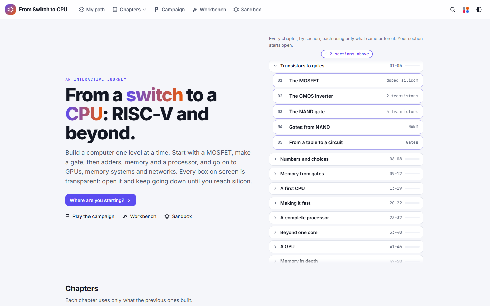

# From Switch to CPU: the manual

**From Switch to CPU** builds a computer one level at a time. It starts with a single transistor used as a switch.
From there you make gates, then adders, memory and a processor, and go on to GPUs, memory systems and networks.
Every box on the screen is transparent: open it and keep going down until you reach the transistors. Every value,
gate count and delay you see is computed by simulating the circuit, not drawn by hand. It runs in your browser at
<https://switchtocpu.com/>, or as a desktop program, and needs no account.

## The four sections

You reach them from the top bar: **Chapters**, **Campaign**, **Workbench** and **Sandbox**.

| Section | What it is for | Start here if you … | Quick start |
|---|---|---|---|
| **The journey** (**Chapters**) | The story, chapter by chapter: each step explains one idea next to a live circuit you can change and open. Each chapter uses only what the earlier ones built. | want to learn how a computer works, from the beginning or from the chapter you need. | [Quick start](journey.md#quick-start) |
| **Campaign** | A map of levels where you build each part yourself, from the parts the levels before it unlocked, and the site checks your circuit. | learn best by doing, and like a puzzle with a check. | [Quick start](campaign.md#quick-start) |
| **Workbench** | Every part in the library on one bench: try it, change its size, read its cost, truth table and Verilog, open it down to transistors. Also the statistics, the processor benchmarks and the out-of-order lab. | know which part you want to look at, or want to compare parts and processors. | [Quick start](workbench.md#quick-start) |
| **Sandbox** | A circuit editor: place parts, draw wires, package your circuit as a chip and use it in the next one, up to whole computers with screens and keyboards. | want to design your own circuits. | [Quick start](sandbox.md#quick-start) |

Not sure where to begin? On the home page, **Where are you starting?** asks a few questions and suggests a place.
**My path** (top bar) keeps track of what you have done.

## Quick starts

- [The journey: read a step, change an input, open a block down to transistors, answer a question](journey.md#quick-start)
- [The campaign: open the map and pass your first build level](campaign.md#quick-start)
- [The workbench: pick a part, set its size, read its cost and truth table, open it](workbench.md#quick-start)
- [The sandbox: place two gates, wire them, try them, package them as a chip](sandbox.md#quick-start)

## The reference

Each section's page goes on, after its quick start, with a tour of the screen, a recipe for every task, its keys and
gestures, and what to do when something looks wrong.

- [The journey](journey.md): chapters and steps, the live circuits, layers and tours, questions and challenges,
  3D models, printing a chapter.
- [The campaign](campaign.md): the map, levels and their checks, stars, hints and walkthroughs, the codex.
- [The workbench](workbench.md): parts and sizes, inputs and the clock, opening parts and the zoom lens, probes and
  timing, Why?, overlays, the inspector, HDL, statistics, benchmarks and the lab.
- [The sandbox](sandbox.md): parts and wires, chips and their faces, memories and programs, computers with screens and
  keyboards, tests, importing and exporting.
- [Everywhere](everywhere.md): what works in every section: search, view options and themes, keys, My path, notes and
  bookmarks, the review queue, backup and restore, share links, phones and touch screens, working offline, the
  desktop program.

## New in this version

- **Open blocks as you zoom** is on by default: zoom into any block and its inside opens in place, live; zoom
  further to step in. **Opened blocks without colour** is on too, so an opened block's inside reads on the plain
  background. Turn either off in View options.
- Every 3D model sits on the same stage:
  - drag to turn;
  - click the model, then scroll to zoom;
  - **Cutaway** and **Explode**;
  - a **Tour**;
  - the **Names** switch (**N**) to hide or show the labels;
  - full screen.
- 3D models print as figures when you print a chapter.
