# The campaign

[← Back to the manual](README.md)

## What it is for

The campaign is a game of levels. Each level asks you to build one block of a processor from the blocks you have
already built, and then checks your circuit against a test set. You start from transistors and a NAND gate and finish
with a pipelined 16-bit RISC-V processor with traps and interrupts. Optional acts go further: relays and vacuum tubes,
arithmetic units, a GPU, memory, links and signal processing.

Choose the campaign when you want to **build** rather than read. The journey (the chapters) explains each idea with
a finished circuit you can open and probe; the campaign hands you the empty chip and the pins and lets you find the
circuit yourself, with grades for how cheap and how fast it is. The workbench is for looking up one part, and the
sandbox is a free editor with no task. You can use the campaign without reading the chapters: every level has its
own explanation, tips and an answer.

## Quick start

Your first level, from the home page to a passed Check.

You will read the first lesson and then build a CMOS inverter from two transistors. Expect Check to fail first:
that is how you see what the level wants.

1. On the home page, click **Play the campaign**.

   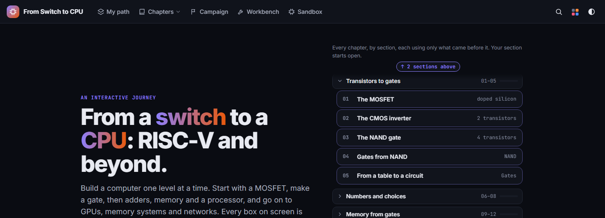

2. The campaign map opens. Each box is a level; the acts run from top to bottom. On the right, under **Start here**,
   click **Begin: Anatomy of a CPU**.

   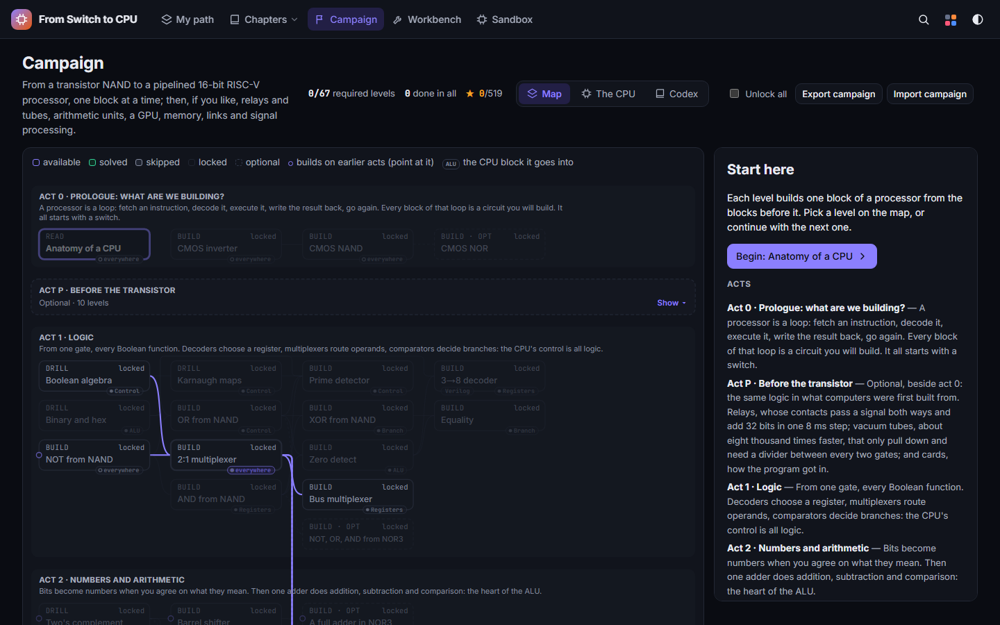

3. The right-hand panel shows the lesson *Anatomy of a CPU*: what a processor is made of and why the levels come in
   this order. Read it, then click **Done reading** at the bottom of the panel. The lesson's box on the map turns
   green (solved) and the next level, **CMOS inverter**, becomes available.

   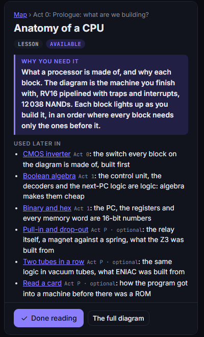

4. Click **CMOS inverter** on the map. The panel now shows why you need this block, which later levels it goes into,
   the problem it solves and what it costs. Click **Play**.

   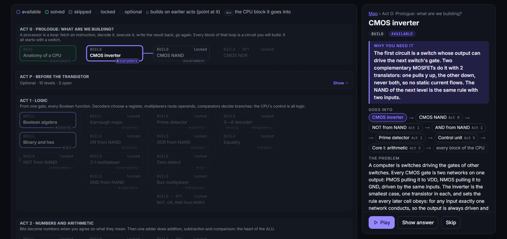

5. The level screen opens. On the left are the level's tabs (**Why**, **Task**, **Tips**, **Codex**); in the middle,
   the parts you may use; on the right, the chip you are building, with its input pin **a** on the left and its
   output pin **y** on the right. The **Task** tab says what to build: y = not a, from one PMOS and one NMOS.

   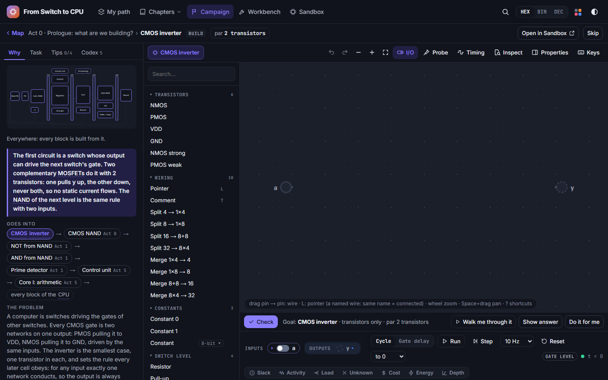

6. Click **Check** under the canvas before building anything. The result reads **Not yet**, and the test player
   opens below with the level's test cases: each row shows the inputs, and a red ✕ with the value it wanted where
   your circuit is wrong. Here both rows fail, because nothing drives y yet. Close the player with the **✕** at its
   right edge.

   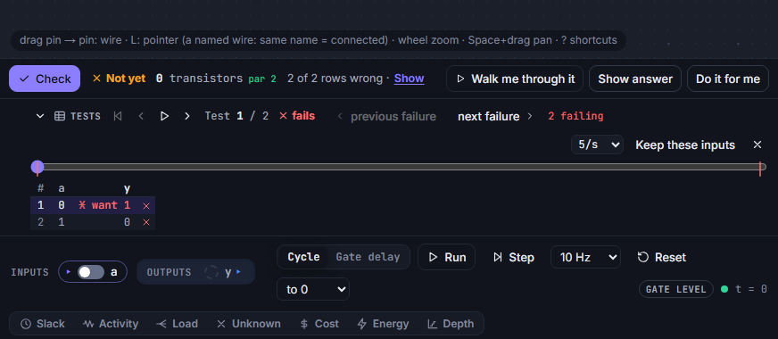

7. Place the parts. Click **VDD** in the parts list, then click on the canvas near the top. Do the same for
   **PMOS** (below VDD), **NMOS** (below the PMOS) and **GND** (at the bottom). Each click on the canvas places one
   part; it is drawn selected, with dots on its connection points.

   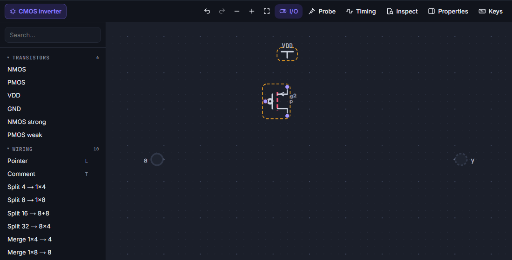

8. Wire it. Press on a connection dot and drag to another, then let go: a wire appears.
   - VDD to the PMOS's top (source),
   - the PMOS's bottom (drain) to the NMOS's top (drain),
   - the NMOS's bottom (source) to GND,
   - pin **a** to the NMOS's gate (its left side), and the PMOS's gate to pin **a** as well,
   - pin **y** to the NMOS's top (drain), where the two drains meet.

   The wires show their values as you build: a wire at 1 glows, a wire at 0 is dark. Click the **a** switch under the
   canvas (under **INPUTS**) to try both values; y should always be the opposite of a.

   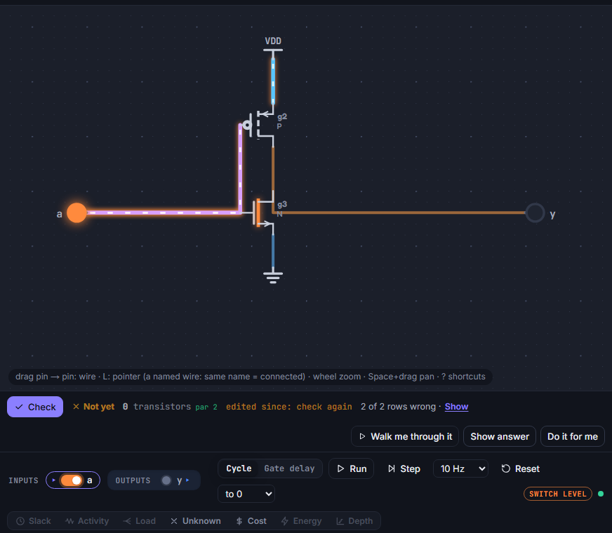

9. Click **Check** again. This time it reads **Passes**, and a card shows your grade: three stars, because you used
   2 transistors and the par is 2. The card compares your circuit with another way of building the block, lists the
   levels now within reach, and names the codex entries you have unlocked.

   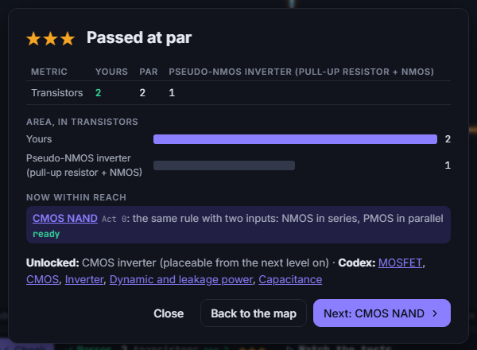

10. Click **Back to the map**. The inverter's box now shows its stars, and **CMOS NAND** is available. Click
    **Next: CMOS NAND** on the card instead to go straight to the next level.

    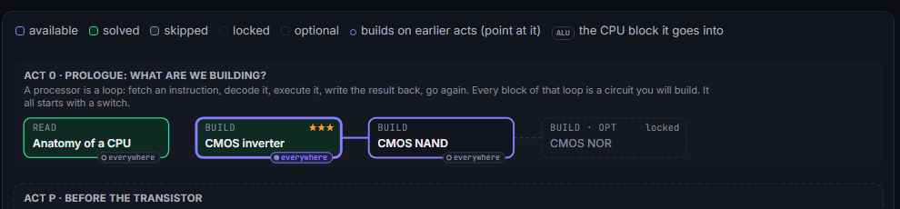

Your circuit and your progress are saved in this browser as you go. To carry them to another computer, see
[Move your progress to another computer](#move-your-progress-to-another-computer).

## The screen

### The map

- **The header.** It shows how far you are: required levels solved out of all required levels, levels done in all
  (optional ones included), and your stars out of all the stars there are. Beside the counters:
  - **Map**, **The CPU** and **Codex** switch between the three views of the campaign.
  - **Unlock all** opens every level.
  - **Export campaign** and **Import campaign** carry your progress between computers.

  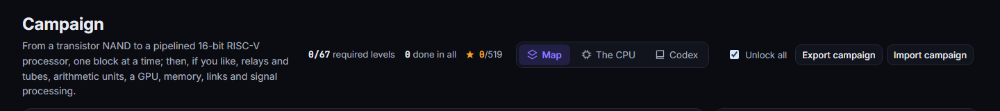

- **The legend.** It explains the boxes:
  - The colours mean available (outlined), solved (green), skipped and locked (dim).
  - An optional level has a dashed border, and **OPT** (or **OPTIONAL**) in its kind.
  - A small circle on a box's left edge means the level builds on a level in an earlier act; point at it to see
    which.
  - A tag on a box's bottom edge (**ALU**, **Control**, **Registers**, **everywhere** …) names the block of the
    finished CPU the level goes into. A **Verilog** tag marks levels that also show the block as Verilog.
- **The acts.** They run from top to bottom: act 0 (what we are building), then logic, arithmetic, state and memory,
  the instruction set, a single-cycle CPU, pipelining, and traps and interrupts.
  - Each act starts with a line on why it comes there.
  - Each box says its kind: **READ** (a lesson), **BUILD** (a circuit), **DRILL** (questions), a program, or a CPU
    core.
  - Lines between the boxes show which level needs which.
- **The optional acts.** Each is folded to one line until you open it:
  - **Act P · Before the transistor**: relays, vacuum tubes and punched cards, beside act 0;
  - the acts after the CPU: arithmetic units, a GPU, memory, links and signals;
  - **Debugging · Find it, fix it**: the bug hunts (see [Hunt a bug](#hunt-a-bug)).

  Click **Show ▾** on the line to unfold an act, and **Hide** to fold it again.

  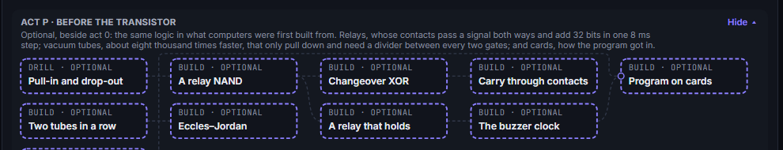

- **The side panel.** It is on the right and shows the level you clicked.
  - On a fresh start it shows **Start here**, with a **Begin** button and a summary of every act.
  - For a level, it shows:
    - **Why you need it**, and **Goes into**: the chain of later levels that use this block.
    - **The problem** and **What it costs**: the par and the alternatives, measured.
    - **Used later in** (the levels that place this block) and, for some levels, **Builds on**.
    - **More: without it, alternatives, pitfalls**, folded: what you would do instead, and the usual mistakes.
    - **The task**, **Success criteria**, **Grading**, **Tips** and **Codex**, as on the level screen.
    - **Go deeper**: the chapters of the journey that teach the same thing.
  - The level's buttons are at the bottom: **Play**, **Show answer** and **Skip** for a build level, **Done
    reading** for a lesson. A drill or a program is played in the panel itself.

### The level screen

- **The top bar.**
  - **Map** goes back to the map. Next to it are the act and the level's name, the level's kind (**BUILD**,
    **CPU CORE**, **FIX IT** …) and its par.
  - On the right are **Open in Sandbox** and **Skip**.
  - Once the level is solved, the bar also shows your stars and **Next: …**.
- **The tabs on the left.**
  - **Why**: the case for the block.
  - **Task**: what to build, the success criteria, the grading table (par and your best), what the level unlocks,
    and the pitfalls.
  - **Tips**: its number says how many tips you have opened.
  - **Codex**: the entries this level teaches.
- **The parts list.**
  - It holds only the parts this level allows. On later levels, **Unlocked parts** lists the blocks you have built,
    each with its cost in NANDs.
  - **Search…** at the top filters the list.
  - To place a part, click it, then click the canvas.
- **The canvas.**
  - It shows your chip, with its input pins on the left and its output pins on the right.
  - The toolbar above it has **Undo**, **Redo**, **Zoom out**, **Zoom in** and **Fit to screen**; then **I/O** (the
    pins as switches and lamps), **Probe**, **Timing**, **Inspect** and **Properties**; and **Keys**, the keyboard
    sheet.
- **The challenge strip.** It sits under the canvas.
  - **Check** is on the left, followed by the result and the goal: what to build, from what, and the par.
  - **Walk me through it**, **Show answer** and **Do it for me** are on the right.
- **The run bar.**
  - **INPUTS** (click one to toggle it) and **OUTPUTS** (their values).
  - **Cycle** / **Gate delay** (how far a step advances), **Run**, **Step**, the speed and **Reset**.
  - The power-on value: **to 0**, **to X** or **random**.
  - Which simulation is running: **GATE LEVEL** or **SWITCH LEVEL**.
- **The overlays.** The last row colours every part by **Slack**, **Activity**, **Load**, **Unknown**, **Cost**,
  **Energy** or **Depth**.

### The CPU

**The CPU** (in the header's switch) shows the processor the campaign builds, block by block:
- next PC, PC and the instruction ROM;
- control, the registers and the immediate generator;
- the ALU, branch, the data RAM and I/O;
- the pipeline registers, the hazard and forwarding units, and the CSRs and traps.

Click a block to see what it does and which levels build it. Blocks you have built light up. The text under the
diagram explains the loop the processor runs, and why the acts come in this order.

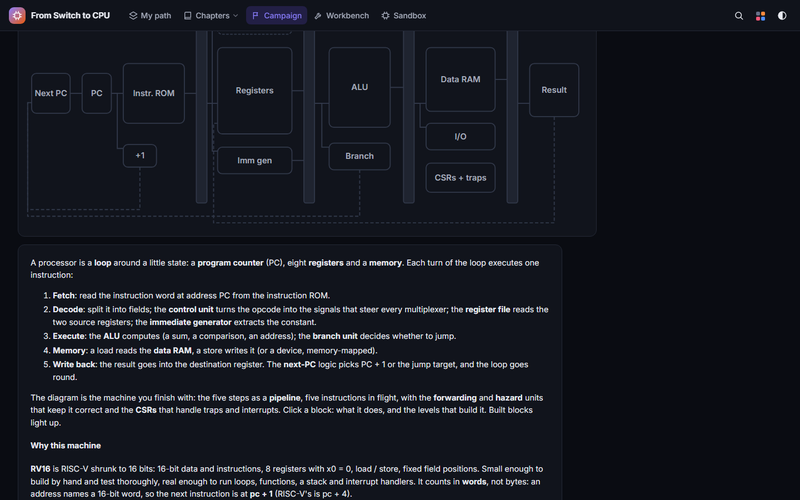

## How to …

### Read a lesson

1. Click a **READ** box on the map. The lesson opens in the side panel.
2. Read it. The links under **Go deeper** open the matching chapters of the journey.
3. Click **Done reading**. The lesson counts as solved, and the levels after it open.

### Pass a build level

1. Click the level on the map, then **Play**.
2. Read the **Task** tab: the pins, what each must do, and the parts you may use. **Success criteria** says how
   Check tests your circuit, for example every input combination, or a clocked sequence.
3. Place parts: click a part in the list, then click the canvas.
4. Wire them: press on a connection dot and drag to another.
5. Try it: toggle the inputs under **INPUTS**, and watch the outputs and the wires.
6. Click **Check**. **Not yet** opens the test player on the first failing case. **Passes** shows your grade.

### Use the test player

When Check fails, the test player opens under the challenge strip. It plays Check's test cases on your own circuit,
one at a time, so you can watch the case that fails.

1. The table lists the cases. A red ✕ marks a wrong output, with the value it wanted (**want 1**).
2. Move through the cases with **First test**, **Previous test**, **Next test** and the play button (**Play the
   tests on the circuit**, which stops at a failing one). Drag the scrub bar to jump.
3. **previous failure** and **next failure** jump between the failing cases. The speed menu (**5/s** at first)
   sets the play rate.
4. While the player is open, the canvas shows your circuit at the selected case's inputs. If you fix something, the
   current row is recomputed on your edited circuit at once, and **edited since: check again** reminds you to Check.
5. To close the player:
   - **Keep these inputs** closes it and leaves that case's inputs on your pins.
   - The **✕** at the right edge closes it and gives your circuit its own inputs back.
   - The arrow at the left only folds it to one line.

The view does not jump when the player opens. It keeps your zoom and position, and pans only if a failing pin would
be out of sight.

### Understand your grade

- **Par.** Every level has one: its cost in transistors or NANDs, and for some levels also depth, clock period,
  cycles or edits. Par is a target, never a requirement.
- **The stars.**
  - ★: the level passes.
  - ★★: every metric is within 1.5 × par.
  - ★★★: every metric is at or under par.
- **The card when you pass.** It shows:
  - a table of your numbers against par and against an alternative design, and a bar chart of the cost;
  - the levels now within reach, and the codex entries you have unlocked;
  - the buttons **Close**, **Back to the map** and **Next: …**.
- **Improving a grade.** Edit the circuit and Check again. Your best stays in the **Task** tab's grading table and on
  the map box.
- **Drills.** They are graded by mistakes. A drill passes after the required number of correct answers; ★★★ allows
  at most 2 mistakes, ★★ at most 3. A shown answer counts as a mistake.

### Get a tip, the walkthrough or the answer

Help comes in steps, so you can take as little as you need. All of it is in the **Tips** tab:

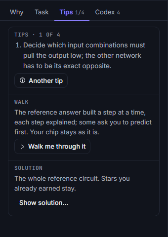

1. **Show a tip** reveals the first tip, a nudge. **Another tip** reveals the next one; the last one usually says how
   to reach par.
2. **Walk me through it** opens the walkthrough: the reference answer, built one step at a time on a separate copy of
   the chip. Your own circuit stays as it is. See
   [Follow the walkthrough or build along](#follow-the-walkthrough-or-build-along).
3. **Show solution…** first asks **Show the whole answer?**. Click **Show it** to see the whole reference circuit, or
   **Not yet** to back out. Stars you have already earned stay.

   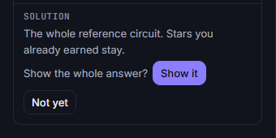

The challenge strip has the same help as buttons:
- **Walk me through it** starts the walkthrough.
- **Show answer** opens the walkthrough at its last step, with **Use this answer** and **Build it myself** at the bottom.
- **Do it for me** asks *Replace your circuit with the answer?* Click **Replace** to put the reference answer in your
  chip, or **Cancel**. **Undo** (**Ctrl Z**) brings your own circuit back.

### Follow the walkthrough or build along

The walkthrough builds the reference answer a few parts at a time and explains each step.

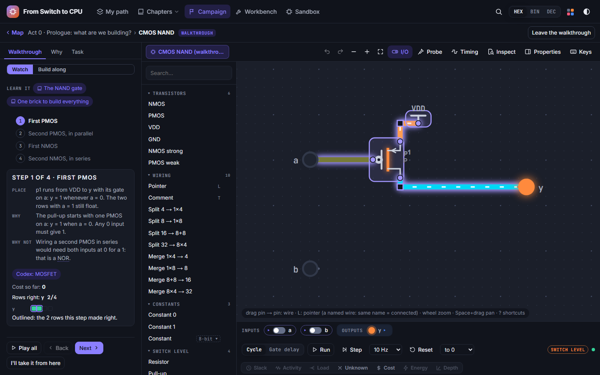

1. Click **Walk me through it**, in the challenge strip or in the **Tips** tab.
2. The **Walkthrough** tab lists the steps. **LEARN IT** links the chapters that teach the idea.
3. Each step says what it places (**PLACE**), why (**WHY**), and why not something else (**WHY NOT**). It also
   shows the cost so far, and how many rows of the truth table are now right; the rows this step fixed are
   outlined.
4. Move through the steps with **Next** and **Back**, or click **Play all**.
5. A step marked **PREDICT FIRST** asks you to pick an answer before it shows its parts.
6. To do the work yourself, click **Build along** (beside **Watch** at the top). Each step's parts then appear as
   outlines. Place the outlined parts (a part dropped near its outline snaps onto it), wire them, and click
   **Check step**.

   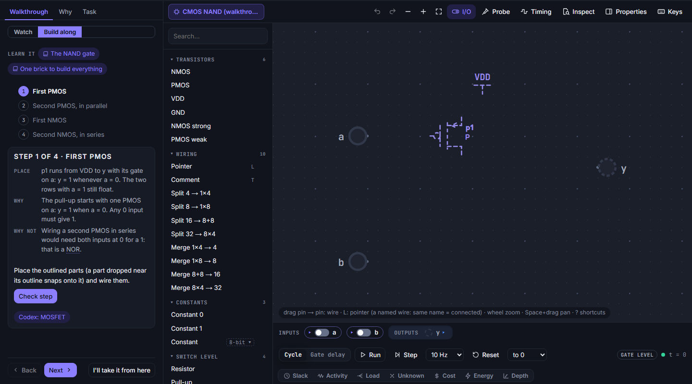

7. To get back to your own chip, click **I'll take it from here**, or **Leave the walkthrough** at the top right.

### Answer a drill

Drills are short questions with exact answers: Boolean algebra, binary and hex, two's complement, Karnaugh maps,
instruction encodings and more. You play them in the side panel of the map.

1. Click a **DRILL** box on the map.
2. Read the question under **PRACTICE**, type your answer in the box and click **Check**.
3. A wrong answer says why. For an expression, it gives an input where yours differs from the right answer.
4. **Show answer** shows the answer, and counts as a mistake.
5. The counter under the question (for example **0/6 correct · 1 mistake**) shows how far you are.

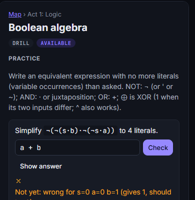

### Write a program

Act 4 teaches the RV16 instruction set by programming it, before any of it is built. A program level gives you a
task, a few test cases and an editor.

1. Click a program box on the map (for example **First program**). The task and **YOUR PROGRAM** appear in the side
   panel.
2. Write the program in the editor. Reading a word from the input and writing one to the output use the addresses
   the task gives, for example `lw rd, -4(x0)` and `sw rs, -3(x0)`. End with `halt`.
3. Under **Run the tests on**, leave **Golden model** selected. **Your core** becomes available once you pass
   **Core III: control flow** in act 5: your programs then run on the processor you built.
4. Click **Run the tests**. A table lists each test with the number of instructions it took. Your grade compares
   the program's size, and its instructions per test, with par.
5. **Reset**, **Show solution**, **Save as deck** and **Load deck…** sit beside **Run the tests**; under the results,
   **Step through a test** opens a test to follow.

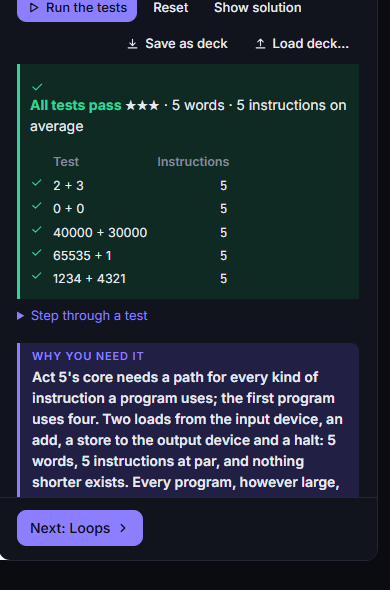

### Build a CPU core and debug it on a bench

A core level asks for a whole processor. You build it from the blocks you made earlier, which are now in the parts
list under **Unlocked parts**.

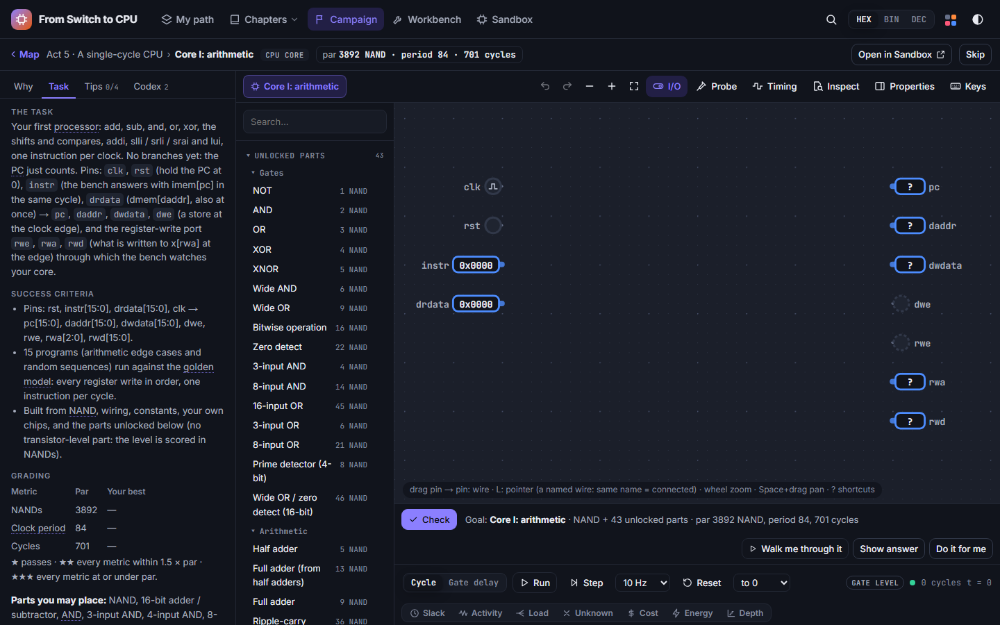

1. Read the **Task** tab. It lists the pins:
   - The bench sends in the instruction (**instr**) and the data (**drdata**).
   - Your core sends out the PC, the data address, the data to store and the write enable.
   - Your core also sends out its register writes (**rwe**, **rwa**, **rwd**), so the bench can watch every write.
2. Click **Check**. It runs every test program against the golden model (an exact model of the instruction set), and
   compares every register write and store, in order. It also checks the cycle budget.
3. A failing program gets a line that names it, says how far it got, and gives the write it expected next with the
   instruction that should have made it.

   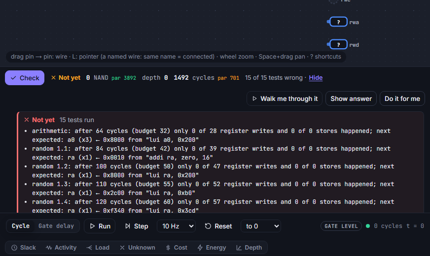

4. Under **Watch a program run**, click a program's name. It opens in the sandbox as a new chip: a small computer
   around your core, with the program in a ROM, your core, a RAM and LEDs. The CPU panel beside it runs the program
   against the golden model:
   - **Run to halt**, **Step** and **Slow** run it.
   - The listing shows the program; click a line to light the parts it uses.
   - The registers are shown as your core wrote them, with the writes the panel checked.
   - The panel stops at the first difference and names it.

   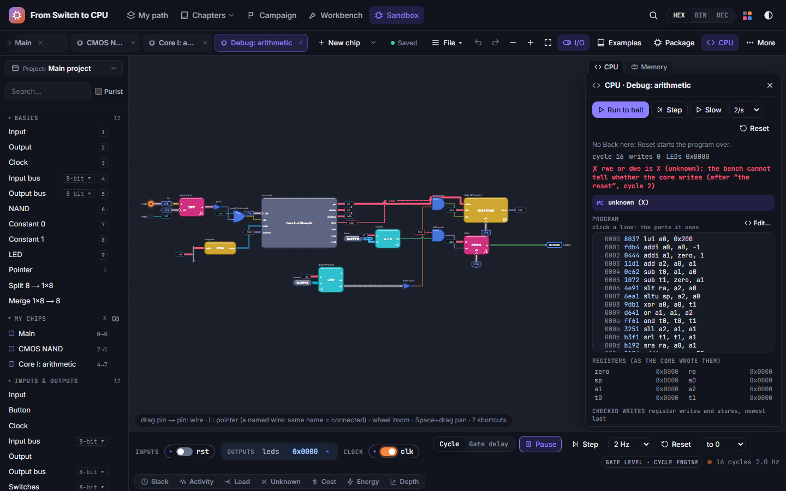

5. Go back to the level (its tab at the top of the sandbox, for example **Core I: arithmetic**), fix the core, and
   Check again.

### Hunt a bug

Bug hunts are optional levels: a block you have built, now wrong. They are grouped under **Debugging · Find it, fix
it**, an optional group near the bottom of the map; click its **Show ▾** to unfold it. Each bug hunt builds on the
level it breaks; point at the small circle on its box's left edge to see which. There are two kinds:

- **FIX IT**: a colleague's drawing with one mistake in it. Repair it in as few edits as you can.
- **FIND IT**: the drawing is right, but the chip has a defect in the silicon, a net stuck at 0 or at 1. Name that
  net with the fault brush.

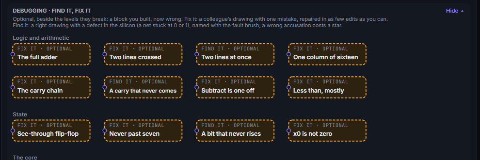

**To fix a drawing (FIX IT):**

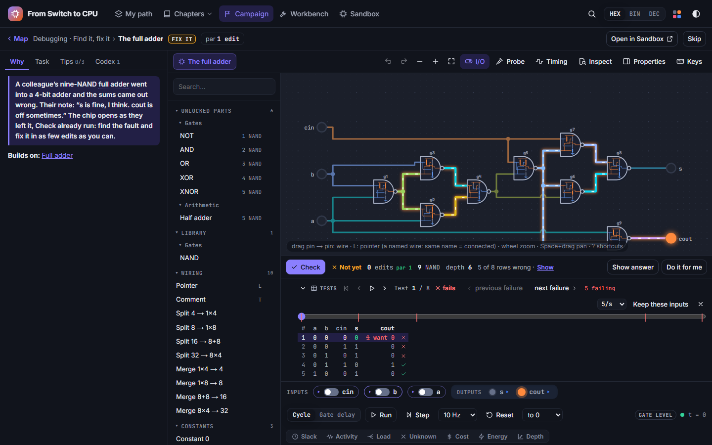

1. Click the level on the map, then **Play**. The circuit opens as the colleague left it, and the **Why** tab tells
   their story.
2. Click **Check**. The test player shows which rows are wrong.
3. Find the fault with the inputs, the probe or the test player, and fix it.
4. Check again. The grade counts edits:
   - adding, removing or swapping a part is one edit, and so is moving a pin to another net;
   - moving parts and redrawing wires are free.

   Par is the fewest edits that fix it.

**To find a defect (FIND IT):**

1. Click the level on the map, then **Play**. Check has already run, and the test player shows the failing cases;
   they are your clues. A FIND IT level never passes Check, because the drawing is already right.
2. Work out which net would give exactly those failures. Probe wires, step through the failing cases, or use the
   **Timing** panel to see which bit never moves.
3. Press **B**, or click **Accuse** beside Check. The banner says: *click the wire you think is stuck, then say at
   what* (**B** or **Esc** to stop).
4. Click the wire, then choose **It is stuck at 0 here** or **… at 1**. Each wrong accusation costs a star, so par is
   0 wrong.

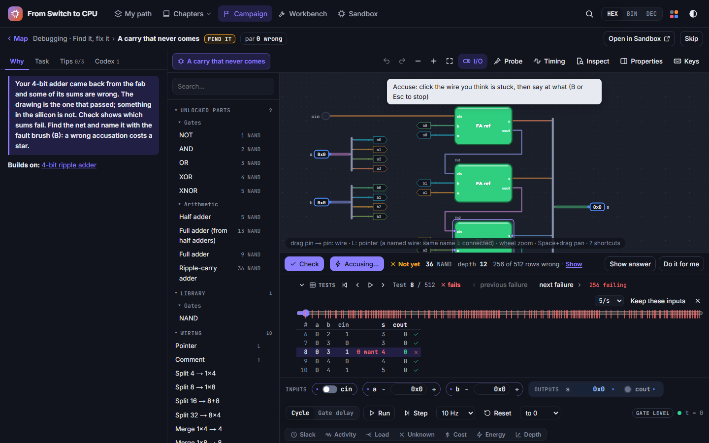

### Skip a level, or unlock everything

- **Skip** (in the side panel, or in the level screen's top bar) marks a level skipped. Its part unlocks as if you
  had built it, so the levels after it open. The panel then shows **Un-skip**, which takes it back.

  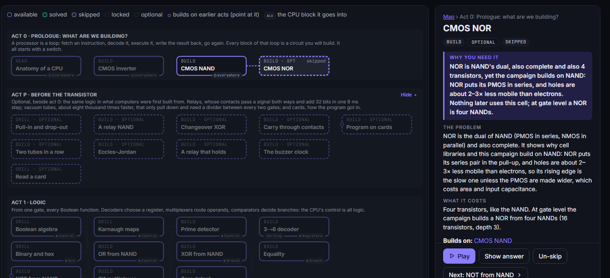

- **Unlock all** in the header opens every level at once, whatever you have solved. It does not change the parts
  each level may use, and it marks nothing as solved. Untick it to go back.

### Open a level in the sandbox

**Open in Sandbox** (at the top right of the level screen) opens the level's chip in the sandbox. You get the full
editor there, and the level's challenge strip (Check, tips, stars) comes with it.

### Use the codex

The codex collects every component, law, tool, trick and concept the campaign teaches. An entry is discovered when
you finish or skip the level that teaches it. With **Unlock all**, every entry shows.

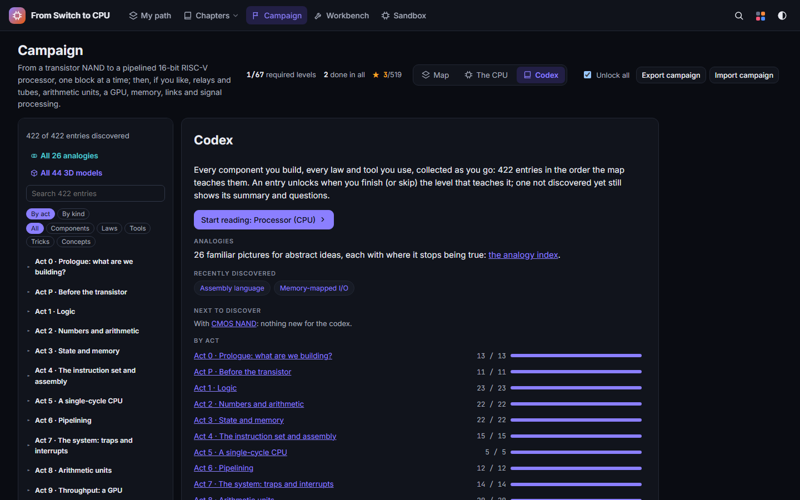

1. Click **Codex** in the header.
2. The left column lists the entries **By act** or **By kind**. Narrow them with **All**, **Components**, **Laws**,
   **Tools**, **Tricks** and **Concepts**, or type in the search box above.
3. The front page has **Start reading**, a link to the analogy index, and **Next to discover**: what the next level
   will add.
4. Click an entry to read it. An entry has:
   - a summary, and the level that unlocks it;
   - **Read in**: the chapters that teach it;
   - **In 3D**: its model, if it has one;
   - **Leads to** and **See also**: related entries;
   - **The idea**, often with an **Analogy** and a figure;
   - the parts' datasheets and live schematics.
5. An entry you have not discovered yet shows only its summary and **Check yourself**, the entry's own questions.
   Answer them, or click **Show answer**. **Show the full entry anyway** opens the whole entry without marking it
   discovered.

   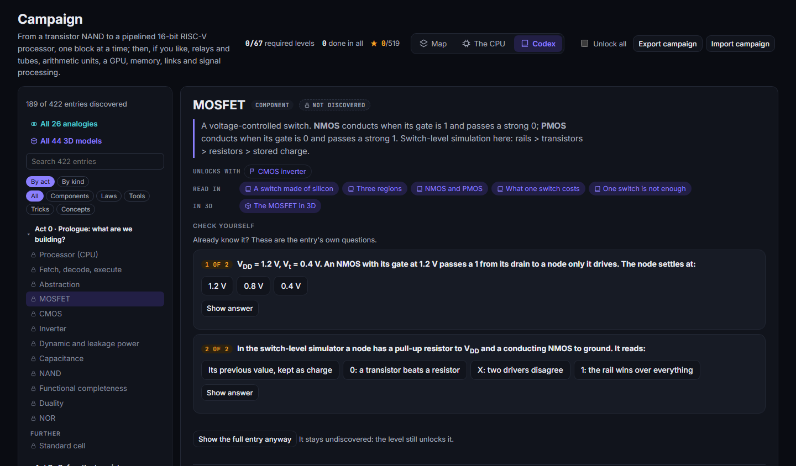

6. The analogies link at the top of the left column lists every analogy the site uses, each with the point where it
   stops being true.

### Look at a 3D model

The 3D models link, at the top of the codex's left column, lists every machine and device the site shows in 3D.

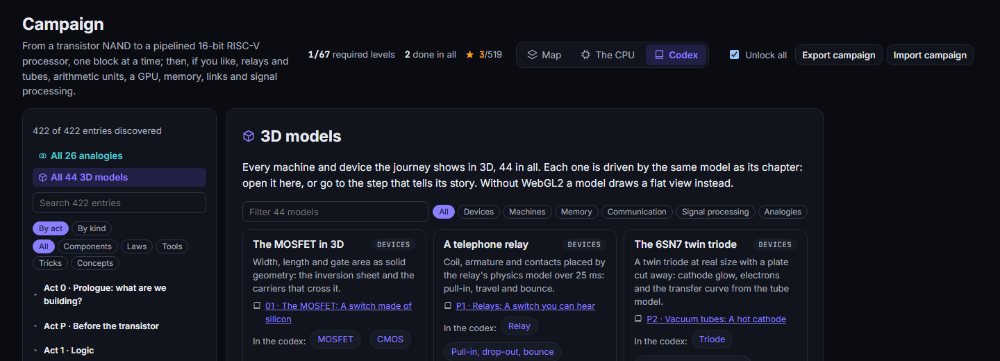

- The filter box and the chips (**Devices**, **Machines**, **Memory**, **Communication**, **Signal processing**,
  **Analogies**) narrow the list.
- **Open here** opens a model on the page.
- **In chapter** goes to the step that tells the model's story.

On an open model:

1. Drag to orbit, and right-drag or Shift-drag to pan (two fingers on a touch screen). To zoom, click the model and
   then scroll (or **Ctrl** + scroll, or pinch). Double-click to reset the view.
2. Move the sliders under the model to drive it. Each model has its own; here they are the gate and drain voltages,
   the width W and the length L.
3. **Cutaway** slices the model open, and **Explode** pulls its parts apart.
4. **Tour ›** plays a guided tour of the model. **Reset view** puts the camera back.
5. The buttons in the model's corner are **Hide names** (or show them; the **N** key does the same), **Turn by
   itself**, **Save image** (a PNG, with its labels) and **Full screen**.
6. **Close**, at the top right, returns to the list.

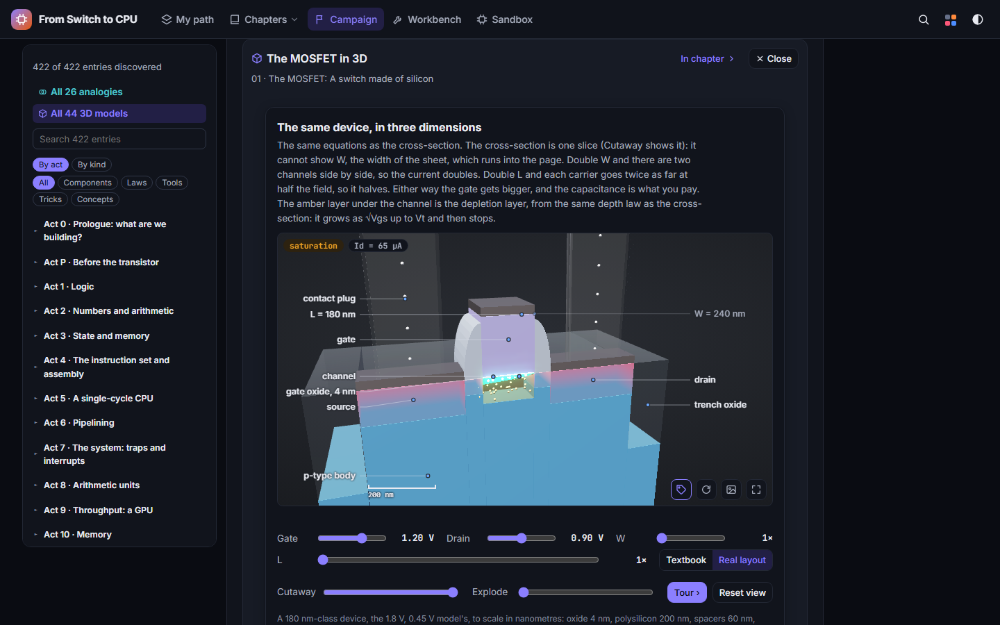

### Move your progress to another computer

Your progress and your level chips are kept in this browser.

1. On the campaign page, click **Export campaign**. A `.json` file downloads, holding your progress and your level
   chips.
2. On the other computer (or browser), open the campaign page, click **Import campaign** and pick the file.
3. The file is merged into the progress already there. Your chips there are never overwritten.

To save everything on the site at once (chapters, notes and sandbox projects as well as the campaign), see [What works
everywhere](everywhere.md).

## Keys and gestures

On the level screen, press **?** (or click **Keys** on the canvas toolbar) for the full sheet. These are the keys you
will use most:

| Key | What it does |
|---|---|
| **1** … **9** | arm a favourite part; a click (or ↵) places it |
| **L** · **T** | arm a pointer (a named wire: the same name joins the nets) · a comment |
| **W** | start a wire from the pin under the keyboard cursor |
| **Esc** | cancel the wire, disarm the part, clear the selection |
| **R** · **Shift R** | turn the selection a quarter clockwise · anticlockwise |
| **F** | flip the selection left–right |
| **F2** | rename the selected part, pin or pointer |
| **Del** | delete the selection |
| **Ctrl Z** · **Ctrl Y** | undo · redo |
| **Ctrl ↵** | run / pause |
| **.** | one step |
| **P** | probe mode: click wires to record them |
| **O** · **Shift O** | next overlay · overlay off |
| **+** · **−** · **0** | zoom in · zoom out · fit |
| **Space** (held) | pan with a drag |
| **Ctrl K** or **/** | search |

With the mouse:
- the wheel zooms, and Space + drag pans;
- a drag from one pin to another draws a wire;
- a right-click opens the menu of what is under the pointer.

The [sandbox page](sandbox.md) lists every mouse and touch gesture.

## If something looks wrong

- **"… is locked" appears instead of the level.** A link took you to a level whose requirements you have not
  finished. The card names the level to do first: click it, or **Back to the map**, or tick **Unlock all**.
- **Check says Not yet, and an output reads X.** Either nothing drives that output to a 0 or a 1 yet, or two parts
  drive it against each other; the message under Check says which. Wire the output to a part, and check that no
  input it depends on is left open.
- **You clicked a part, but nothing was placed.** A part lands where you next click on the canvas. While the test
  player is open the canvas is smaller, so close the player with its **✕** first, or click higher up.
- **Your circuit vanished after Show answer.** It is still there: Show answer opens the walkthrough on a separate
  copy. Click **Leave the walkthrough** to get back to it. After **Do it for me**, press
  **Ctrl Z** (Undo) instead.
- **A level you skipped is not counted as solved.** Skipped levels unlock what comes after them, but they do not
  count as solved. Click the level, click **Un-skip**, and play it.
- **Your progress is missing on another computer or browser.** Progress lives in the browser it was made in. Use
  **Export campaign** there and **Import campaign** here.

Next: [The workbench](workbench.md)
