# What works everywhere

[← Back to the manual](README.md)

These tools are in every section of **From Switch to CPU**: the chapters, the campaign, the workbench and the sandbox. Most of
them start from the top bar, which is the same on every page. Use this page to find a control you have seen but not tried,
or to find out whether something you want to do is possible.

Most used first: search, the way back, the keys, how the circuits look, where to start, your notes, then the 3D models,
sharing, printing, backups, phones, offline use and the desktop program.

- [Quick start: five things to know](#quick-start-five-things-to-know)
- [Search for anything](#search-for-anything)
- [Go back to where you were](#go-back-to-where-you-were)
- [See every key on a page](#see-every-key-on-a-page)
- [Change how circuits look](#change-how-circuits-look)
- [Switch between light and dark](#switch-between-light-and-dark)
- [Choose where to start, and follow My path](#choose-where-to-start-and-follow-my-path)
- [Bookmark a place and write a note](#bookmark-a-place-and-write-a-note)
- [Review what you have read](#review-what-you-have-read)
- [Use a 3D model](#use-a-3d-model)
- [Make room for the circuit](#make-room-for-the-circuit)
- [Share a circuit as an image or a link](#share-a-circuit-as-an-image-or-a-link)
- [Print a chapter or save it as a PDF](#print-a-chapter-or-save-it-as-a-pdf)
- [Back up your progress and move it to another browser](#back-up-your-progress-and-move-it-to-another-browser)
- [Use it on a phone or tablet](#use-it-on-a-phone-or-tablet)
- [Use it offline](#use-it-offline)
- [The desktop program](#the-desktop-program)
- [Keys and gestures](#keys-and-gestures)
- [If something looks wrong](#if-something-looks-wrong)

## Quick start: five things to know

1. Press **Ctrl K** (or **/**) on any page and type what you are looking for: a chapter, a part, a level, a codex term or
   an action such as *print*. Press **Enter** to go there.
2. After a search or a link takes you to another section, a pill such as **↩ Ch 04 · 3** appears in the top bar. Click it,
   or press **Alt Backspace**, to go back to exactly where you were.
3. Press **?** on any page to see every key that works there.
4. Click the coloured squares in the top bar (**View options**) to change how circuits look. A preset such as **Classroom**
   or **Paper** changes the whole look at once; **Undo: back to what you had** reverts it.
5. Your progress, notes and sandbox chips are kept in this browser only. Use **Export all progress** at the bottom of the
   home page to keep a copy.

## Search for anything

The search finds chapters and their steps, workbench parts, campaign levels, codex entries, your notes, and actions you
can take on the current page.

1. Press **Ctrl K** (on a Mac, **⌘ K**), or **/**, or click the magnifying glass in the top bar.
   A search box opens with the most useful results for the page you are on.
2. Type a few words, for example `full adder`.
   The results are grouped: workbench parts, chapters and steps, campaign levels and codex entries. A level
   or codex entry you have not reached yet is listed and marked **locked**.
3. Use **↑** and **↓** to move, and **Enter** to open the highlighted result. **Shift Enter** opens it in a new tab.

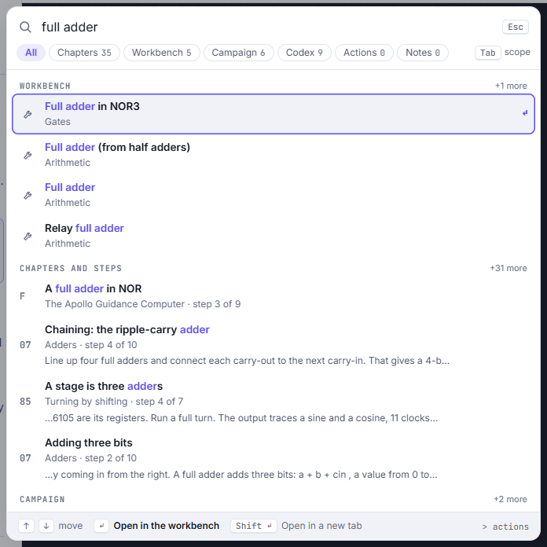

**Search one kind of thing.** Press **Tab** in the search box to step through the scope chips (**All**, **Chapters**,
**Workbench**, **Campaign**, **Codex**, **Actions** and **Notes**). Only that kind of result is listed.

**Run an action.** Start the query with `>` to list actions instead of places, for example `>print` for
**Print this chapter**. On a chapter step the actions include **Next step**, **Copy link to this view**, **Open in Sandbox**,
**Probe mode (P)**, **Why? (W)**, view switches such as **Flowing bits** and **Larger text**, and backup actions such as
**Export all progress**. Each switch shows whether it is on or off.

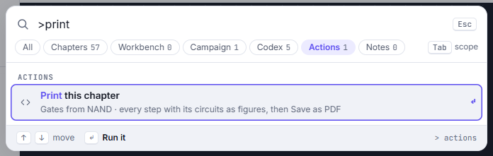

**Close it.** Press **Esc**. If you have typed something, the first **Esc** clears it and the second closes the box.

## Go back to where you were

When a search result, a link in a chapter, or **Open in Sandbox** takes you to a different section, the site keeps the
place you left: the step, the part you had opened, and how far you had scrolled.

1. On a chapter step, press **Ctrl K**, type `half adder` and open the workbench result **Half adder**.
   The workbench opens on the half adder, and a pill appears in the top bar naming where you came from, here
   **↩ Ch 04 · 3** (chapter 4, step 3).
2. Click the pill, or press **Alt Backspace**.
   You are back on the step, as you left it.

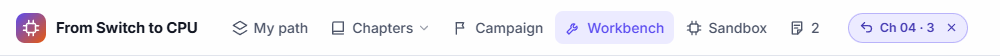

The pill remembers up to three places; each click goes back one. Click its **×** to forget them. Going to a section with the
top bar's links, or to the home page, forgets them too.

## See every key on a page

1. Press **?** (or open the search and choose **Keys on this page**).
   The **Keys on this page** sheet opens. It lists the keys that work anywhere, the keys for this kind of page (for
   example **]** and **[** for the next and previous step in a chapter) and, on a page with a circuit, the keys that work
   once the circuit has the focus.
2. Press **Esc** or click **close**.

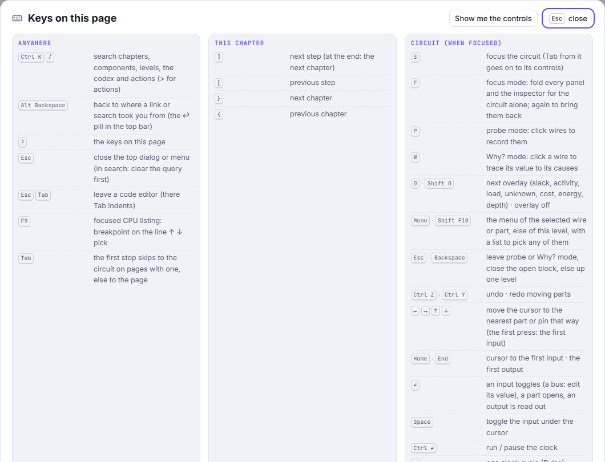

**Show me the controls** at the top of the sheet starts a short guided tour of the circuit's toolbar.

**Single letters as shortcuts.** Keys such as **F**, **/**, **[** and **?** work on their own. If they get in the way (for
example with speech input), turn off **Single-key shortcuts** under **View options** › **Behaviour**; then only
**Ctrl** / **⌘** combinations and **Esc** remain.

## Change how circuits look

Click the four coloured squares in the top bar (**View options**). A live preview of a small circuit at the top of the
menu shows each change as you make it.

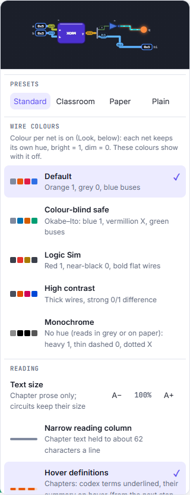

**Presets** change the look in one click:

| Preset | What it is for |
|---|---|
| **Standard** | The look the site ships with. |
| **Classroom** | For a projector: high contrast, thick wires, larger text, no motion. |
| **Paper** | Light and monochrome, for screenshots that will be printed: no colour fills, no grid, no motion. |
| **Plain** | A textbook schematic: outlined parts, one wire colour, nothing moving along the wires. |

After a preset, **Undo: back to what you had** puts your previous settings back. Presets change only the look, never how
circuits behave.

The menu's sections:

- **Wire colours**: **Default**, **Colour-blind safe**, **Logic Sim**, **High contrast** and **Monochrome**. Each says
  what a 1, a 0 and a bus look like in it.
- **Reading**: **Text size** (**A−** and **A+**, for the chapter text only), **Narrow reading column**, and **Hover
  definitions** (terms underlined in the chapters, with a summary when you point at them).
- **Look**: **Vivid look**, **Dark board**, **Cartoon parts**, **Working gates**, **Coloured modules**, **Colour per net**,
  **Flowing bits**, **Wire thickness** (**Thin**, **Normal**, **Thick**), **Grid** (**Dots**, **Lines**, **None**) and
  **Reduce motion**.
- **Labels**: **Port names**, **Part names**, **Bus values**, **Bit ranges**, **3D model names**, **Hide unreadable
  text** and **Names when zoomed out** (**Off**, **Normal**, **Large**).
- **Behaviour**: **Move parts by dragging**, **Open blocks as you zoom**, **Opened blocks without colour**, **Reset every
  level's layout…**, **Simple connections**, **Automatic clock**, **Load-dependent delay**, **Minimap** and
  **Single-key shortcuts**.
- **Reset view options to defaults**, at the bottom, puts every option in the menu back as it was on your first visit.

Two of the defaults change how you move around a circuit:

- **Open blocks as you zoom** (on): zoom into a block, with the mouse wheel or a pinch, and its inside opens in place,
  live; zoom further to step into it. With it off, a block opens only when you double-click it.
- **Opened blocks without colour** (on): an opened block drops its colour, so its inside reads on the plain board. Closed
  blocks keep their colour.

**Numbers on buses.** On a page with a circuit the top bar also has **HEX**, **BIN** and **DEC**: how bus values are shown.
**Slow motion** next to them plays every change one gate delay at a time.

## Switch between light and dark

Click the half-filled circle at the right of the top bar (**Theme**). Each click goes to the next of three settings:
**auto** (follow your system), **light**, then **dark**. Pointing at the button says which one is on and what the next click
does, for example *Theme: auto, click for light*. Every page and every circuit follows the theme.

## Choose where to start, and follow My path

Nothing on the site is locked: every chapter is open from the first visit. **Where are you starting?** and **My path**
only suggest an order.

1. On the home page, click **Where are you starting?** (or go to **My path** › **Change where I start**).
2. Pick the closest of the four: **New to hardware and code**, **I write software**, **I know digital logic** or **I design
   hardware**. Each card says which tier it starts you in.

   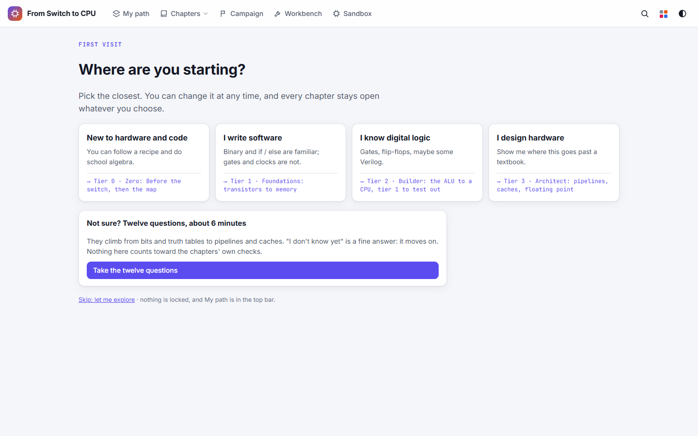

3. Not sure? Click **Take the twelve questions** (about 6 minutes). They climb from bits to caches; "I don't know yet"
   is a fine answer. At the end you get a suggested tier. Nothing you answer here counts toward the chapters' own checks.

   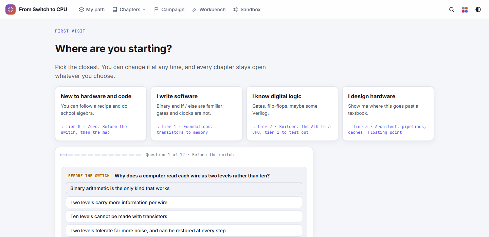

4. Click **My path** in the top bar.
   The page lists the tiers (**Zero**, **Foundations**, **Builder**, **Architect**, **Master**), the skills in each,
   how many you have mastered, and **Next up**: the next thing to read and a question to practise, with a time estimate.

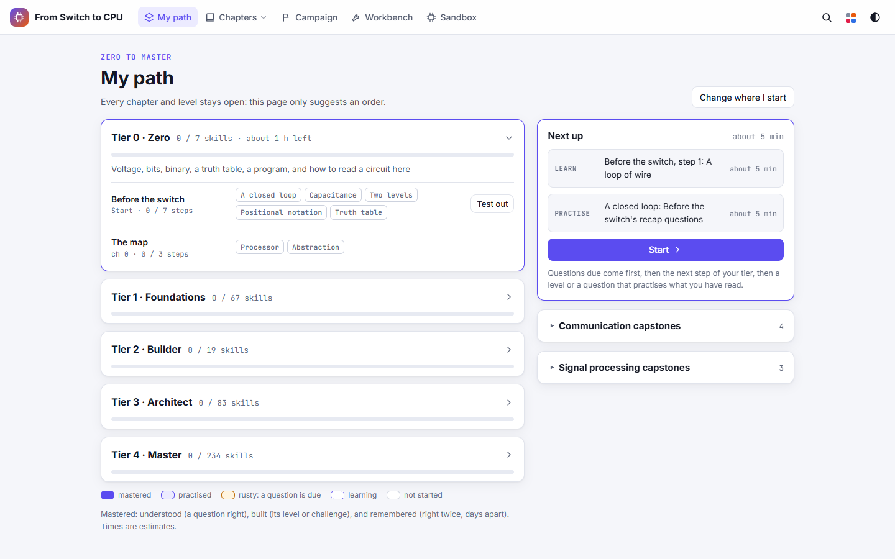

A skill counts as **mastered** when you have understood it (answered a question on it), built it (passed its level or
challenge) and remembered it (answered right twice, days apart). **Rusty** means a question on it is due again.

## Bookmark a place and write a note

Bookmarks and notes stay in this browser (and in a backup file). Nobody else sees them, and they are never part of a
shared link.

**Bookmark a step**

1. On a chapter step, click **Bookmark** under the chapter title.
   It changes to **Bookmarked**. Click it again to remove the bookmark.

**Write a note**

1. On a chapter step, click **Add note**.
   A yellow card, **Your note**, opens in the step.
2. Type your note. It is saved as you type.
3. Optional: click **Pin here** to tie the note to the circuit as it is now (the part you have opened and the inputs you
   have set); until then the card says **Not pinned to the circuit**. Click **Delete** to remove the note.

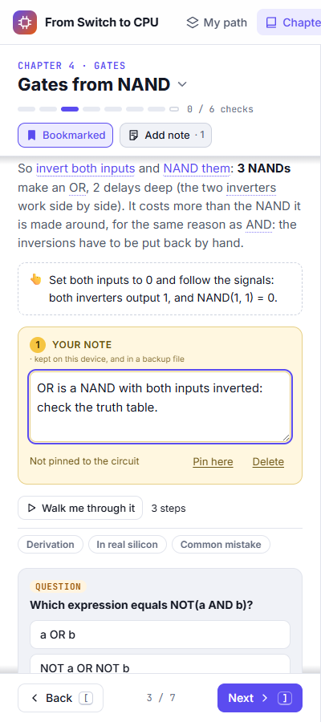

**See all your notes and bookmarks**

1. Once you have a note or a bookmark, a notebook icon with a count appears in the top bar. Click it.
   **My notes and review** opens, with **All**, **Notes** and **Bookmarks** filters and a search box.
2. Click an item to go back to its place.

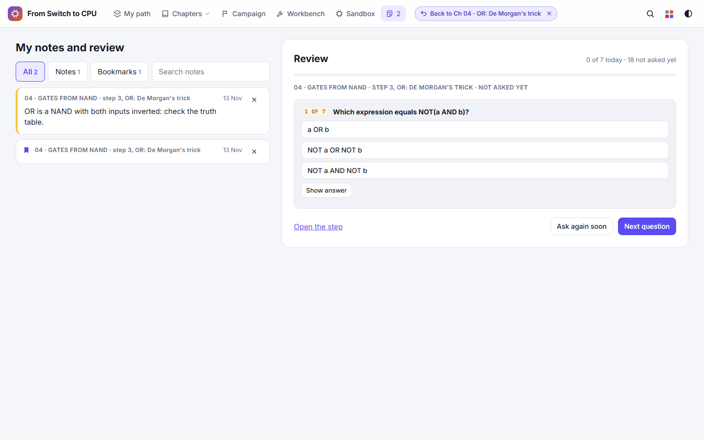

You can also find notes from the search box: press **Tab** to the **Notes** scope.

## Review what you have read

Every question you answer in the chapters, recaps and codex is remembered, and comes back for review: a question you got
wrong comes back first, one you got right comes back after longer and longer gaps. Only questions from chapters you have
visited are asked.

1. Open **My notes and review** (the notebook icon in the top bar).
   The **Review** panel says how many questions are due today, for example **0 of 7 today · 18 not asked yet**.
2. Read the question and pick an answer, or click **Show answer**.
3. Click **Next question**. **Ask again soon** brings a question back sooner; **Open the step** takes you to the step it
   comes from.

## Use a 3D model

Many chapters have a 3D model of a real part: a transistor, a vacuum tube, a relay, a disk, a sensor. Every model has
the same controls.

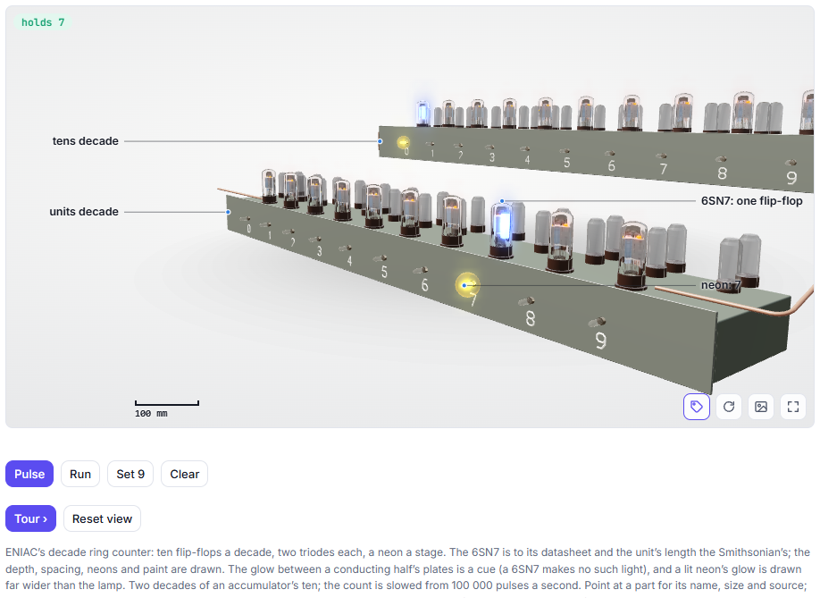

**Look around**

- **Drag** to turn the model. **Right-drag** or **Shift-drag** to move it (two fingers on a touch screen).
- To zoom, **click the model first, then scroll**; or **Ctrl + scroll** at any time; or pinch. Until you click it, the
  wheel scrolls the page, so the model never traps your scrolling. **Esc** gives the wheel back to the page.
- **Double-click** to return to the starting view, or click **Reset view**.
- With the model focused, the **arrow keys** turn it, **Shift + arrows** move it, **+** and **−** zoom and **Home** resets.

**The corner buttons** (bottom right of the model):

| Button | What it does |
|---|---|
| Tag | **Hide names** / show names, also the **N** key. The same switch is **3D model names** under **View options**. |
| Circular arrow | **Turn by itself**: the model turns slowly; click again to stop it. |
| Picture | **Save image (PNG, with its labels)**: the model as you see it, with its names and scale bar. |
| Corners | **Full screen**. **Esc** leaves it. |

**Names.** On a wide screen the names of the parts sit in the margins, with a line to each part. On a narrow screen (and
with names hidden) numbered badges mark the parts and a numbered list under the model names them; tap or click a name in
the list to light up that part. Point at a part to see its name even with names hidden.

**Cut it open.** Models with an inside have a **Cutaway** slider (cut the model open) and an **Explode** slider (pull its
parts apart). Many also have their own controls, such as the transistor's **Gate** and **Drain** voltages.

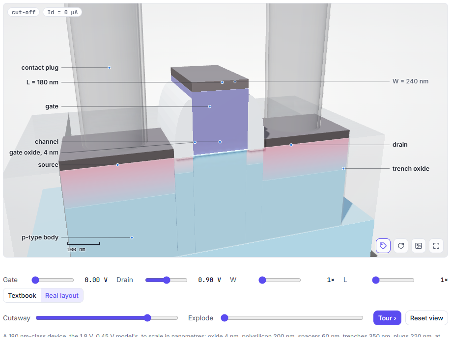

**Take the tour.** Click **Tour ›** for a guided walk through the model, one part at a time, with a caption for each.
Then **Next ›** moves on and **‹ Back** goes back a stop; at the last stop **Done** ends the tour.

## Make room for the circuit

The circuit's toolbar, above every circuit in a chapter step and in the workbench, has three buttons for this:

- **Fit to screen** (four corners) fits the whole circuit in view again after you have zoomed or moved it. With the circuit
  focused, **0** does the same.
- **Hide the side panes** (the last button) gives the circuit the full width of the window, hiding the chapter text and the
  inspector. Click it again to bring them back.
- With the circuit focused, **F** folds every panel and the inspector, and brings them back when you press it again.

## Share a circuit as an image or a link

On any circuit (a chapter step or the workbench), click **Share this view** (the picture icon) in the circuit's toolbar. When the toolbar has no room for it, the same three rows are in **More tools**.

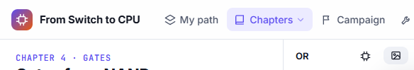

- **Image as SVG**: the level you are looking at, whole, as drawn in the current theme. Best for slides and documents:
  it stays sharp at any size.
- **Image as PNG**: the same at twice the screen's resolution.
- **Copy link to this view**: a link that reopens the circuit as it is now: the chapter step, the part you have opened, the
  inputs you have set, the probes and the clock cycles. Paste it anywhere; whoever opens it sees what you see.

A shared link never carries your notes, bookmarks or progress. In the sandbox, **File** has its own share link for a chip
(see the sandbox page).

## Print a chapter or save it as a PDF

A chapter prints as a book chapter: its goals, every step's text, each circuit as a numbered figure with a caption, the
questions with their answers at the end, and a link to each step on the site. 3D models print as figures too.

1. On any step of the chapter, click the **▾** next to the chapter's title and choose **Print this chapter** (or press
   **Ctrl K** and type `>print`).

   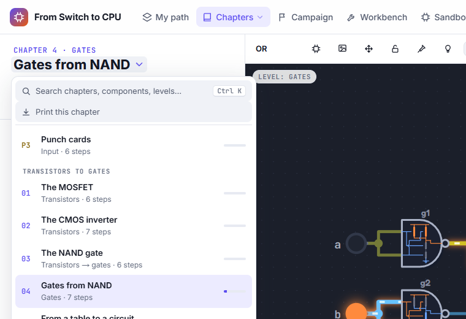

2. The print view opens and draws every figure, with a progress bar. A large chapter takes a little while.
3. When everything is drawn, your browser's print dialog opens. Choose a printer, or **Save as PDF** to keep a file.

   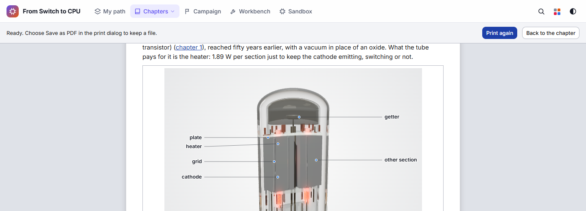

4. **Print again** opens the dialog again; **Back to the chapter** returns to the step you came from.

Each 3D model becomes a numbered figure: its starting view, in the paper's light colours with its names on, whatever theme
you use, with a link to the live model on the site.

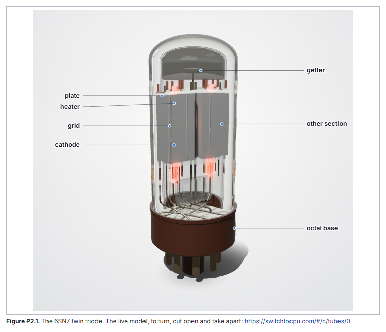

The printed page is always light, whatever theme you use on screen.

## Back up your progress and move it to another browser

Everything you do here (chapters read, checks and levels passed, puzzles, notes, review history, sandbox projects and chips,
and your settings) is stored in this browser only. Clearing the browser's site data deletes it. A backup file keeps a copy,
and moves it to another browser or computer.

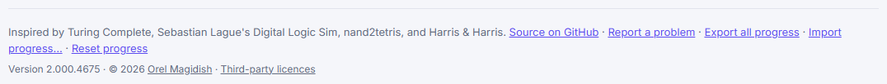

**Make a backup**

1. Scroll to the bottom of the home page and click **Export all progress** (or press **Ctrl K** and type `>export`).
   A file named like `mosfet-riscv-backup-2026-11-13.json` is downloaded.

**Restore or merge a backup**

1. At the bottom of the home page, click **Import progress…** and choose the backup file.
2. A summary opens: what **The file holds** and what **Merging it adds**.
3. Click **Merge and reload**, or **Cancel**.

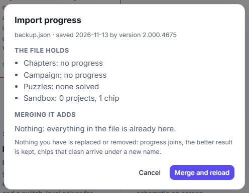

Importing never replaces or removes anything you have: progress joins, the better result is kept, and a chip whose name
clashes with one of yours arrives under a new name. Importing the same file twice changes nothing.

**Start again.** **Reset progress** (at the bottom of the home page) opens **Reset your progress?**, which lists what it
clears (the chapter steps you have seen, the checks you have solved, campaign levels with their stars and tips, and puzzles
solved) and what it keeps (sandbox projects and chips, notes and bookmarks, settings and look). It cannot be undone, so the
dialog offers **Export all progress first** beside **Cancel** and **Reset progress**.

## Use it on a phone or tablet

The whole site works on a phone, with the same sections and controls.

- The top bar shows the section names under their icons.
- On a chapter step, the circuit sits below the text. **Show circuit** (at the top) and **Circuit** (beside **Back** and
  **Next** at the end of the text) scroll down to it; scroll up to read on.

  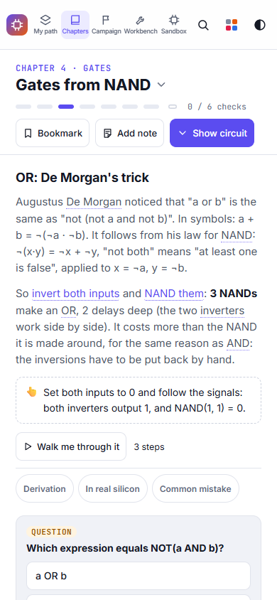

- On the circuit: **double-tap** a part to open it, **drag** to move the view, **pinch** to zoom. A hint saying so appears
  at the bottom; tap it to hide it. Less used tools are behind **More tools** in the circuit's toolbar.
- **Move parts by dragging** starts off on a touch screen, so a drag moves the view rather than a part. Turn it on under
  **View options** › **Behaviour**, or with the lock in the circuit's toolbar.
- 3D models: one finger turns the model, two fingers move it, pinch zooms.

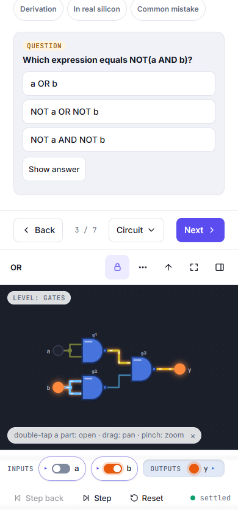

## Use it offline

After your first visit, the site keeps itself in your browser and works without a connection.

1. Open the site once while online and stay a few seconds.
2. Later, with no connection, open the same address.
   The chapters and their circuits open as usual, including chapters you had not visited.

Your progress is saved in the browser either way.

## The desktop program

There is also a desktop program for Windows: the same site in a window of its own.

1. Open the project's releases on GitHub and find **Desktop program (Windows, portable)**.
2. Download the `.exe` file (named like `MOSFET-to-RISCV-<version>-portable.exe`).
3. Run it. It is portable: there is nothing to install.

Share links made in the desktop program open the public site, so they work for anyone you send them to.

## Keys and gestures

These work on every page. Press **?** for the full list of the page you are on.

| Key | What it does |
|---|---|
| **Ctrl K** or **/** | Search chapters, components, levels, the codex and actions (start with `>` for actions). |
| **Alt Backspace** | Back to where a link or search took you from (the **↩** pill in the top bar). |
| **?** | The keys on this page. |
| **Esc** | Close the top dialog or menu (in the search box: clear the query first). |
| **Esc**, **Tab** | Leave a code editor (inside one, **Tab** indents). |
| **Tab** | The first stop skips to the circuit on pages that have one, else to the page. |
| **]** / **[** | Next / previous step (in a chapter). |
| **}** / **{** | Next / previous chapter. |

On a circuit, once it has the focus (press **S**): **F** folds every panel, **P** probes wires, **W** asks *Why?* of a wire,
**Esc** or **Backspace** goes up one level, the arrow keys move a cursor between parts and pins, **Space** toggles the input
under the cursor, **Home** and **End** move the cursor to the first input and the first output, **Enter** toggles an input,
opens a part or reads out an output, **Ctrl Enter** runs or pauses the clock,
**Ctrl Z** / **Ctrl Y** undo and redo moving parts, **.** runs one clock cycle (Pulse), **>** one gate delay (Step) and **,**
goes back a step, **+**, **−** and **0** zoom in, zoom out and fit, **O** shows the next overlay (slack, activity, load and
more; **Shift O** turns it off), and **Shift F10** (or the menu key) opens the menu of the selected wire or part.

In a CPU panel's program listing, once it has the focus, **↑** and **↓** pick a line and **F9** sets a breakpoint on it.

| Gesture | Mouse | Touch |
|---|---|---|
| Open a block | Double-click it, or zoom into it | Double-tap it, or pinch into it |
| Move the view | Drag the board (or any drag, with **Move parts by dragging** off) | Drag |
| Zoom | Mouse wheel | Pinch |
| Turn a 3D model | Drag | One finger |
| Move a 3D model | Right-drag or Shift-drag | Two fingers |
| Zoom a 3D model | Click it, then scroll; or Ctrl + scroll | Pinch |

## If something looks wrong

- **The mouse wheel scrolls the page instead of zooming a 3D model.** That is on purpose, so a model never traps your
  scrolling. Click the model first, then scroll; or hold **Ctrl** while scrolling. **Esc** gives the wheel back to the page.

- **Dragging moves the view, not the part.** **Move parts by dragging** is off (it starts off on touch screens), or the lock in
  the circuit's toolbar is closed. Click the lock, or turn the option on under **View options** › **Behaviour**.

- **A block opened when I only meant to zoom.** **Open blocks as you zoom** is on by default. Zoom back out to close it, press
  **Esc** to go up a level, or turn the option off under **View options** › **Behaviour** to open blocks only by
  double-clicking.

- **Letter keys do things while I type or dictate.** Turn off **Single-key shortcuts** under **View options** ›
  **Behaviour**. Keys never act while you type in a text field.

- **My progress is gone.** Progress lives in one browser. A private window, another browser or another computer starts
  empty, and clearing the browser's site data deletes it. If you exported a backup, use **Import progress…** at the bottom of
  the home page. Export one now and then.

- **The colours are hard to tell apart.** Open **View options** and pick **Colour-blind safe** or **High contrast** under
  **Wire colours**, or the **Monochrome** palette, which uses line styles instead of hue.

- **Everything moves too much.** Turn on **Reduce motion** under **View options** › **Look**, or pick the **Plain** preset.
  **Slow motion** still plays when you ask for it.

Back to [the manual](README.md)
