# The journey: the chapters

[← Back to the manual](README.md)

## What it is for

The chapters are the book of From Switch to CPU. They start at a single switch and build, one chapter at a time, up to
a processor and beyond. Each chapter uses only what the chapters before it built. A chapter is a row of short steps: on
the left you read, in the middle you work a live circuit (or a figure or 3D model), and on the right the inspector tells
you what the selected part is and what it costs.

Start here if you want to understand how a computer works, in order. Choose the **Campaign** instead to solve
puzzles, the **Workbench** to look up one part, and the **Sandbox** to build your own circuits.

## Quick start

Five minutes, from the home page to having taken a gate apart and answered its question.

1. Open the home page. On the right is the list of chapters by section, with **Transistors to gates** open (the page
   says "Your section starts open"; click any other section to unfold it).

   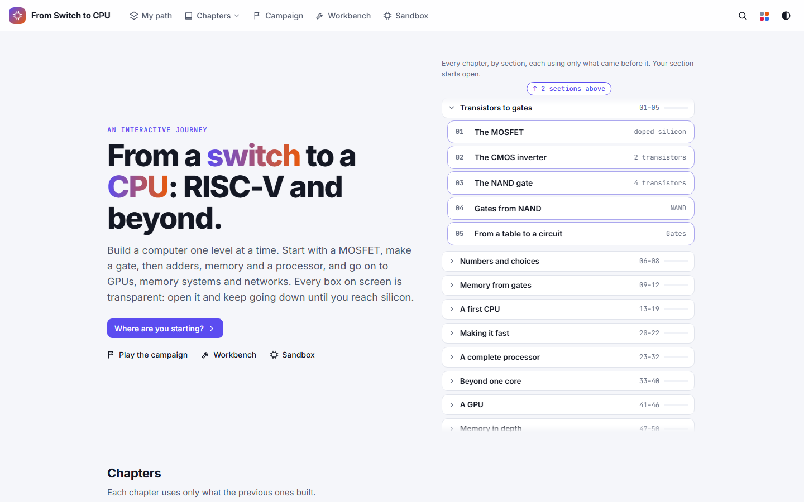

2. Under **Transistors to gates**, click **04 Gates from NAND**. The chapter opens at its first step. The first time,
   two cards point out the controls ("1 OF 2 · Open any box …"): read them, or click **Skip the tour**.

   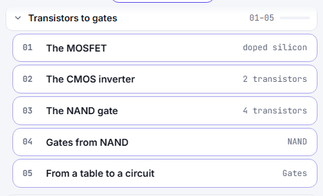

3. Click the third dot under the chapter's title (its tooltip reads **Step 3: OR: De Morgan's trick (has a check)**). You can also
   click **Next** at the bottom of the text twice. Read the text on the left: it says how an OR gate is made from three NAND
   gates.

   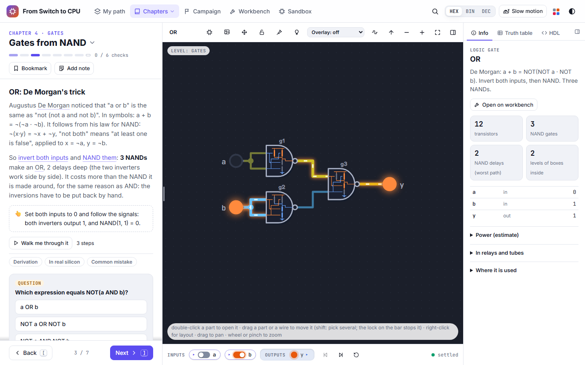

4. In the bar under the circuit, click the switch labelled **b** under **INPUTS**. Both inputs are now 0. The wires
   change colour, the output **y** goes dark (0), and a green **Done** note appears at the top: you have just done the
   step's "Set both inputs to 0" exercise. You can also click the round input on the circuit itself.

   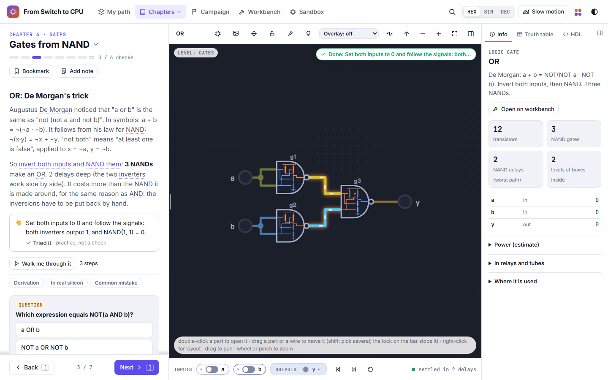

5. Double-click the gate labelled **g1**. The circuit is replaced by what is inside it: a NAND gate made of four
   transistors, with the values you set still flowing through it. The bar at the top of the circuit shows where you are
   (**OR › g1 NAND**).

   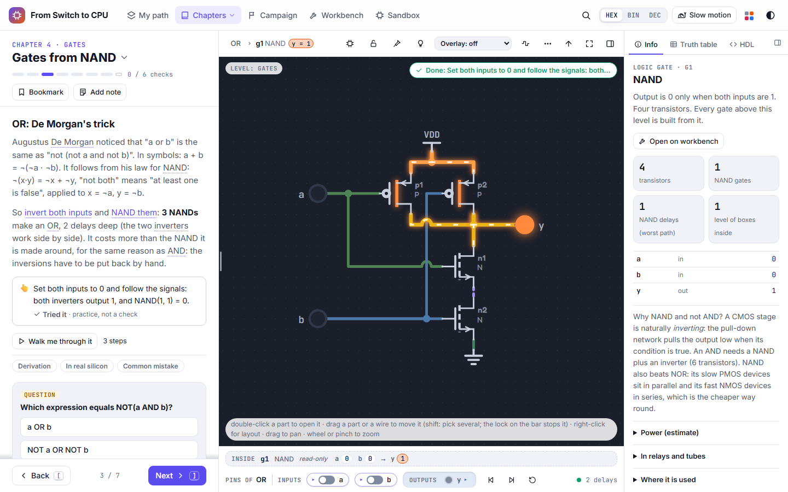

6. Double-click the transistor labelled **p1**. You are now inside one transistor: a cross-section with its gate,
   source and drain, driven by the live value from the circuit.

   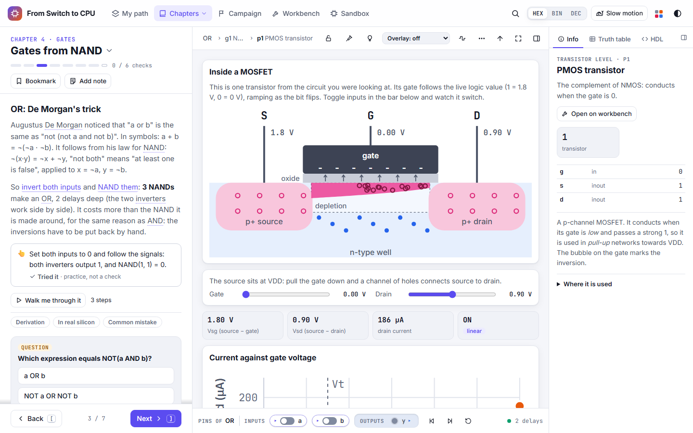

7. Click **Up one level** (the ↑ arrow on the bar above the circuit) twice, or press **Esc** twice, to come back to the
   OR gate.

8. Scroll the left pane down to **QUESTION** and click an answer. A wrong answer is marked and says why it is wrong;
   pick again. The right one turns the box green and marks it **SOLVED**.

   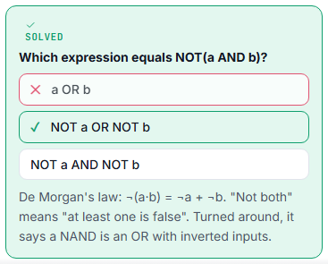

9. Look at the top of the left pane: the step's dot is now filled and the count reads **1 / 6 checks**. Click **Next**
   to go on.

   

That is the whole pattern of every chapter: read, try the circuit, open what you do not believe, answer the check.

## The screen

- **Top bar**: the site's name (back to the home page), **My path**, **Chapters** (a menu of every chapter),
  **Campaign**, **Workbench**, **Sandbox**; on the right the search (magnifier), **HEX / BIN / DEC** (how bus values are
  written), **Slow motion**, **View options** (the coloured squares) and the theme switch.
- **Left pane, the text**: the chapter number and title (click it for the chapter menu), a dot per step (a dot with a
  check has a question or challenge), the count of checks solved, **Bookmark** and **Add note**. Below, the step's
  text, its **Try** boxes, **Walk me through it**, the folded extras (for example **Derivation**, **In real silicon**,
  **Common mistake**) and the step's **QUESTION** or **CHALLENGE**. **Back** and **Next** sit at the bottom. Drag the
  thin handle between the text and the circuit to make the text wider or narrower.
- **Middle, the circuit**. Above it, a bar with the name of the level you are in and the circuit's tools (see
  [Change, reuse or share the circuit](#change-reuse-or-share-the-circuit)). Below it, the run bar: **INPUTS** (one
  switch per input), **OUTPUTS**, then **Step back**, **Step** (one gate delay) and **Reset**, and on the right whether
  the circuit has settled.
- **Right, the inspector**: what the selected part is (nothing selected: the whole circuit). **Info** gives its
  transistor and NAND counts, its delay, its pins and values, **Open on workbench**, and folded sections **Power
  (estimate)**, **In relays and tubes** and **Where it is used**. **Truth table** and **HDL** are the other two tabs.
  Fold it with the button at its top right.

## How to …

### Move between steps and chapters

1. Click a step's dot under the chapter title, or **Back** / **Next** at the bottom of the text. At the last step,
   **Next** goes on to the next chapter.
2. Keys: **]** next step, **[** previous step, **}** next chapter, **{** previous chapter.
3. A step that opens with *Optional: a deep dive. Nothing later relies on it.* can be skipped: no later step,
   question or level needs it.
4. To jump anywhere, click the chapter title (or **Chapters** in the top bar): the menu lists every chapter with its
   number of steps and how far you got, and has a search box at its top.
5. A long chapter is cut into parts. Its bar of dots is grouped into segments, one per part, with a line such as
   *Part 1 of 6 · 0 / 23 checks · core path 24 steps* under it ("core path": the steps that are not deep dives). Click
   **⌄** at the line's end to list the parts (for example **Shift and add**, **Dividing**, **In the CPU**) with their
   steps; click a step to go there.

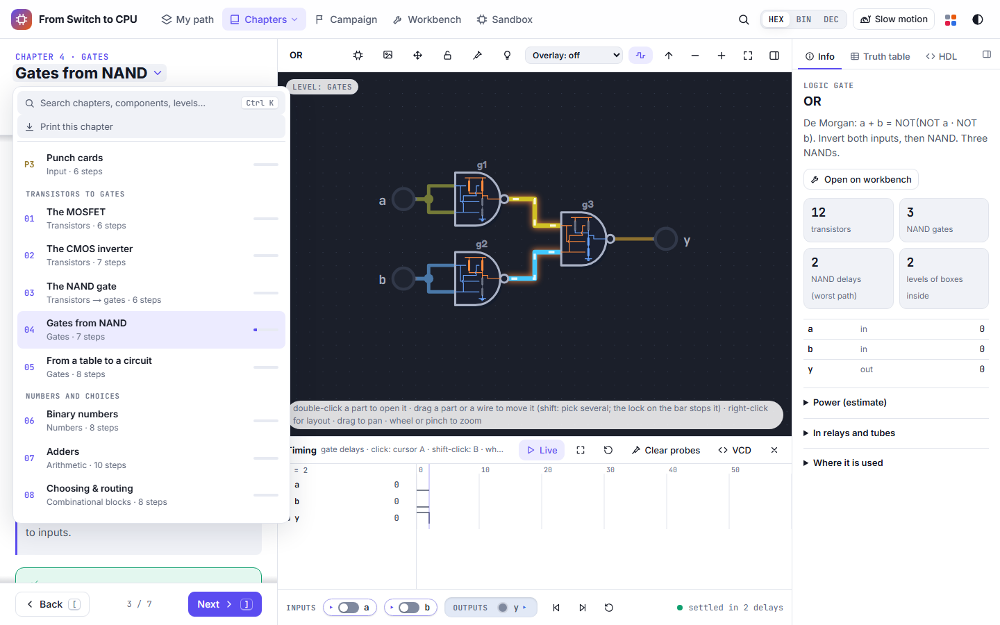

### Set inputs and watch the signals

1. Click an input's switch under **INPUTS**, or click the input on the circuit. A bus input (several bits) has **−**
   and **+** beside its value to step it down or up.
2. Wires carrying a 1 are bright, a 0 is dark; an unknown value is drawn in its own colour.
3. To see a change spread gate by gate, click **Slow motion** in the top bar, then change an input: each change travels
   along its wire over one gate delay.
4. **Step** (in the run bar) advances one gate delay; **Step back** undoes the last step, clock cycle or input change;
   **Reset** powers the circuit off and on.
5. **HEX**, **BIN** and **DEC** in the top bar choose how buses show their values.

### Open any part, down to the transistors

1. Double-click a part to open it. Its inside replaces the view, with the live values. Keep going: gates open into
   NANDs, NANDs into transistors, a transistor into its cross-section.
2. Or zoom: with the mouse over a part, scroll the wheel up (or pinch). Once the part fills the view it opens by
   itself, and a note at the top says how to zoom back out. (This is **Open blocks as you zoom** in **View options**,
   on by default.)

   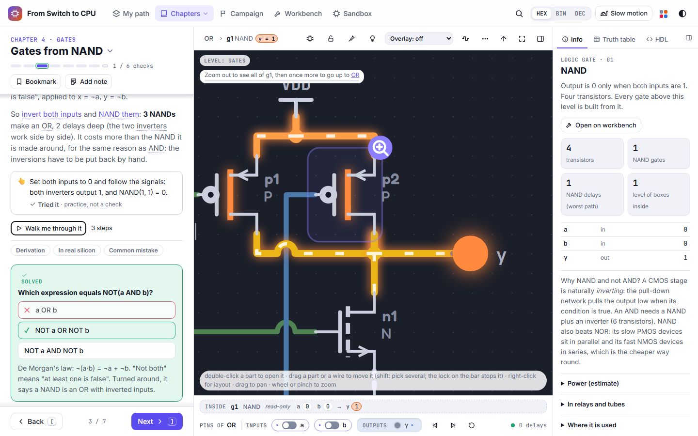

3. The bar above the circuit shows the path (**OR › g1 NAND › p1**). Click any name in it to go back there. **Up one
   level** (the ↑ arrow, or **Esc** / **Backspace**) goes up one.
4. While you are inside, a strip under the circuit reads **Inside** the part, **read-only**, with that part's own pins
   and values, and the run bar is labelled **Pins of** the whole circuit: the inputs still belong to it.

### Read what a part costs and does

1. Click a part once to select it; the inspector shows it. With nothing selected it shows the whole circuit.
2. **Info**: transistors, NAND gates, NAND delays on the slowest path, levels of boxes inside, and every pin's value.
3. **Truth table**: every input combination, computed from the circuit; the row you are on is highlighted.

   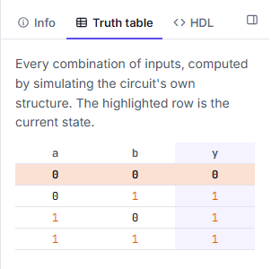

4. **HDL**: the part as Verilog you can copy or download.
5. **Open on workbench** opens the part on its own page in the workbench.

### Ask why a wire has its value

1. Click **Why?** on the bar above the circuit (the light bulb), or press **W**.
2. Click a wire. A card explains the value step by step back to the inputs that decide it, for example "g3 = 1
   because g2 = 0: one 0 into a NAND is enough". Hover a line to light its part; open a box to follow the trace inside it.
3. The card's **Each part** tab says what each part of this level is for.
4. **Esc** leaves Why? mode.

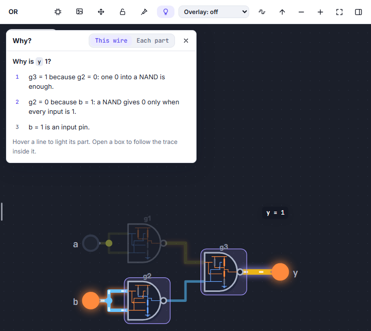

### Use a part's menu

Right-click a part (or select it and press the menu key) for everything you can do with it: **Look inside**
(the same as a double-click) and **Inspect** (its datasheet and cost in the inspector), then three groups:

- **Measure**: its **Slack** (how far its slowest path is from the critical one), **Light the critical path through
  it**, and **Power**.
- **Explain**: its **Truth table**, its **Codex** entry, the **Chapter** that teaches it, **Break a part** (what goes
  wrong without it) and **Where it is used**.
- **Take it elsewhere**: **Open in Sandbox**, **Copy Verilog**, **Save an image as SVG** or **PNG**, **Copy a link to
  this view** (with this part picked out).

Right-click a wire or the empty circuit for their own menus.

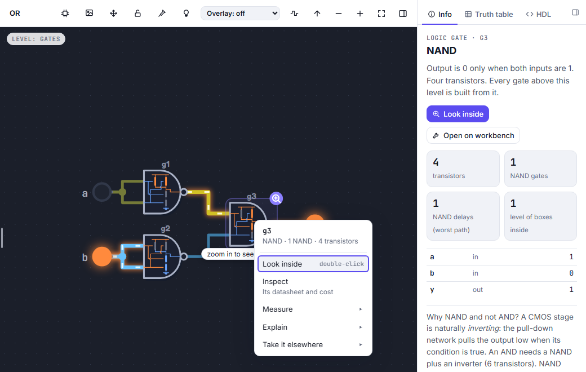

### Follow the text on the circuit

- Underlined words in the text are parts: hover one to light it on the circuit, click it to keep it lit.
- **Walk me through it** plays the step as a short tour on the circuit: each card sets the inputs, lights the parts
  involved and says what happens. Use **Next**, **Back** or **Play** on the card; **×** ends it.

  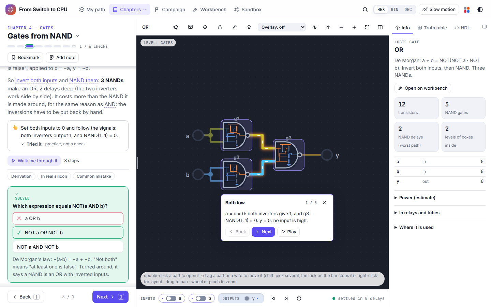

- **Try** boxes (with a pointing hand) are exercises on the circuit. When you have done one, it says **Tried it**:
  practice, not a check.
- The folded buttons under the text (**Derivation**, **In real silicon**, **Common mistake** and others) open more
  detail; nothing later depends on them.
- Some figures have a **Wire / Water** switch that shows the same idea as water in pipes.

### Answer questions and challenges

1. A **QUESTION** has a few answers; click one. A wrong one says why; you can pick again. **Show answer** gives it away.
2. A **CHALLENGE** asks you to make the circuit do something (set inputs, run a program until it stops). It ticks
   itself when the circuit gets there. **Show a hint** gives the hints one at a time, then **Show answer**. The
   challenge's goal is also shown over the circuit; click it to see the challenge.
3. Challenges are optional. Each solved one fills its step's dot and the **checks** count under the chapter title.

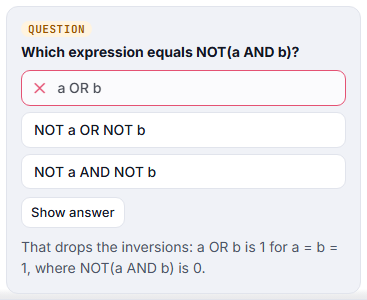

### Review a chapter: the recap

The last dot of a chapter, **Recap**, lists **WHAT TO KEEP**, three **CHECK YOURSELF** questions, the chapter's terms
**IN THE CODEX** and the levels to **PRACTISE IN THE CAMPAIGN**.

### Run a processor

Steps with a processor have a CPU panel on the right of the circuit.

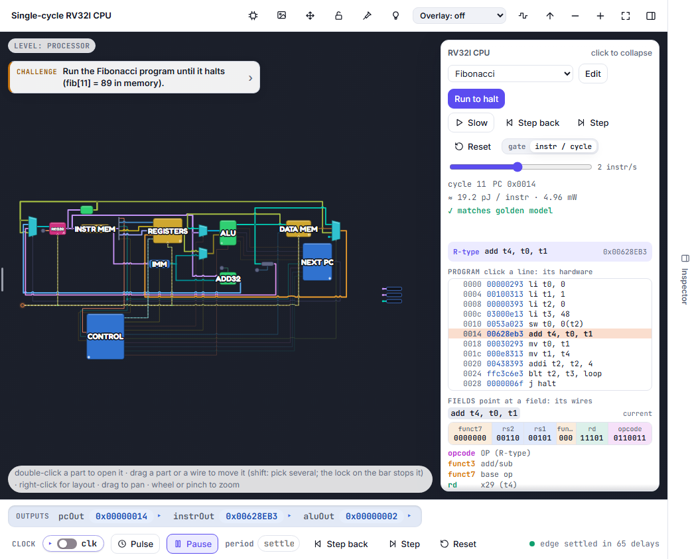

1. Where the panel offers several programs, pick one in its list (for example **Fibonacci**), or click **Edit** to
   write your own.
2. **Run to halt** runs the program to the end as fast as your browser allows. **Slow** runs it at the speed set by
   the slider (instructions a second). **Step** does one step: choose **gate** (one gate delay) or **instr / cycle**
   (one instruction). **Step back** undoes one; **Reset** starts the program again.
3. The panel says after every cycle whether the hardware **matches golden model**, an independent simulator of the
   instruction set.
4. Click a line of the program to light the hardware that instruction uses. Click just left of an address (its
   **Breakpoint** button) to stop a run when that instruction is reached.
5. Under the program, **FIELDS** shows the selected instruction's bits split into its fields (point at a field to
   light its wires), and **NARRATE** tells the last instruction unit by unit.
6. Under the circuit, the clock bar has **Pulse** (one clock cycle), **Run** (runs the clock), **Step back**, **Step**
   and **Reset**.

### Watch a memory's contents

On a step whose circuit holds a memory or a register file, a **Memory contents** panel beside the circuit lists every
word with its value, live (for example *8 × 8 bits*: **x0** to **x7**). It changes as the circuit writes.

### Look at a 3D model

Some steps have a model in 3D (a transistor, a relay, a valve, a chip, a picture tube).

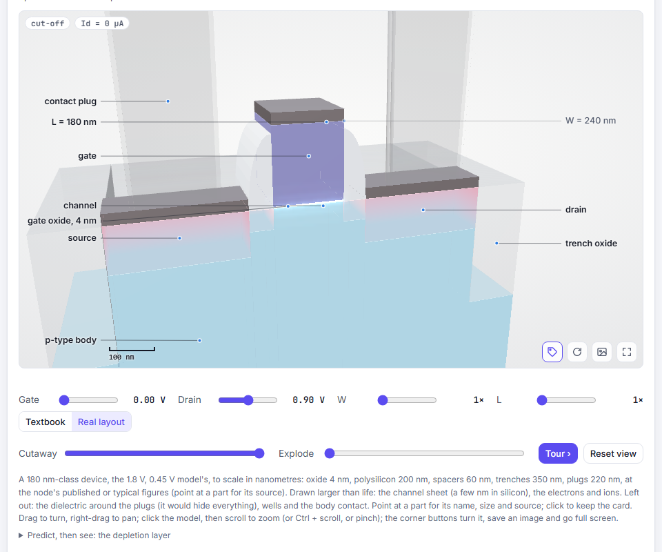

1. Drag to turn it, right-drag to move it. Click the model once, then scroll to zoom (Ctrl + scroll and pinch work too).
2. Point at a part for its name, size and source; click to keep that card open.
3. **Cutaway** cuts the model open; **Explode** pulls its parts apart. **Tour ›** goes through the model view by view;
   **Reset view** goes back to the start.
4. The four buttons at the model's corner: **Hide names** (key **N**), **Turn by itself**, **Save image** (a PNG with
   its labels) and **Full screen**.
5. Under the model, its sliders and buttons drive it from the same model the chapter computes (here the gate and drain
   voltages). The note under it says what is drawn to scale and what is exaggerated.

### Change, reuse or share the circuit

These are the buttons on the bar above the circuit, left to right after the level's name:

- **Open in Sandbox**: an editable copy of the circuit on screen, as one of your own chips.
- **Share**: **Image as SVG**, **Image as PNG**, or **Copy link to this view** (the step, the opened part, the inputs,
  probes and clock cycles).
- **Layout**: unravel named labels into wires, or reset this level. You can drag parts and wires to tidy a drawing;
  **Lock the layout** (the padlock) stops that, so a drag pans instead.
- **Probe** (**P**): click wires to add them to the timing diagram. The first probe opens the timing panel under the
  circuit: every probed wire over time, with **Live**, **Fit everything recorded**, **Clear the recording**, **Clear
  probes**, **VCD** (the recording as a file other waveform viewers read) and **×** to close it. **Timing diagram** on
  the bar opens and closes the panel.
- **Why?** (**W**): click a wire to trace its value back to the inputs that decide it, or see what each part is for.
- **Overlay**: one quantity drawn over the whole circuit: **Slack**, **Activity**, **Load**, **Unknown**, **Cost**,
  **Energy**, **Depth** (**O** cycles through them, **Shift O** turns it off).
- **Up one level**, **Zoom out**, **Zoom in**, **Fit to screen**, and **Hide the side panes** (the circuit full width).
  On a narrow screen some of these move into a **⋯** menu (**More tools**).
- Right-click a part or a wire (or the empty circuit) for a menu of what you can do with it.

### Keep your place: bookmarks, notes, print

1. **Bookmark** keeps this step in My notes, the list of your bookmarks and notes.
2. **Add note** opens a note card in the step; what you type is kept. **Pin here** ties it to the circuit as it is
   now. See [Bookmark a place and write a note](everywhere.md#bookmark-a-place-and-write-a-note).
3. In the chapter menu, **Print this chapter** lays the whole chapter out as a book: every step's text, a numbered
   figure for each circuit and 3D model, the questions with their answers at the end. It opens your browser's print
   dialog when the figures are ready.

### Read a chapter on a phone

On a narrow screen the text comes first and the circuit sits under it.

1. Read the step. Underlined words light their part on the circuit when you tap them.
2. Tap **Circuit** in the bar at the bottom (or **Show circuit** under the chapter title) to scroll down to it.
3. Double-tap a part to open it, drag to pan, pinch to zoom. Tap **×** on the hint to hide it.
4. The layout is locked on a phone, so a drag always pans. The rarer tools are under **⋯** (**More tools**).
5. The input switches and **Step back**, **Step**, **Reset** are under the circuit, as on a computer.

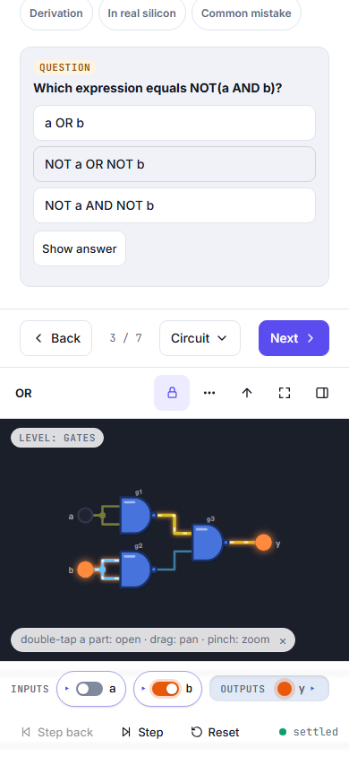

## Keys and gestures

Press **?** on any page for its keys. On a chapter step:

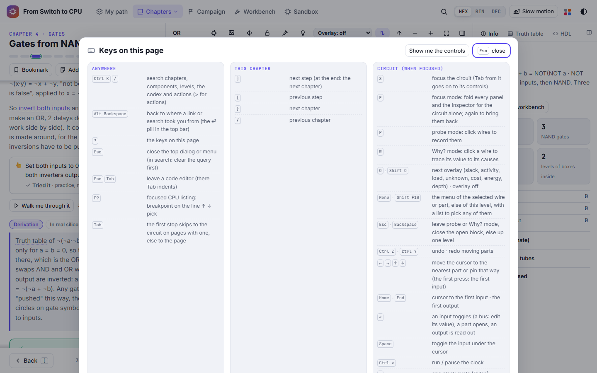

| Key | What it does |
| --- | --- |
| **]** / **[** | next / previous step |
| **}** / **{** | next / previous chapter |
| **Ctrl K** or **/** | search chapters, components, levels, the codex and actions |
| **S** | focus the circuit |
| **F** | focus mode: fold every panel for the circuit alone; again to bring them back |
| **P** / **W** | probe mode / Why? mode |
| **O** · **Shift O** | next overlay · overlay off |
| **Esc** · **Backspace** | leave probe or Why? mode, close the open block, else up one level |
| arrow keys | move the cursor to the nearest part or pin that way |
| **Home** · **End** | cursor to the first input · the first output |
| **Enter** | on an input: toggle it (a bus: edit its value); on a part: open it; on an output: read it out |
| **Space** | toggle the input under the cursor |
| **Ctrl Enter** | run / pause the clock |
| **.** | one clock cycle (Pulse) |
| **>** · **,** | one gate delay forward · back one step |
| **+** · **−** · **0** | zoom in (opens the part under the cursor) · zoom out · fit |
| **Menu** · **Shift F10** | the menu of the selected wire or part, else of this level |
| **Ctrl Z** · **Ctrl Y** | undo / redo moving parts |
| **Alt Backspace** | back to where a link or search took you from |

Mouse and touch on the circuit: double-click (double-tap) a part to open it; drag the background to pan; wheel or pinch
to zoom; drag a part or a wire to move it; right-click for its menu.

## If something looks wrong

- **I am lost deep inside a part.** Click the first name in the bar above the circuit, or press **Esc** until you are
  back at the top.
- **The text pane or the inspector is gone.** You may have hidden the side panes: click **Hide the side panes** again
  (at the right end of the bar above the circuit), or press **F** if you used focus mode.
- **I moved a part by accident.** **Ctrl Z** undoes it; **Layout** can reset this level; the padlock (**Lock the
  layout**) stops parts moving.
- **The circuit keeps changing by itself.** A step with a clock starts running at two cycles a second. **Pulse** or
  **Step** in the bar under the circuit pauses it, and so does **Ctrl Enter**.
- **Scrolling over a 3D model scrolls the page.** Click the model once first; then the wheel zooms it.
- **A part opened when I only wanted to zoom.** That is **Open blocks as you zoom**: zoom back out and it closes. Turn
  it off in **View options** › **Behaviour** if you prefer to open parts only by double-clicking.

Next: [The campaign](campaign.md)
