# The sandbox

[← Back to the manual](README.md)

## What it is for

The sandbox is a free circuit editor. You place parts, wire them, run the circuit, and package what you built as a chip
that you can place in your next circuit, all the way up to a whole computer. Use it when you want to build something
of your own, try an idea from a chapter, or open one of the ready-made examples and take it apart. The journey explains,
the campaign sets you goals with rules, the workbench shows the library's parts one at a time; the sandbox is where you
build without rules. Everything you make is saved in your browser as you go.

## Quick start

You will place a NAND gate, wire two inputs and an output to it, try it, and package it as a chip of your own.

1. On any page, click **Sandbox** in the top bar.

   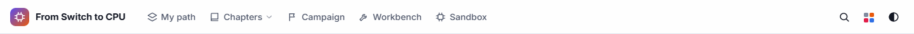

   The first time, a short tour of the screen starts (**1 of 5 · Parts**). Click **Next** to follow it, or **Skip the
   tour** (or press **Esc**) to go straight on.

   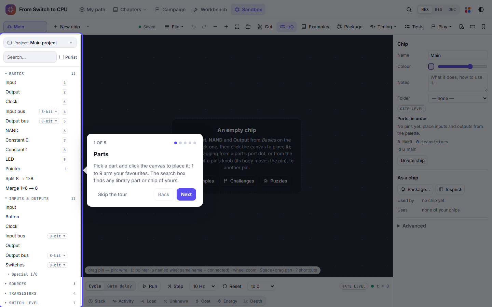

2. You see an empty chip called **Main**: the parts list on the left, the canvas in the middle, the chip's properties on
   the right, and the run bar at the bottom.

   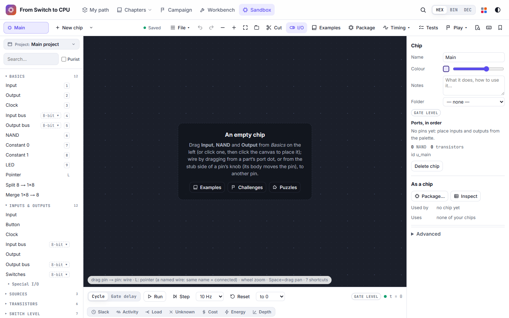

3. In the parts list under **Basics**, click **NAND**, then click on the canvas. The gate appears where you clicked.
   (The hints on the right now say its inputs are not connected: they read X, unknown.)

   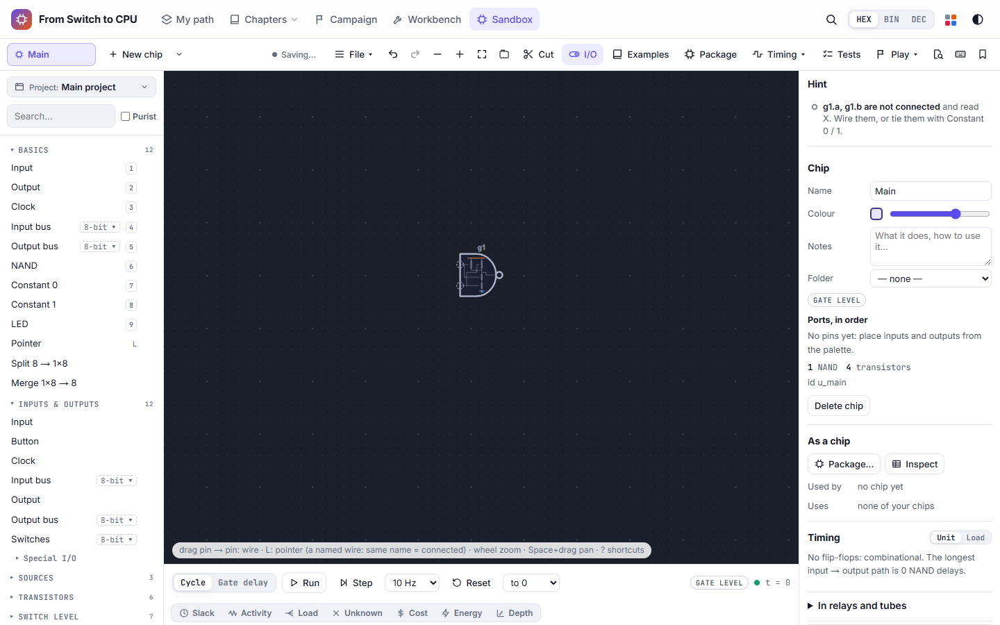

4. Click **Input** and click on the canvas to the left of the gate; do it again a little lower for a second input. Then
   click **Output** and click to the right of the gate. They are named **in1**, **in2** and **out1**.

   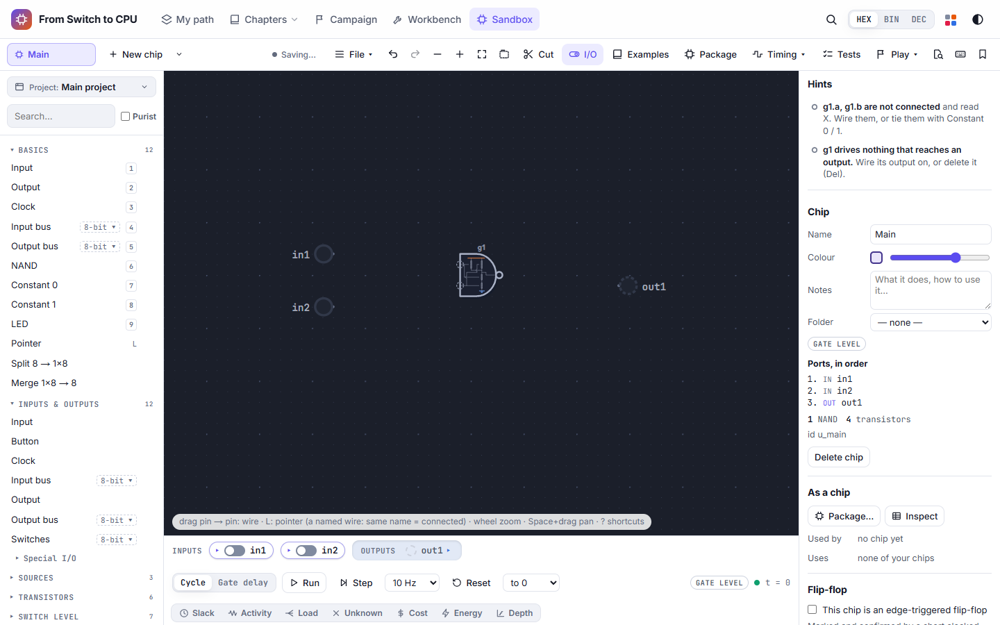

5. Draw the wires: press on the right-hand edge of **in1**'s round knob and drag to the gate's top input, then release.
   Do the same from **in2** to the gate's bottom input, and from the gate's output to the left edge of **out1**'s knob.
   With both inputs at 0, the output lights up: a NAND gives 1 unless both inputs are 1.

   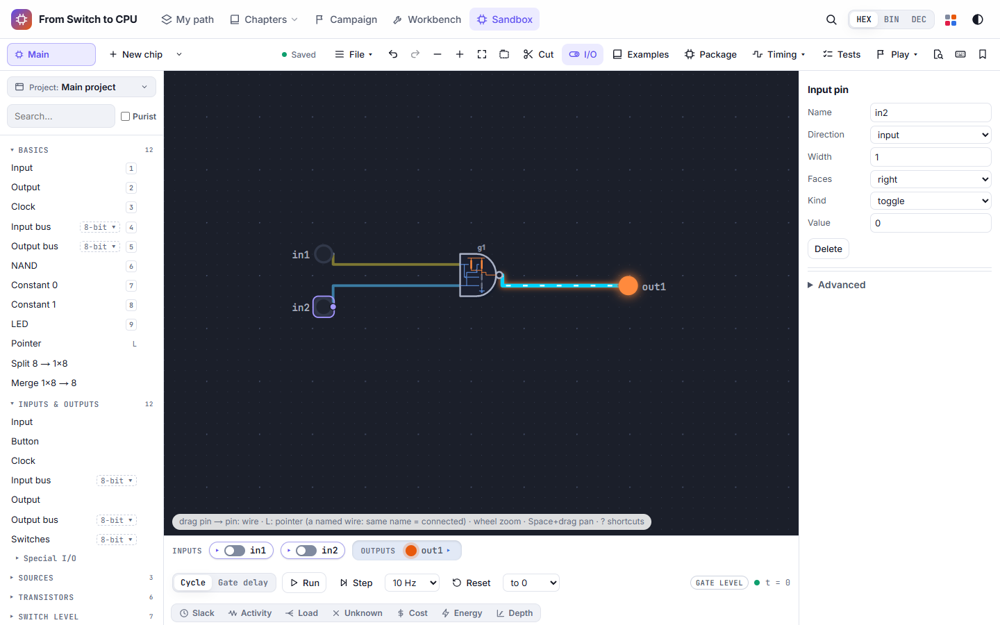

6. Click **in1**'s knob, then **in2**'s knob, to switch each to 1. The output goes dark: 1 NAND 1 is 0. (The same
   switches sit in the bar under the canvas, under **Inputs**.)

   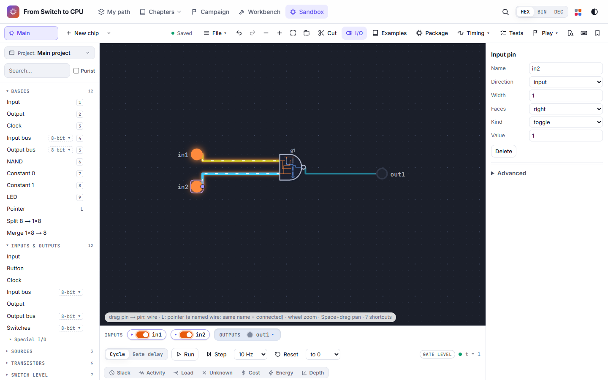

7. Click **Package** in the toolbar. The **Package as chip** dialog shows the box your circuit will become, with its pins
   on the edges.

   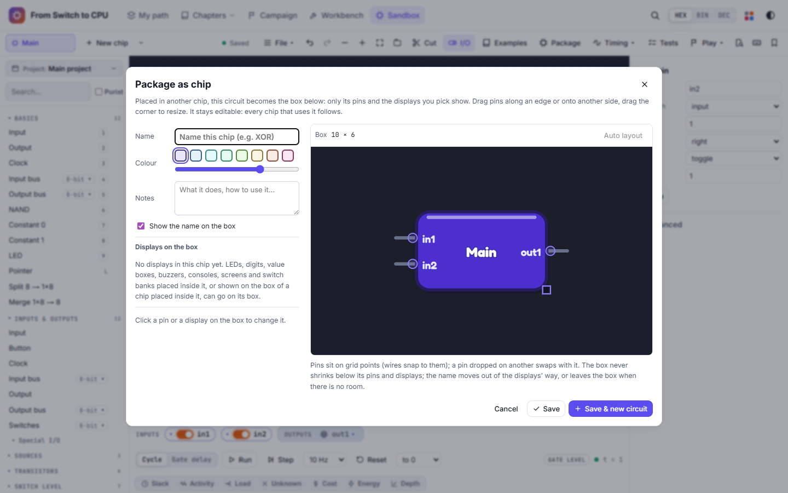

8. Type a name in the **Name** box, for example *My NAND*, and click **Save & new circuit**. A message says the chip is
   in the palette under **My chips**. The first tab now carries the chip's new name, **My NAND**, and a new empty chip
   opens beside it as **Chip 2**.

   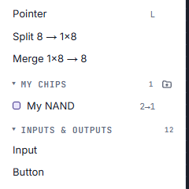

9. In the parts list under **My chips**, click **My NAND**, then click on the canvas. Your chip is now a part like any
   other, with **in1**, **in2** and **out1** on its box.

   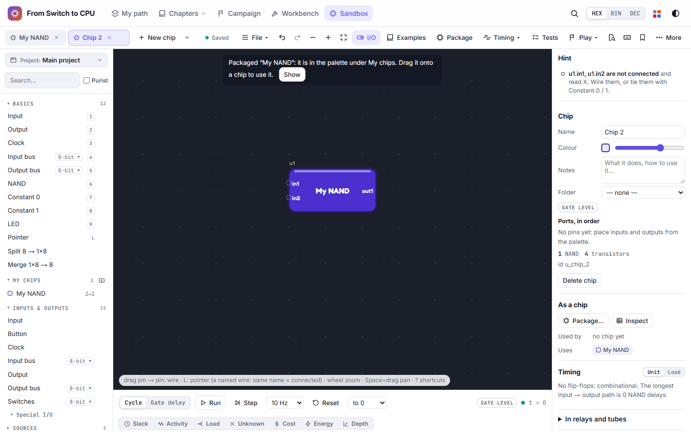

That is the whole cycle: build, try, package, reuse. Every part you place can be opened again: double-click it to look
inside (see [Look inside a part](#look-inside-a-part)).

## The screen

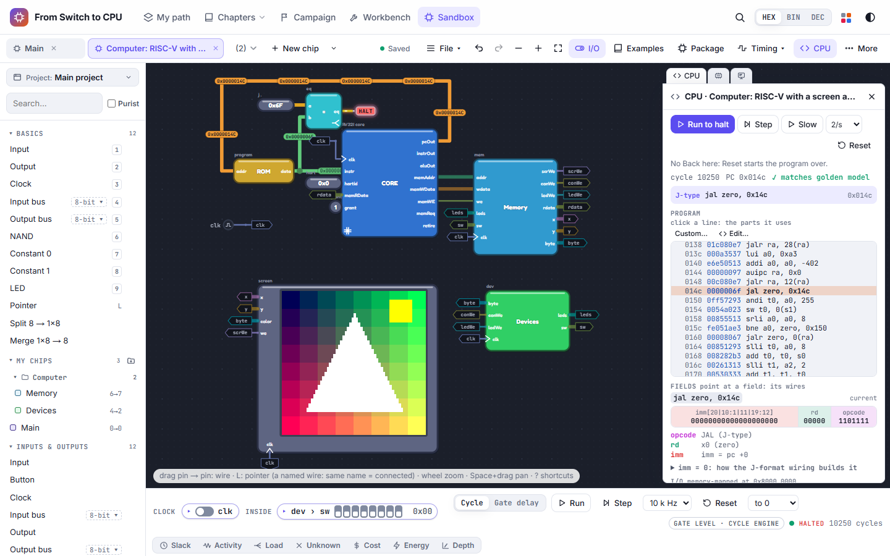

- **Top bar**: the site's sections, search (magnifier), the number base for bus values (**HEX**, **BIN**, **DEC**),
  view options and the theme.
- **Tabs and toolbar** (second row): your open chips as tabs, **New chip** (and the arrow beside it for other kinds of
  chip), the save state (**Saved**), **File**, undo / redo, zoom out / in, **Fit to screen**, the section tool, **Cut**,
  **I/O**, **Examples**, **Package**, **Timing**, **Tests**, **Play**, the inspector, the keys sheet (**?**) and the
  bookmark. On a narrow window the least used of these move into **More**.
- **Left**: the project switcher (**Project: Main project**), the parts search, **Purist** (only NAND and the parts
  built from it), and the parts list in groups.
- **Middle**: the canvas. A line of hints along its bottom edge names the basic gestures.
- **Right**: the properties of what is selected (or of the chip), with hints about problems at the top. Drawers such as
  **CPU**, **Memory** and **Screens** open here too, as tabs.
- **Bottom**: the **I/O** bar (the chip's inputs to switch and outputs to read), then the run bar (**Cycle** / **Gate
  delay**, **Run**, **Step**, the speed, **Reset**, the power-on state) and the overlays (**Slack**, **Activity**,
  **Load**, **Unknown**, **Cost**, **Energy**, **Depth**).

## How to …

### Place, move and delete parts

1. Click a part in the parts list, then click on the canvas. Hold **Shift** while you click to place several.
2. Or press a number key **1** to **9** (the numbers beside the **Basics** parts) to arm that part, and click or press
   **Enter** to place it.
3. Drag a part to move it. Drag on empty canvas to select several with a rubber band; **Shift** + click adds to the
   selection.
4. **Delete** or **Backspace** deletes the selection. **R** turns it a quarter turn, **F** flips it left to right.
5. Click the ☆ beside a part in the list (**Add to favorites**) to mark it as a favourite.

### Wire parts together

1. Press on a pin's knob (on the side its wire leaves from) or on a part's port, and drag to another port. Release on
   the target.
2. To make corners, click on empty canvas while drawing; **Backspace** removes the last corner, **Esc** cancels.
3. To branch, end a new wire on an existing wire, or hold **Ctrl** (or **Alt**) and drag from a wire.
4. Drag a wire to reshape it; double-click a corner to take it out.
5. **Cut** (**K**) lets you drag a line across wires to cut them.

### Use pointers (named wires)

A pointer is a wire by name: every pointer with the same name is the same wire, so you can connect distant places
without drawing a long wire.

1. Press **L** (or click **Pointer** in **Basics**) and place it on a port.
2. Give it a name (**F2**), and place another pointer with the same name where the signal should arrive.
3. Click a pointer's name flag to jump to the next pointer with that name.

### Rename, undo and redo

- Select a part, pin or pointer and press **F2**, or click its name once it is selected, to rename it where it is drawn.
  The name is also in the properties on the right.
- **Ctrl Z** undoes, **Ctrl Y** or **Ctrl Shift Z** redoes (or the arrows in the toolbar). A drag is one step.

### Use the right-click menu

Right-click a part, a wire or empty canvas to see what you can do with it. On a part: start a wire from one of its pins,
**Rename**, **Look inside**, **Inspect**, **Measure**, **Explain**, **Take it elsewhere**, **Flip**, **Rotate clockwise**,
**Rotate anticlockwise**, **Group in a section**, **Duplicate**, **Copy**, **Cut** and **Delete**, each with its key. On
a touch screen, press and hold.

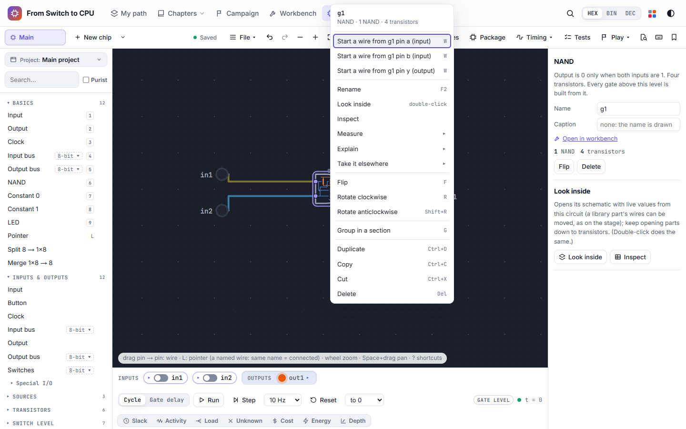

### Use pins and buses

- **Input** and **Output** are 1-bit pins. **Input bus** and **Output bus** carry several bits: pick the width on the
  part (the **8-bit ▾** tag) before placing it, or in its properties afterwards.
- Click a 1-bit input to toggle it; click a bus input to type its value.
- The **Wiring** group has splitters and mergers (for example **Split 8 → 1×8**, **Merge 8×4 → 32**) to cut a bus into
  wires or bytes and join them again. They cost nothing: they are only wiring.
- **HEX**, **BIN** and **DEC** in the top bar choose how bus values are written.

### Run a circuit

- A circuit without a clock simply follows its inputs: change an input and the outputs follow.
- **I/O** in the toolbar shows or hides the bar of the chip's pins above the run bar: click an input there to change it.
- A chip with a **Clock** pin runs on the run bar: **Run** starts it (or **Ctrl Enter**), **Step** (or **.**) does one
  clock cycle, the speed box sets cycles per second, **Reset** powers it on again.
- **Cycle** runs one whole clock cycle at a time (fast); **Gate delay** steps one gate delay at a time, so you can watch
  a signal travel. The box after **Reset** chooses what storage holds at power-on.
- The overlays below the run bar colour the circuit by **Slack**, **Activity**, **Load**, **Unknown** values, **Cost**,
  **Energy** or logic **Depth** (**O** cycles through them).

### Look inside a part

1. Double-click any library part (or the right-click menu’s **Look inside**). Its circuit opens beside yours, with live values,
   driven by your circuit.
2. Double-click a part inside it to go one level deeper; the path is shown at the top (**INSIDE**). You can go all the
   way down to transistors.
3. **Why?** traces the selected wire's value back to what caused it. **Close** (or **Esc**) goes back.

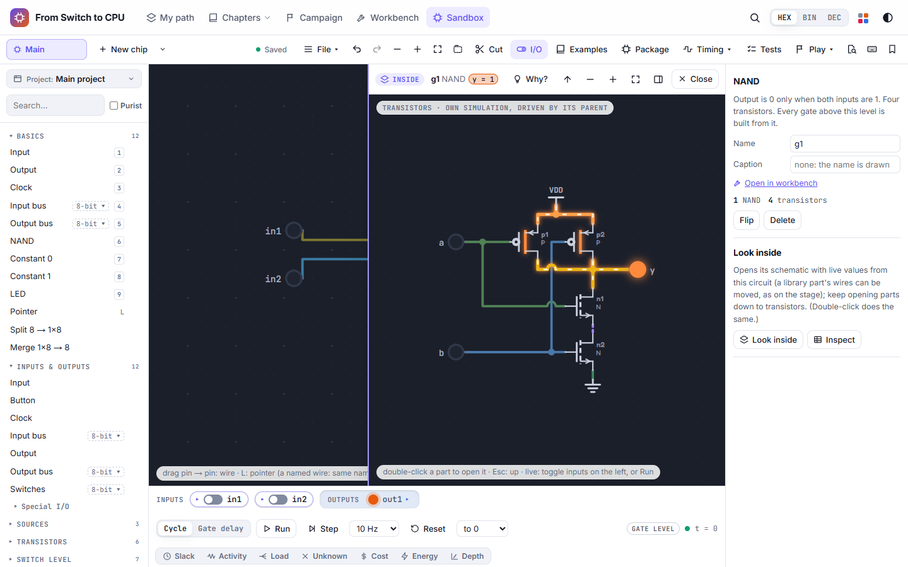

### Inspect a part: its cost, truth table and Verilog

1. Select a part on the canvas (or nothing, for the chip itself).
2. Click the inspector button in the toolbar (**Inspect the selected part, or this chip**). A drawer opens on the right
   with three tabs:
   - **Info**: what the part is, its cost in transistors and NAND gates, its worst-case delay, its pins and their
     values, and **Open on workbench**;
   - **Truth table**;
   - **HDL**: the part as Verilog.
3. Close it with its **×**.

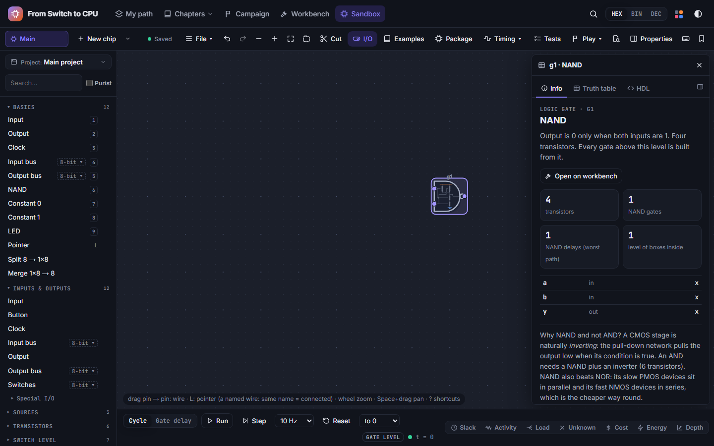

### Package a chip and edit its face

1. Click **Package** (or **Package…** in the chip's properties).
2. Set **Name**, **Colour** and **Notes**. Untick **Show the name on the box** to hide the name.
3. In the box preview, drag a pin along an edge or onto another side; a pin dropped on another swaps with it. Drag the
   square at the bottom-right corner to resize the box (the size is shown as **Box** at the top of the preview).
   **Auto layout** puts everything back.
   A pin you click or drag is selected: under **Pin** you can also send it to **Left**, **Top**, **Right** or **Bottom**,
   and the arrow keys nudge it along its edge.

   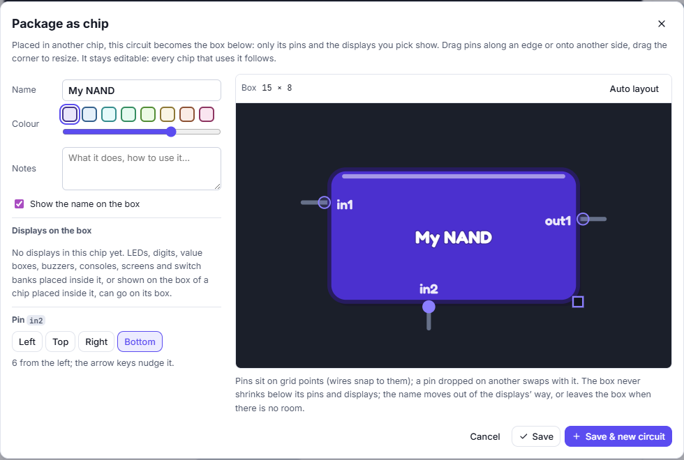
4. Under **Displays on the box**, tick the LEDs, digits, screens or switch banks inside the chip that should show on its
   box, then move and scale them on the preview.
5. **Save**, or **Save & new circuit** to start the next chip at once. The chip stays editable: every chip that uses it
   follows your changes.

### Change a chip you packaged

1. Double-click your chip where it is placed (or click its tab, if it is open). It opens for editing, and the toolbar
   shows the way back: **Back** · *the chip you came from* › *your chip*.
2. Change it like any circuit. Here an output **out2** was added.

   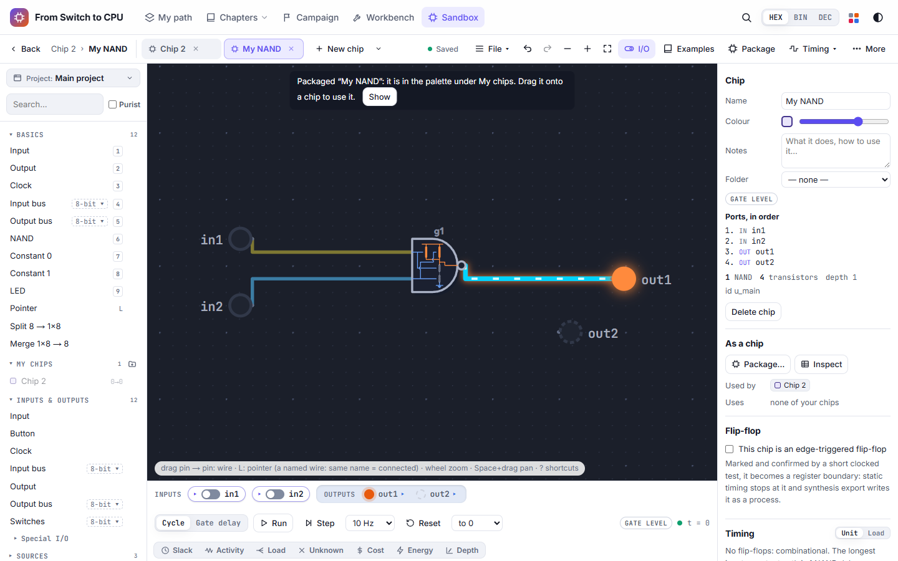

3. Click **Back**. Every place the chip is used follows at once: the box now has **out2** too. Its properties list
   where it is used, under **Used by**.

   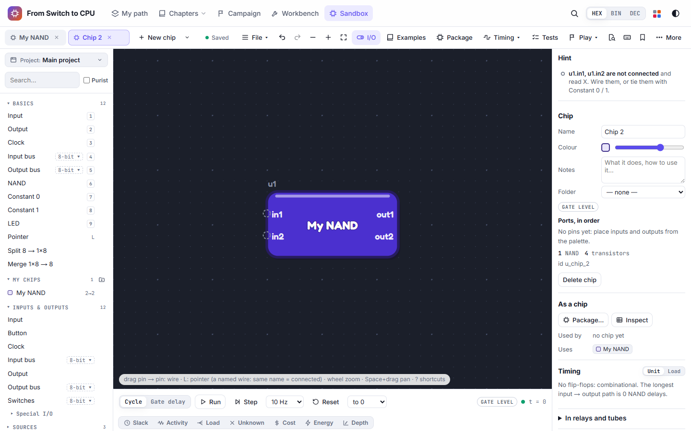

### Start other kinds of chip

The arrow beside **New chip** offers:

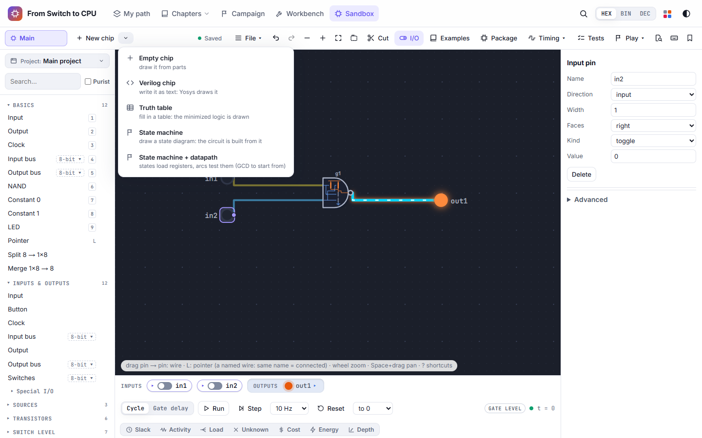

- **Empty chip**: draw it from parts.
- **Verilog chip**: write it as text; it is synthesized and drawn for you.
- **Truth table**: fill in a table; the minimized logic is drawn.
- **State machine**: draw a state diagram; the circuit is built from it.
- **State machine + datapath**: states load registers, arcs test them (it starts from a GCD example).

Each of these keeps its own editor beside the canvas: the drawing is made from it, and the banner over the canvas says
so. **Detach as drawn chip** turns it into an ordinary drawn chip; **Hide table** (**Hide machine**, **Hide text**)
folds the editor away.

#### Make a truth-table chip

1. **New chip ▾** › **Truth table**. It starts with inputs **a**, **b**, **c** and output **y** (a majority function).
2. Click a cell in the **y** column to cycle it 0 → 1 → – (don't care), or type 0, 1 or - in it. The **Karnaugh map**,
   the **Minimized** equation and its cost in NAND gates follow at once, and so does the circuit.
3. Or type an expression after **y =** (for example `a·b`) and click **Fill**.
4. **+ Input** / **+ Output** add columns; **NAND**, **AND–OR**, **PLA** or **ROM** choose how the circuit is built.

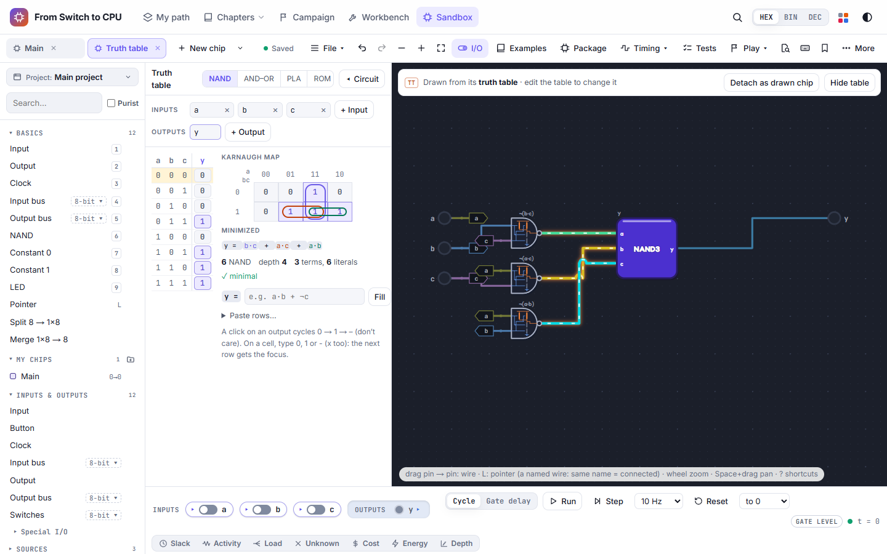

#### Make a state-machine chip

1. **New chip ▾** › **State machine**. It starts with three states, input **x** and output **y**; the chip also gets
   **rst** and **clk**.
2. Click **+ State**, then click in the diagram to add a state. A drag from a state's rim to another state adds an arc (or use
   **Arc**); double-click empty space for a new state, a state to rename it; right-click for more.
3. Select a state or an arc to set its outputs and conditions underneath.
4. Under **Encoding**, compare **Binary**, **Gray** and **One-hot**: each is built and its cost counted.

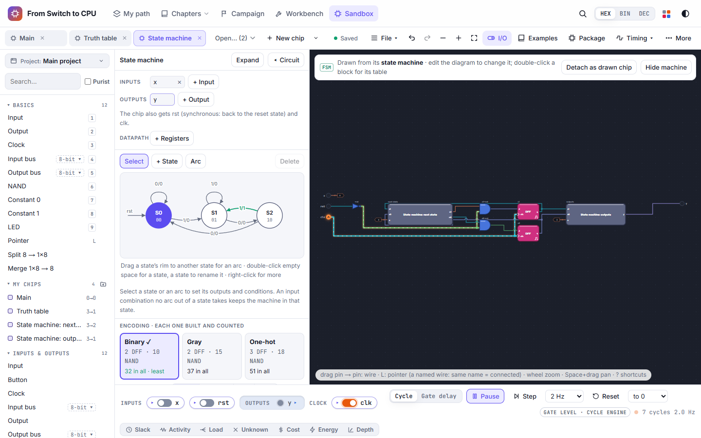

#### Make a Verilog chip

1. **New chip ▾** › **Verilog chip**. A small module opens in the text pane on the left.
2. Edit the text. It is synthesized a moment after you stop typing (or click **Synthesize**), and the drawing on the
   right is replaced; **synthesized** and **No problems.** show it worked, with the cells used underneath.
3. Every module becomes a chip; the ports are the chip's pins.

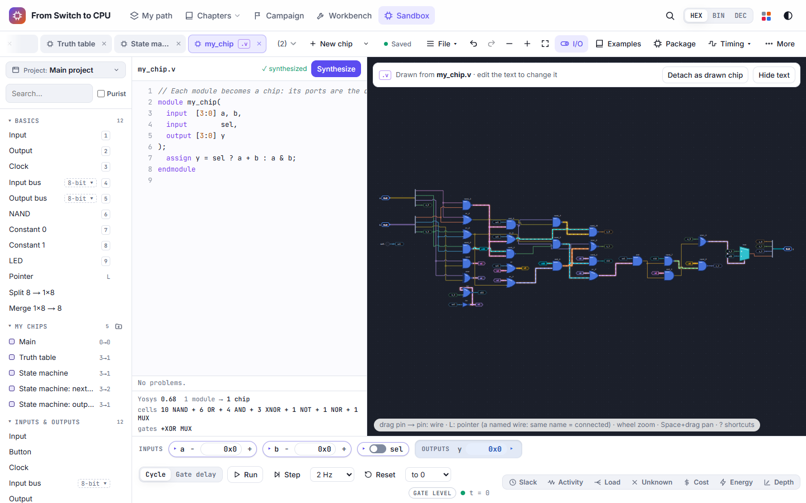

### Find a part in the parts list

The groups are **Basics**, **My chips** (once you package one), **Inputs & outputs** (pins, buttons, clocks, switches,
and under **Special I/O** the key, the keyboard, the puzzle ports and the card reader), **Sources** (cycle counter, random source, timer),
**Transistors**, **Switch level** (resistors, pull-ups and pull-downs, capacitors, transmission gates,
tri-state parts), **Relays and tubes**, **Constants**, **Displays** (with the console and the screen), **Wiring**, **Memory**, **Processor
cores**, **Communication** and **Library** (every gate, adder, register and larger block of the site). Type in **Search…**
to find a part by name. Tick **Purist** to see only NAND and what you have built from it.

### Program a ROM and use RAM

- In **Memory**, **ROM (words)** is a lookup table written as hex words; **Program ROM (RV32)** holds a RISC-V program;
  **RAM** is read-write memory. Their size and contents are in the properties.
- To write a ROM's program, open its program editor with the **Edit…** button in the CPU drawer.
  Type assembly in **Text**; **Tiles** shows each instruction as a tile you can drag to reorder.
- **Build instruction** opens the instruction builder under the editor: pick an instruction, set its operands or click
  its bits, and see which parts of the CPU it uses. **Replace line** or **Insert below** puts it in the program.
- **Apply** writes the program into the ROM; **Save as deck** and **Load deck…** use punched-card decks.

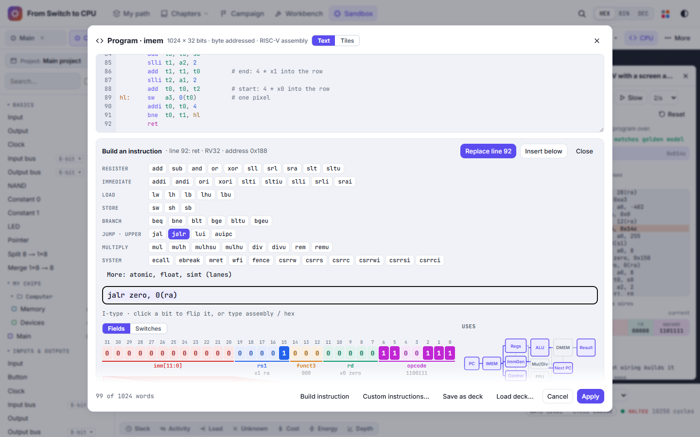

### Show results and take input: displays, keys, console, screen and switches

- **Displays** has **LED**, **LED bank**, **7-segment**, **Hex digit**, **Value**, **Buzzer**, **Halt** (stops
  **Run** when its input is 1), **Console** (prints a character at each clock edge) and **Screen** (a pixel screen you
  write by x, y and colour).
- **Inputs & outputs** has **Switches** (a bank of toggles), and under **Special I/O** **Key** (1 while a chosen key is
  held) and **Keyboard** (typed keys wait in order).
- When a chip has a console, screen or switch bank, even deep inside, the **Screens** drawer shows them all live, with
  **Clear** and **PNG**.

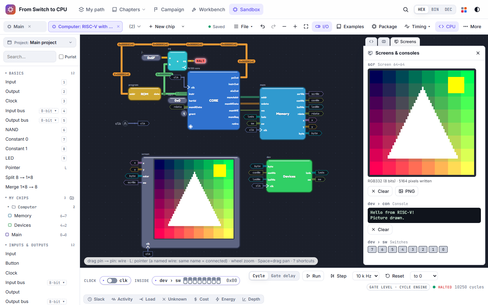

### Open an example

1. Click **Examples** in the toolbar. The gallery is grouped into **First circuits**, **Whole computers**, **RISC-V
   widths** and **Circuit techniques**.
2. Type in **Search examples** to filter, or use the arrow keys between cards.
3. Click a card. It opens as a new chip; your own chips are untouched. Cards marked **CPU drawer** open with the CPU
   drawer.

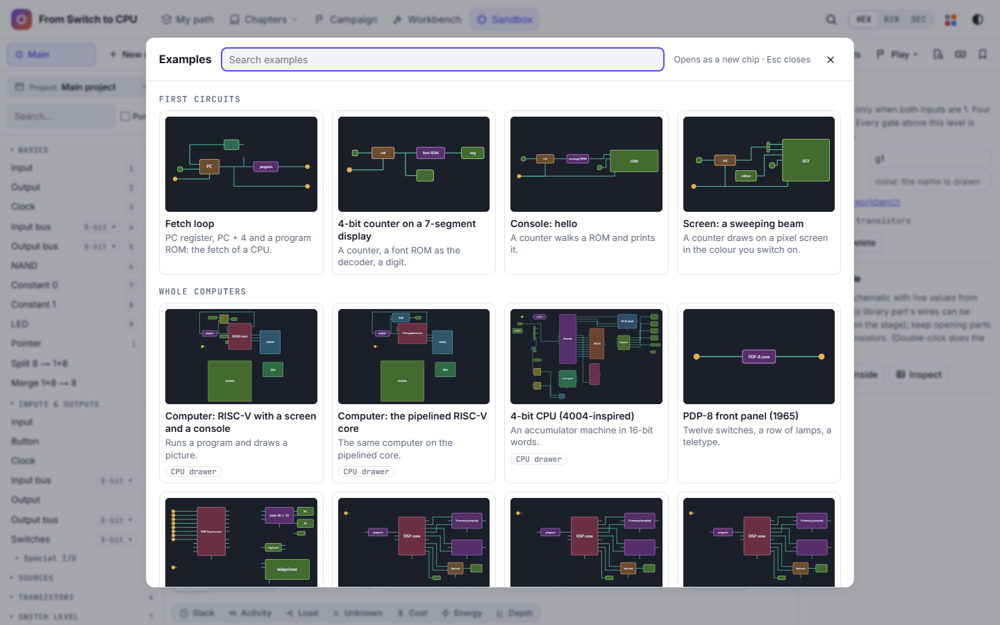

### Run a program with the CPU drawer

When a chip holds a complete CPU and its program ROM (try **Examples** › **Computer: RISC-V with a screen and a
console**), the **CPU** drawer opens on the right on a wide window (on a narrow one, click **CPU** in the toolbar).

1. **Run to halt** runs the program to its end; **Step** runs one instruction; **Slow** runs at the rate beside it.
   **Reset** starts the program over.
2. The listing marks the current instruction; click a line to light the parts it uses on the circuit. Click the dot at
   the start of a line to set a breakpoint there.
3. Under it: the instruction's fields, the registers and the memory. The drawer runs a reference model beside your
   circuit and says **matches golden model** while the two agree, or names the first difference.
4. **Edit…** opens the program editor; **Custom…** lets you add your own instructions to the core.

### Watch memories and screens in the drawers

The tabs at the top of the drawer area switch between **CPU**, **Memory** (the contents of every RAM and register file in
the chip, live: pick one at the top) and **Screens**. Each opens by itself on a wide window when the chip has something
to show.

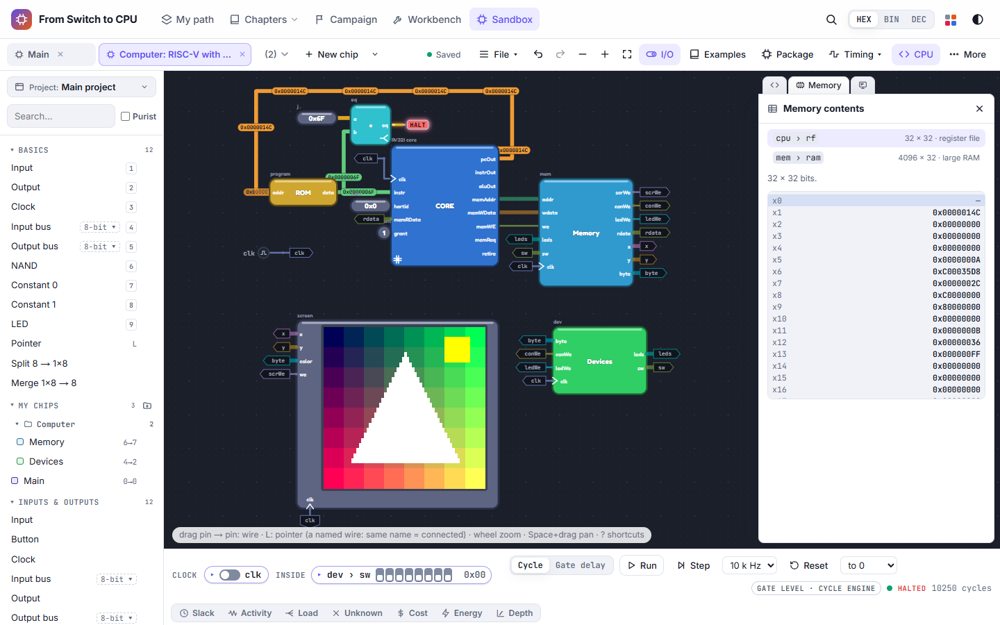

### Probe wires and use the timing panel

The timing panel draws chosen wires over time, gate delay by gate delay, like a logic analyser. To try it, open
**Examples** › **4-bit counter on a 7-segment display** (it starts counting by itself).

1. **Timing ▾** › **Timing panel**. A panel opens under the canvas; it records only while it is open.
2. **Timing ▾** › **Probe mode** (or **P**), then click the wires you want to watch. Each gets a coloured flag with its
   name on the canvas and a lane in the panel; a bus shows its value in each stretch of time. **Esc** leaves probe mode.
3. Let it run, or press **.** to step. In the panel, a click sets cursor A, **Shift** + click cursor B; the wheel or a
   pinch zooms, a drag pans. **Live** follows the newest time.
4. **Clear probes** removes the lanes; **VCD** saves the recording for other waveform viewers.

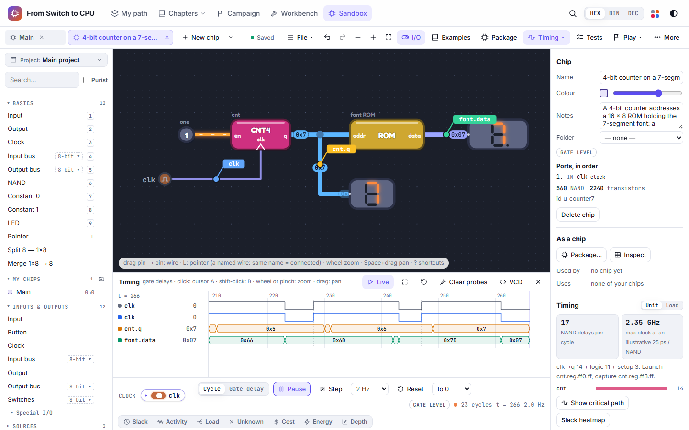

**Timing ▾** › **Fault brush** (**B**) breaks a wire, so you can see what depends on it.

### Write test tables

1. Click **Tests**. A pane opens under the canvas with a table of the chip's inputs and expected outputs (it starts with
   one row whose expected values are X, unchecked).
2. Write rows in the text beside the table, in the test syntax of the Digital simulator.
3. **Fill outputs from the circuit** copies what the circuit does into the expected column. **Run all** checks every
   table; **Run on every edit** keeps checking as you change the circuit.

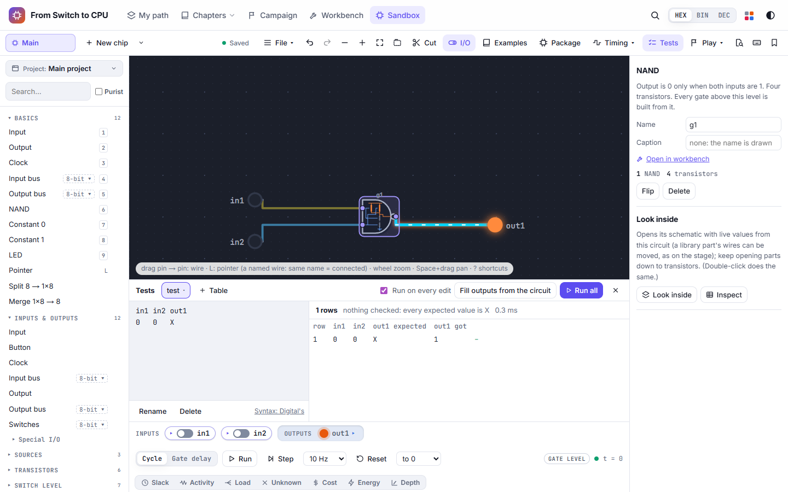

### Take on a challenge or a puzzle

Both are optional, and every one has an answer you can look at.

#### Build a chip for a challenge and check it

1. **Play ▾** › **Challenges**. The list opens on the right, grouped by topic, each group with its rule (for example
   **NAND only**) and your count of solved ones.

   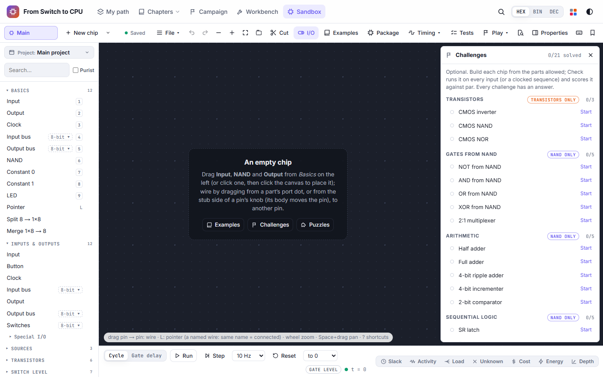

2. Click **Start** beside one, for example **NOT from NAND**. A new chip opens with its pins already placed (**a** and **y**), the parts
   list limited to what the rule allows (**Purist** is ticked), and a strip under the canvas with the task, **Check**,
   **Show answer** and **Do it for me**.
3. Build something, and click **Check**. If it is wrong you see **Not yet**, the input combinations that fail, and the
   test player under it: step through the cases (**previous failure**, **next failure**, play at a rate), each showing
   what the circuit gave against what was wanted.

   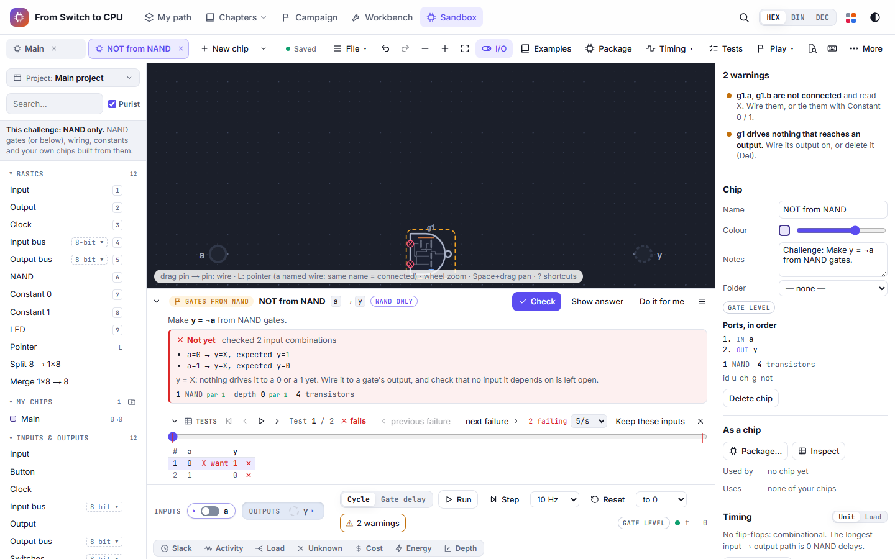

4. Fix it (for a NOT from a NAND: wire **a** to both of the NAND's inputs and its output to **y**) and click **Check**
   again. **Passes** shows with your cost against par: NAND gates, depth and transistors.

   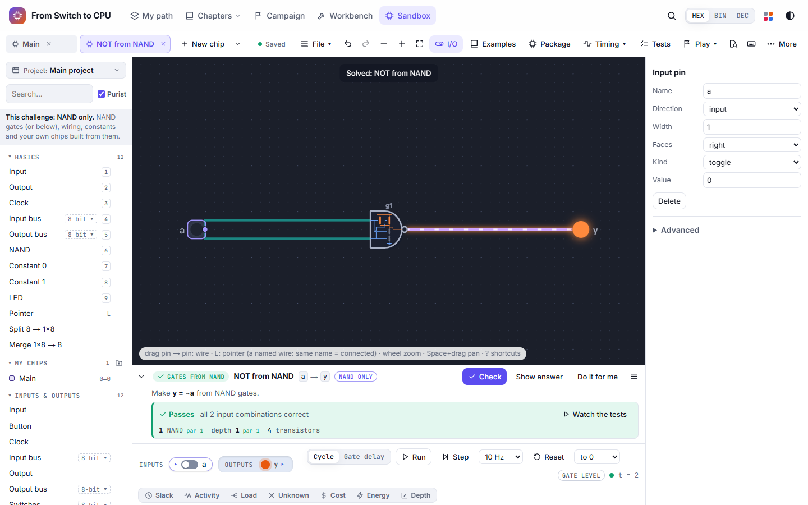

#### Write a program for a puzzle

1. **Play ▾** › **Puzzles**. Each puzzle turns streams of input words into output words (**Echo**, **Countdown**,
   **Multiply**, **Sort**, …).

   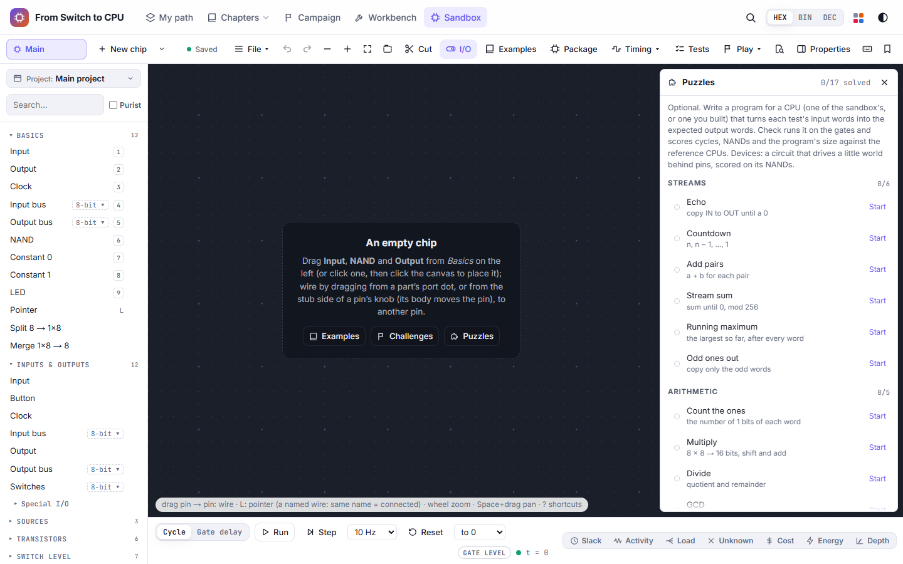

2. Click **Start** beside one, for example **Echo**, and choose the computer that will run it (a ready-wired 4-bit, RV16
   or RV32I computer).
3. The puzzle opens as a chip with its computer, and a strip under the canvas: the task, how the program reads input and
   writes output, the tests, **Check**, **Show answer**, **Do it for me**, **Start over…**, and a chart of cycles against NAND gates with
   the reference CPUs on it.

   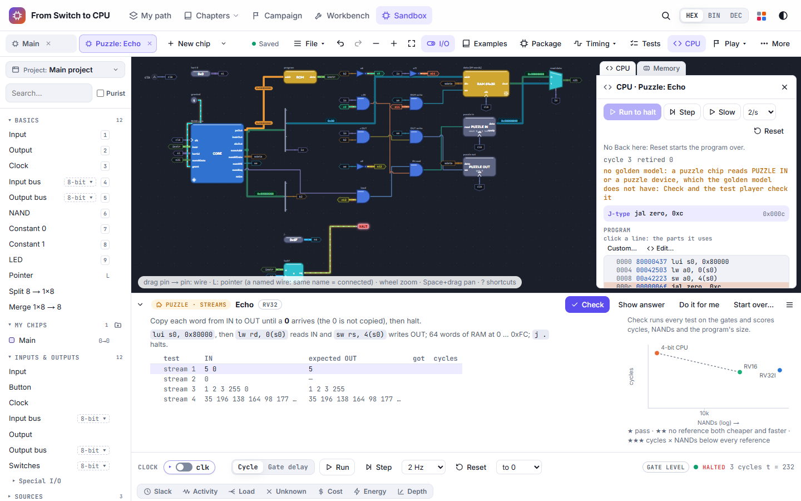

4. Write the program in the ROM (**Edit…** in the CPU drawer), then click **Check**: every test runs on the gates, each
   row is ticked or crossed, and you are scored on cycles, NAND gates and program words. (**Do it for me** loads the
   reference program after asking to **Replace** yours; it passes but earns no stars.)

   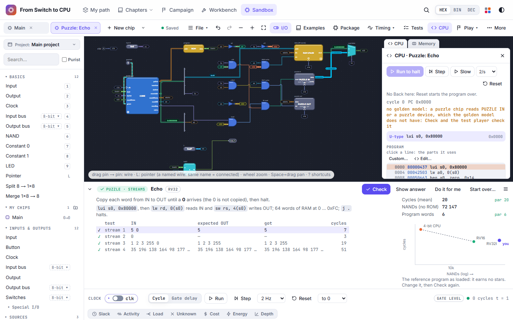

### Label your circuit with sections and comments

- Select some parts and press **G** (or the section button in the toolbar) to put a titled frame around them. Drag the
  frame's border or title to move it with what is inside; double-click the title to rename it. **Delete** removes only
  the frame.
- Press **T** to place a comment: free text on the canvas, saved with the chip, never part of the circuit. Double-click
  it to edit.

### Find your way with the minimap

Press **M** to show or hide the minimap at the bottom right of the canvas. It hides itself while the whole chip is in
view. Drag its frame to pan, or click to jump.

### Organise chips in projects and folders

- **Project: Main project** above the parts list switches between projects: separate sets of chips. Its menu has **New
  project**, **Duplicate**, **Rename…**, **Export this project**, **Import a file as a new project** and **Delete this
  project…**. Campaign levels always open in the first project.
- In **My chips**, the folder button makes a folder; drag chips onto a folder to file them.

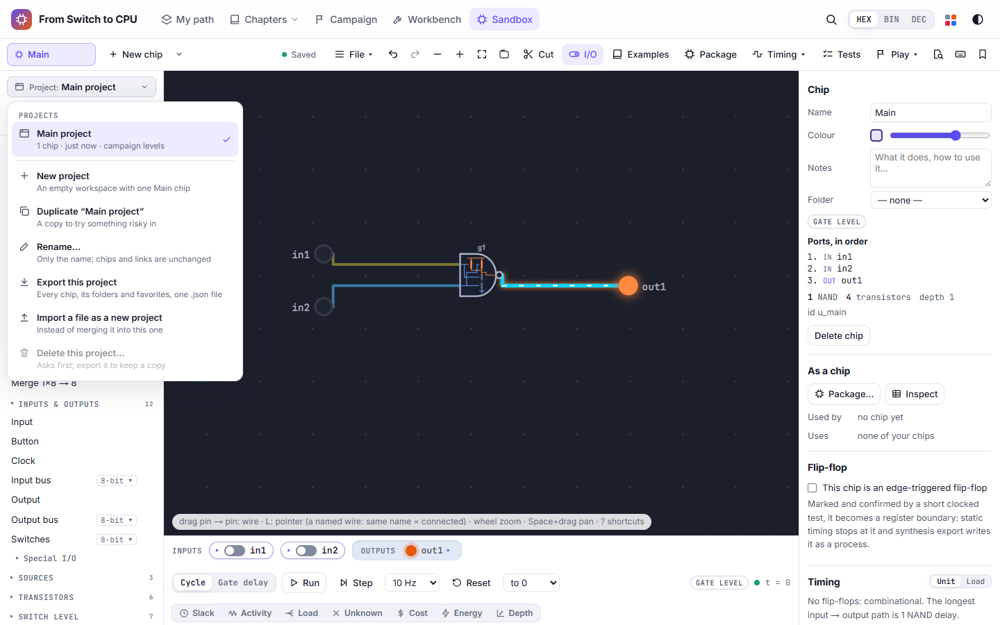

### Save, share and export your chips

**File ▾** has:

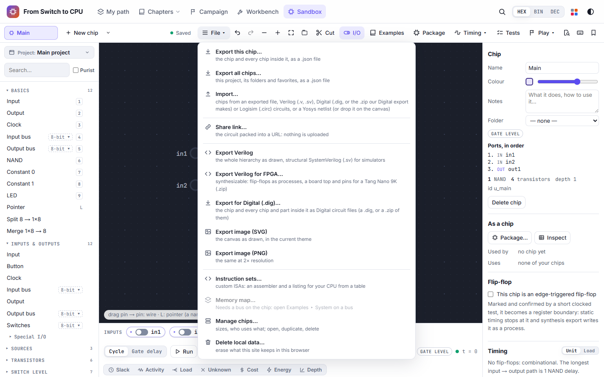

- **Export this chip…** and **Export all chips…**: a .json file to keep or send.
- **Import…**: chips from such a file, Verilog (.v, .sv), Digital (.dig) or Logisim (.circ) circuits, or a Yosys netlist.
  You can also drop the file on the canvas.
- **Share link…**: the circuit packed into a link. Nothing is uploaded; whoever opens the link gets a copy.
- **Export Verilog**, **Export Verilog for FPGA…** (a .zip ready for a Tang Nano 9K board) and **Export for Digital
  (.dig)…**.
- **Export image (SVG)** and **Export image (PNG)**.
- **Instruction sets…** (your own instruction sets), **Memory map…** (on a chip with a bus), **Manage chips…** and
  **Delete local data…**.

#### Save a chip to a file and bring it back

1. Open the chip, then **File ▾** › **Export this chip…**. Your browser saves a file named after the chip, ending in
   `.chip.json`, holding the chip and every chip inside it.
2. To bring it back (on another computer, or after clearing the browser), **File ▾** › **Import…** and pick the file, or
   drop it on the canvas. A summary says what was added. Nothing is overwritten: a chip identical to one you have is
   listed under **Already here** and not added twice.

#### Send a circuit as a link

1. Open the chip, then **File ▾** › **Share link…**. A dialog shows the link; **Copy** copies it to the clipboard.
2. Send it. Whoever opens it gets a copy of the chip and the chips inside it, and chooses whether to import it. The
   circuit travels inside the link itself: nothing is uploaded.

#### Export Verilog for an FPGA board

What it is: the chip as synthesizable Verilog with a top module and pin constraints for a Sipeed Tang Nano 9K board,
ready for Gowin EDA, or for Yosys and nextpnr.

1. Open the chip (try **Examples** › **4-bit counter on a 7-segment display**).
2. **File ▾** › **Export Verilog for FPGA…**. The dialog says how many modules it writes, which sandbox parts (displays,
   switches) become ports of the top module, and which files the .zip holds.
3. Click **Download .zip**. Its README.txt says how to synthesize it. The pins are an example: check them against your
   board before programming it.

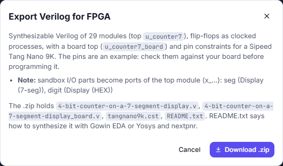

#### Write your own instruction set

What it is: an instruction set written as a table (each instruction's name, operands and bit pattern), so a ROM can be
programmed in your own assembly language for a CPU you built.

1. **File ▾** › **Instruction sets…**. On the left are read-only **Presets** (among them the 4-bit CPU and the PDP-8),
   and under **This sandbox** your own.
2. Pick a preset and click **Copy to edit**, or click **New**.
3. Edit the table on the **Instructions** tab (an encoding is written bit by bit: 0 and 1 fixed, a letter for an
   operand's bits); **Design** paints the patterns on a bit grid; the **Check** tab shows whether the table has
   problems (a tick when it has none).

#### Add your own instructions to the RISC-V core

What it is: up to three new instructions added to the single-cycle RISC-V core, each defined by the control signals it
sets; the core, the assembler and the reference model all learn them.

1. Open a chip with an RV32I core and its CPU drawer (for example **Examples** › **Computer: RISC-V with a screen and a
   console**), and click **Custom…** in the drawer.
2. Under **Add one, starting from**, click a starting point, for example **lwx: rd ← mem[rs1 + rs2]**.
3. Set its **Mnemonic**, **Format** and the signals (**write rd**, **ALU A**, **ALU B**, **ALU op**, **write memory**,
   **result**, **next PC**). The data path lights what it uses, and the bottom line gives the control unit's cost.
   **Apply** builds the core with it; your programs can then use it.

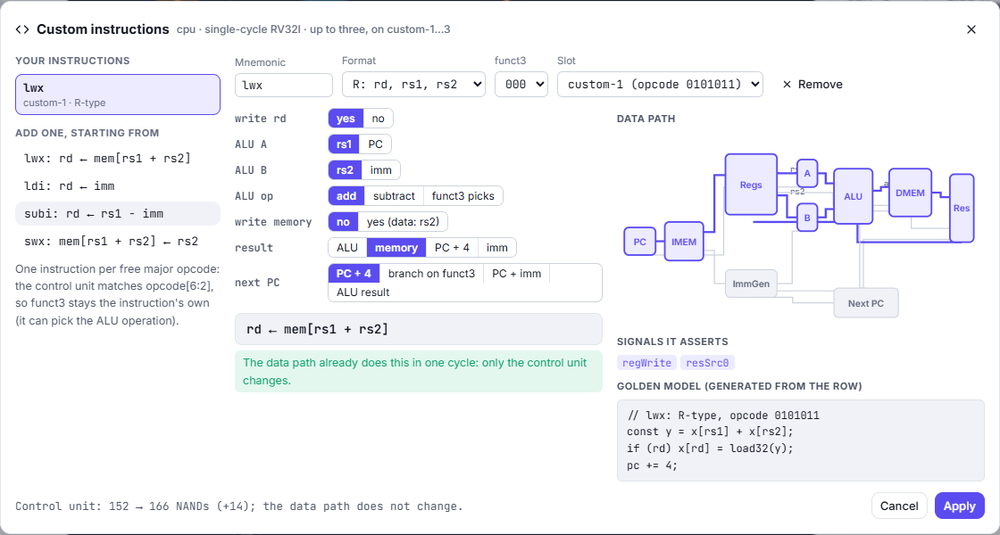

#### Rearrange the memory map

What it is: where each memory and device answers on a bus, as a map you can rearrange; the decoder is rebuilt from it.
It needs a chip with a bus: open **Examples** › **System on a bus** first.

1. **File ▾** › **Memory map…**. The map shows the 16 windows of 256 MiB the bus decodes (on address bits 31 to 28) and
   what sits in each.
2. Drag a new region (**RAM**, **Flash**, **DRAM**, **Screen**, **Keys + timer**) from **Drag onto the map** onto a
   free window. To move a region, drag it, or Tab to it and press ↑ ↓ (**Delete** removes it). Click a region to see its
   base address and window on the right; problems or **No problems** show under the map.
3. **Decoder** shows the address decoder the map makes; **Export** gives a C header and a linker script for your
   programs. The button at the bottom right applies the new map to the chip (it reads **Nothing to apply** until you
   change something).

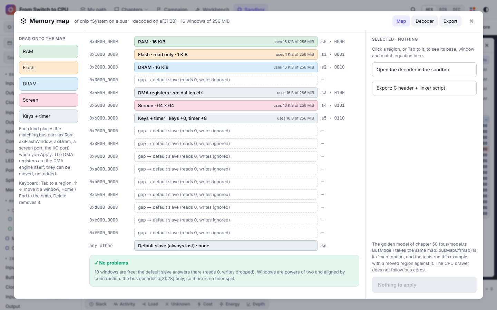

### Use the sandbox on a phone

On a narrow screen the parts list becomes a drawer, and the toolbar keeps its most used buttons (the rest are under
**More**).

1. Tap **Parts** at the top left. The parts list opens over the canvas.

   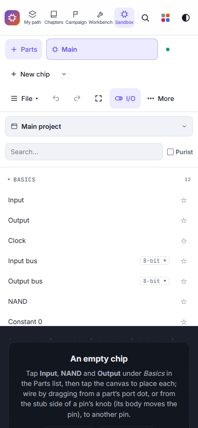

2. Tap a part, for example **NAND**. The drawer closes and a note says **Tap the canvas to place NAND**.
3. Tap the canvas: the part is placed. The run bar and the properties of what you selected sit under the canvas;
   scroll down to reach them.

   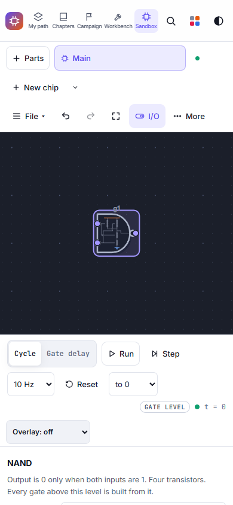

What differs on touch: drag from a pin's port dot to wire; press and hold for the menu (in place of a right-click);
double-tap a part to open it; pinch to zoom and drag with two fingers to pan. Buttons, rows and pins are larger so that
a finger can hit them.

## Keys and gestures

Press **?** in the sandbox for the full list. The most used:

| Key | Does |
|---|---|
| **1** … **9** | arm a part from **Basics** (**Shift**: several) |
| **L** · **T** | a pointer · a comment |
| **W** | start a wire from the pin under the cursor |
| **F2** | rename |
| **R** · **Shift R** · **F** | turn clockwise · anticlockwise · flip |
| **Del** | delete the selection |
| **Ctrl C** / **X** / **V** / **D** | copy · cut · paste · duplicate |
| **Ctrl Z** · **Ctrl Y** | undo · redo |
| **G** | group the selection in a section |
| **Ctrl Enter** · **.** | run / pause · one step |
| **P** · **K** · **B** | probe mode · cut tool · fault brush |
| **O** · **Shift O** | next overlay · overlay off |
| **M** | minimap |
| **+** · **−** · **0** | zoom in · out · fit |
| **Ctrl K** or **/** | search; type **>** for every toolbar action |

Mouse and touch: drag from a pin or port to wire; drag empty canvas to select; **Space** + drag, the middle button or two
fingers to pan; the wheel or a pinch to zoom; right-click (or press and hold on a touch screen) for a part's menu.

## If something looks wrong

- **A wire or output shows X (unknown).** An input somewhere is not connected. The hints at the top right name it: wire
  it, or tie it to **Constant 0** or **Constant 1**.
- **A wire did not connect.** Start the drag on the side of a pin's knob where its wire leaves; a drag from the far side
  moves the pin instead. Release exactly on a port: ports show as dots when you hover a part.
- **Nothing happens when I press Run.** A circuit without a **Clock** has nothing to run: it follows its inputs as you
  change them.
- **A drawer covers my circuit.** Close it with its **×**, or switch it with the tabs; **Fit to screen** (**0**) refits
  the view to the space that is left.
- **A key does nothing.** Keys go to the canvas only while you are not typing in a field; click the canvas first. A key
  that a **Key** part listens to drives that part instead while the chip is open.
- **I lost my work.** Chips are saved in this browser as you go (**Saved** in the toolbar). Use **File ▾** › **Export
  all chips…** to keep a copy elsewhere, and **Ctrl Z** to undo a mistake.

Next: [What works everywhere](everywhere.md)
