# The workbench

[← Back to the manual](README.md)

## What it is for

The workbench holds every part in the site's library on one bench. Use it to try any part on its own: from a single
transistor up to a whole processor. Set its inputs and see its outputs. Read what it costs in transistors, gates and
delay. Look at its truth table and its Verilog, and open it level by level down to transistors.

Come here when you already know which part you want to look at.
- To learn why a part is built the way it is, read its chapter (**Chapters**).
- To build it yourself against a check, play the **Campaign**.
- To draw your own circuit, use the **Sandbox**.

Everything on the workbench is read-only. Open in Sandbox gives you a copy you can change.

## Quick start

Two minutes: pick a part, change its size, try it, read its cost and truth table, and open it down to transistors.

1. On the top bar, click **Workbench**.

   

   The first time, two cards point out the controls ("1 of 2"); read them, or click **Skip the tour**.

   The workbench opens on the **4-bit ripple-carry adder**. The list of parts is on the left, the circuit is in the
   middle, and its details (the inspector) are on the right.

   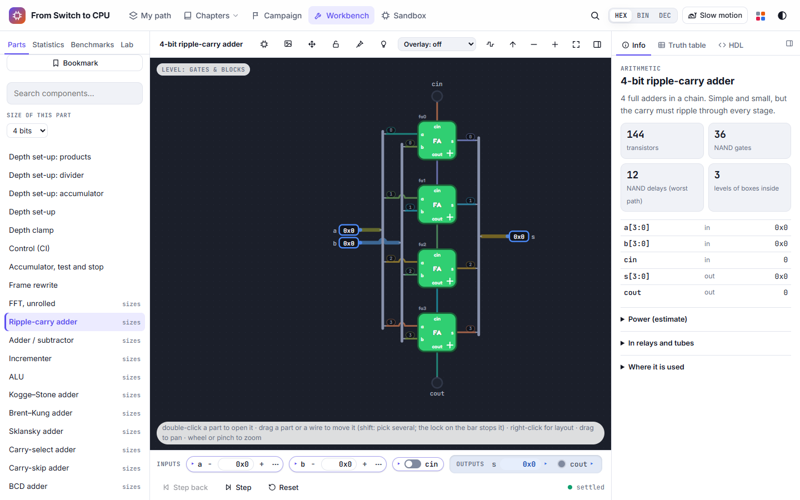

2. Click **Search components…** at the top of the parts list and type `ripple`. The list keeps only the parts whose
   names match.

   

3. Click **Ripple-carry adder**. A part marked **sizes** comes in several sizes: under **Size of this part**, choose
   **2 bits**. The circuit redraws as two full adders (**fa0**, **fa1**) in a chain.

   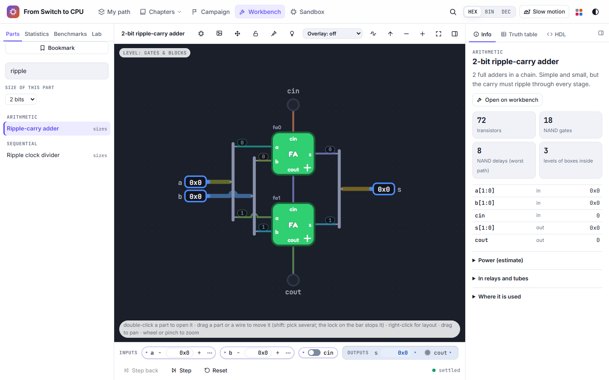

4. Set the inputs in the bar under the circuit. Click **+** next to **a** three times (a = `0x3`) and **+** next to
   **b** once (b = `0x1`). The wires light up as the values arrive, and the outputs change: **s** shows `0x0`, and
   the **cout** lamp turns on, because 3 + 1 = 4 does not fit in two bits. The status at the bottom right says how
   many gate delays it took to settle.

   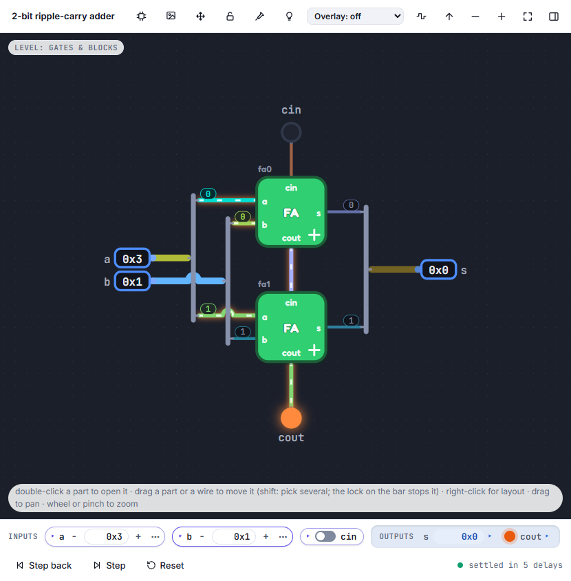

5. Read the cost on the right, under **Info**: transistors, NAND gates, the worst path in NAND delays, and how many
   levels of boxes are inside. Under them, each input and output with its value now.

   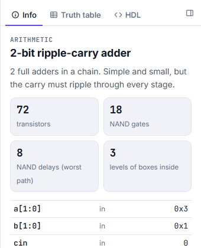

6. Click **Truth table**. Every combination of the inputs is listed with its outputs, worked out by simulating the
   circuit itself. The highlighted row is the current state.

   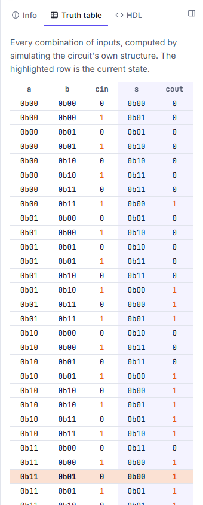

7. Click **Info** to go back, then double-click the first full adder, **fa0**, in the circuit. You are inside it now:
   nine NAND gates. The path above the circuit shows where you are (**2-bit ripple-carry adder › fa0 Full adder**),
   and the inspector describes the full adder.

   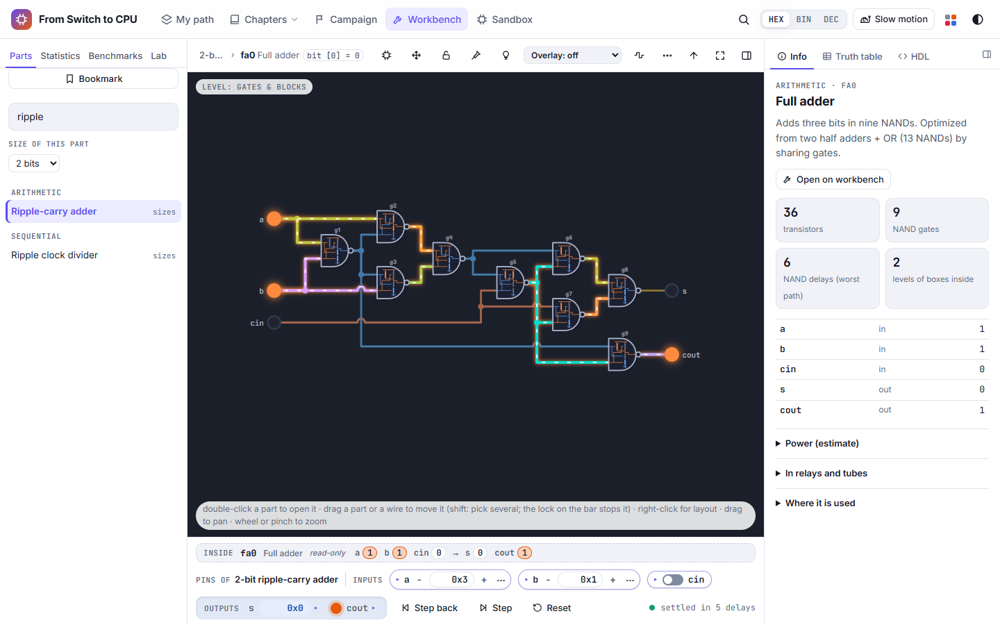

8. Double-click the NAND gate **g1**. Now you see its four transistors, two PMOS above and two NMOS below, with the
   current flowing to the output.

   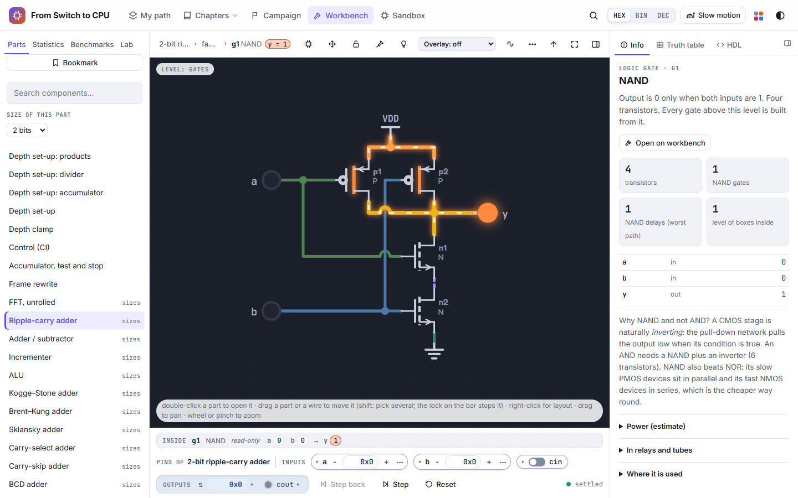

9. Press **Esc** (or click **Up one level**, the up arrow on the bar above the circuit) to go back up one level at a
   time. Click a name in the path above the circuit to jump straight to that level.

You have tried a part, changed its size, read its cost and truth table, and opened it down to transistors. The rest
of this page covers every control.

## The screen

- **Top bar.** **My path**, **Chapters**, **Campaign**, **Workbench** and **Sandbox** take you to the other
  sections. The search button (**Ctrl K**) is on the right. **HEX / BIN / DEC** sets how values are written everywhere on
  the page. **Slow motion** draws every change as it travels, one gate delay at a time. Then View options and the
  theme switch.
- **Left pane: four tabs.**
  - **Parts**: the whole library. It has a **Bookmark** button, **Search components…** and **Size of this part**
    (for parts marked **sizes**).
  - **Statistics**: every part's cost in one table.
  - **Benchmarks**: the processors timed on the same programs.
  - **Lab**: design your own out-of-order core.

  **Statistics**, **Benchmarks** and **Lab** each open as a page of their own, with the same four tabs across the top;
  click **Parts** to come back to the circuit.
- **Middle: the circuit**, with a bar above it and the controls below it.
  - **The bar above**, from left to right:
    - the part's name, and the path when you are inside it;
    - **Open in Sandbox** (the chip icon);
    - **Share** (the picture icon);
    - **Layout** (the four arrows);
    - **Lock the layout** (the padlock);
    - **Probe** (P);
    - **Why?** (W);
    - **Overlay**;
    - **Timing**;
    - **Up one level**;
    - zoom out and zoom in;
    - **Fit to screen**;
    - **Hide the side panes**.
  - **Under the circuit**: the **Inputs** (a number with **−**, **+** and **⋯**, or a switch for a single bit), the
    **Outputs**, then **Step back**, **Step** and **Reset**, and the status (**settled**, or how many delays the last
    change took).
- **Right pane: the inspector.**
  - **Info**: what the part is, its cost, its pins and their values, and three folded sections: **Power
    (estimate)**, **In relays and tubes** and **Where it is used**.
  - **Truth table**.
  - **HDL**: its Verilog or VHDL.
  - The button at the top right folds the inspector away.

## How to …

### Find a part

1. In **Parts**, type in **Search components…**. The list keeps the parts whose names match. Clear the box to see the
   whole list, which is grouped by kind (arithmetic, sequential, memory, processor parts, …).
2. Or press **Ctrl K** anywhere on the site and type a part's name: parts are listed among chapters and levels.
3. To come back to a part later, click **Bookmark** above the list. Your bookmarks are in **My notes**.

### Change a part's size

Parts marked **sizes** (adders, registers, counters, memories, multiplexers, …) come in several sizes.

1. Pick the part.
2. Under **Size of this part**, choose a size. The circuit, its cost and its truth table follow, and the address in
   the browser changes with it, so you can bookmark or share that size.

### Set inputs and read outputs

1. In the bar under the circuit, each input with several bits shows its value.
   - **−** and **+** take one from it or add one.
   - Click the number and type a value.
   - **⋯** (**Edit bits**) sets the bits one by one.
2. An input of one bit is a switch: click it to flip it.
3. Outputs are shown after **Outputs**: a number, or a lamp for a single bit. Click an output's number to change how
   that one value is written.
4. To write every value in hexadecimal, binary or decimal, use **HEX / BIN / DEC** on the top bar.

The circuit follows each change through its gates. The status at the bottom right says when it has **settled** and
how many gate delays it took.

### Run a clocked part: clock, Pulse, Step, Step back

A part with flip-flops (a counter, a register, a processor) has a clock input **clk**.

1. Pick a clocked part, for example **Counter** (try **4 bits**).
2. It starts running by itself, slowly. The clock control under the inputs shows it:
   - the **clk** switch: click it to set the clock by hand;
   - **Pulse**: one whole clock cycle;
   - **Pause the clock** / run;
   - the clock period setting.
3. For the counter, turn on **en** to make it count, and watch **q**.

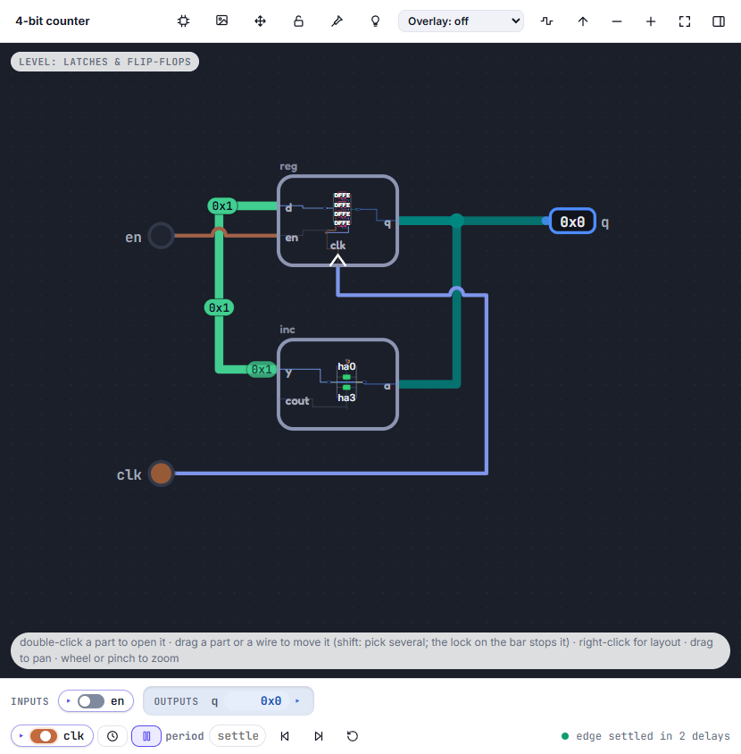

The other controls, on any part:
- **Step** moves time on by one gate delay, so you can follow a change through the gates.
- **Step back** undoes the last clock cycle, gate step or input change. You can press it several times.
- **Reset** switches the whole circuit off and on again.

### Watch a change travel (Slow motion)

1. Click **Slow motion** on the top bar.
2. Change an input (here a = 15, then b = 1, so a carry ripples through all four full adders). Each change is drawn
   as a front moving along the wires, one gate delay at a time, and the status reads **propagating… t =** the delays so
   far until it has settled. The circuit's own timing is the same; only the drawing is slowed.
3. Click **Slow motion** again to turn it off.

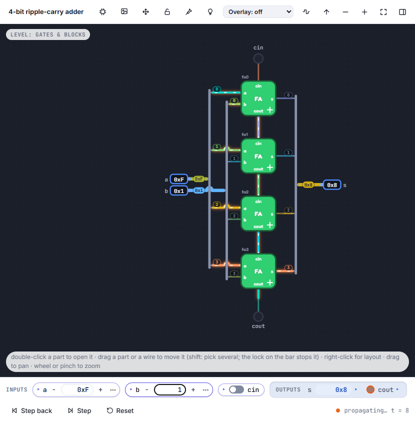

### Open a part: double-click, or zoom in

You can open any box on the screen and keep going down to transistors.

- **Double-click** a part to step inside it. The path above the circuit shows where you are; click a name in it to go
  back to that level. **Esc** or **Up one level** goes up one level.
- **Zoom in on a part** with the mouse wheel, a trackpad pinch, or **+**. Once a box is big enough, its inside opens
  in place, live, without leaving the level. Zoom out and it closes again. Keep zooming in and you step into it: the
  address and the path above the circuit change. To come back up, press **Esc** or click a name in the path.
  This is the **Open blocks as you zoom** option. It is on by default, and so is **Opened blocks without colour**,
  which draws an opened box on the plain background so its inside reads clearly. Both are in View options, on the
  top bar.

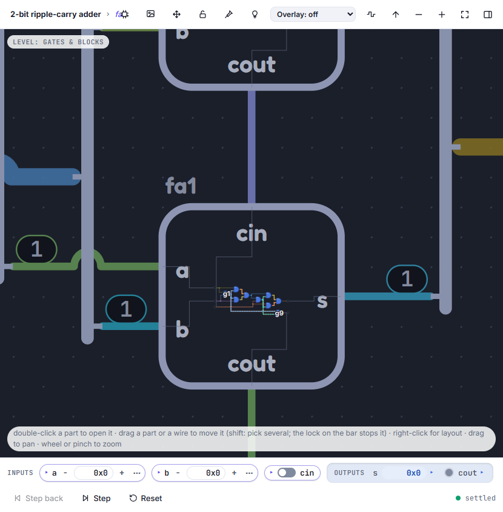

On a touch screen, pinch with two fingers to zoom and open, and drag with one to move the view.

### Record signals over time (Probe and Timing)

1. Click **Probe** (or press **P**). Then click wires or pins in the circuit. Each one you click gets a coloured tag
   and is recorded.
2. Change some inputs.
3. Click **Timing** to open the timing diagram under the circuit. Each probed signal is a row: its value over time,
   in gate delays.
   - Click in the diagram to place cursor A, and Shift-click to place cursor B. The time between them is shown.
   - **Live** follows the newest change.
   - **Clear probes** removes the probes.
   - **VCD** saves the recording as a file that other waveform viewers read.
4. Press **Esc** to leave probe mode.

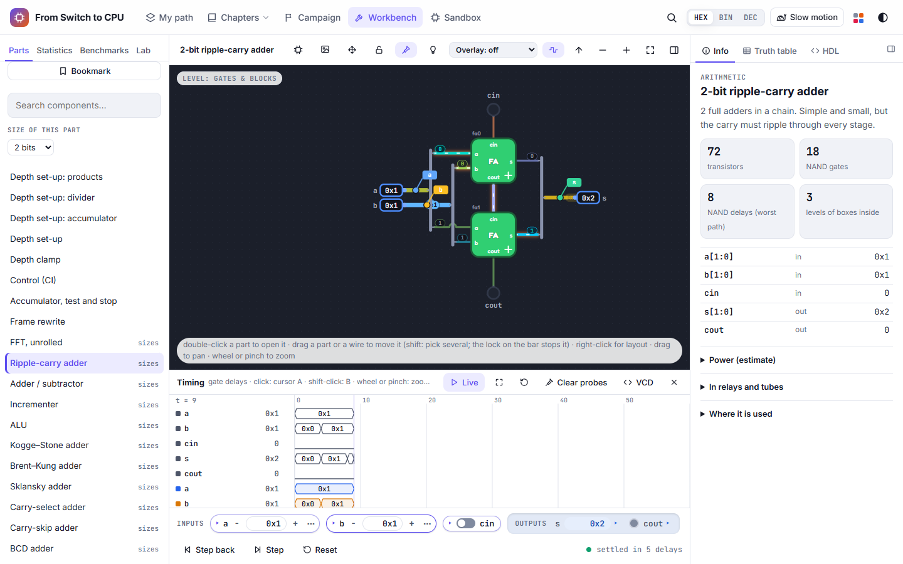

### See why a wire has its value (Why?)

1. Click **Why?** (or press **W**), then click a wire.
2. A card explains the value step by step, back to the inputs that decide it. For example: "**fa1.cout = 1 from a[1]
   = 1, b[1] = 0, fa0.cout = 1**", then why that carry is 1. Hover a line to light its part on the circuit; open a box
   to follow the trace inside it.
3. The card's second tab, **Each part**, shows what each part on this level does: what goes wrong without it.

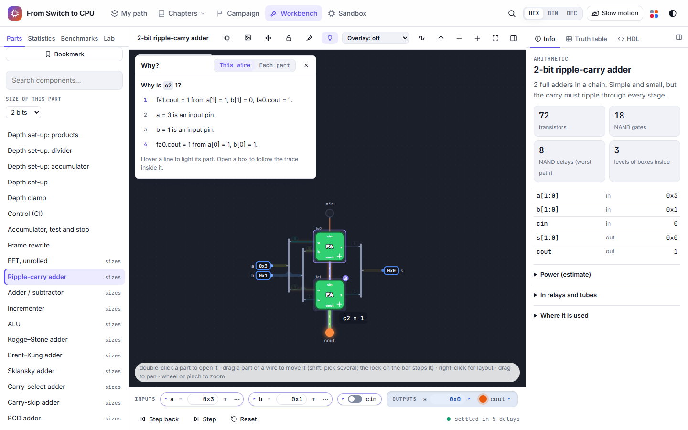

### Colour the circuit by a quantity (Overlay)

1. In the **Overlay: off** drop-down on the bar, choose one of **Slack**, **Activity**, **Load**, **Unknown**, **Cost**,
   **Energy** or **Depth**. The whole circuit is coloured by it, with a key.
   - **Slack** shows how much later each part's slowest path could be before the whole part got slower: parts on the
    critical path are red. The key in the corner explains the colours and counts the parts in each.
   - **Unknown** shows which wires still carry no known value.
   - The others colour by switching activity, load, cost, energy or logic depth.
2. Press **O** to go to the next overlay, and **Shift O** to turn it off.

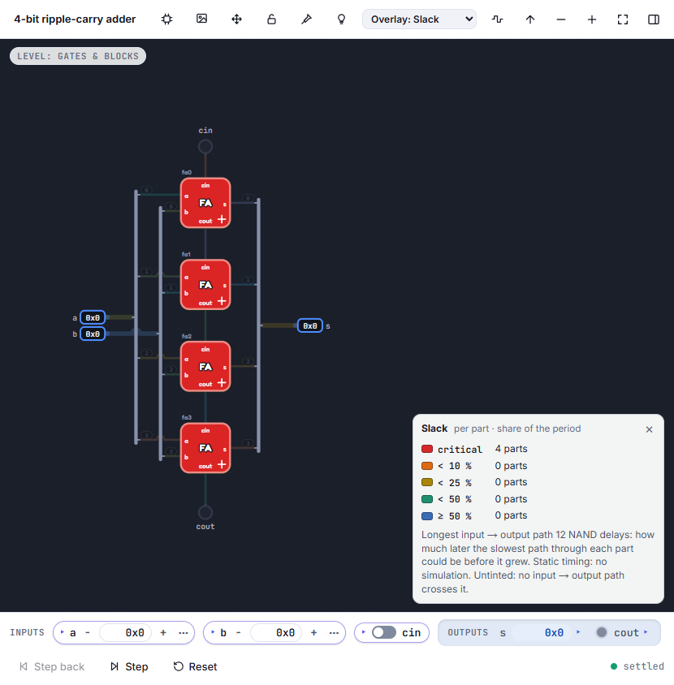

### Use a part's menu (right-click)

Right-click a part (or select it and press the **Menu** key, or **Shift F10**) for everything about it:
- **Look inside**: the same as a double-click.
- **Inspect**: its datasheet and cost in the inspector.
- **Measure ▸**
  - **Slack**: how much shorter than the critical path its slowest path is.
  - **Light the critical path through it**.
  - **Power**: live from the running circuit, else measured on random inputs.
- **Explain ▸**
  - **Truth table**;
  - its **Codex** entry;
  - the **Chapter** that teaches it;
  - **Break a part**: what goes wrong without it, as its row in a table of this level;
  - **Where it is used**.
- **Take it elsewhere ▸**
  - **Open in Sandbox**;
  - **Copy Verilog** (with every module under it);
  - **Save an image as SVG** or **as PNG**;
  - **Copy a link to this view**.

Right-click empty space for the same menus about the whole level.

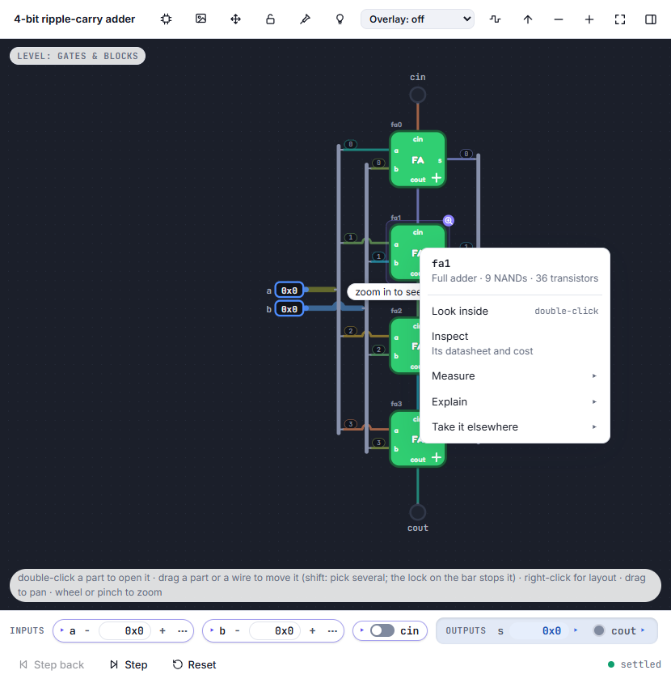

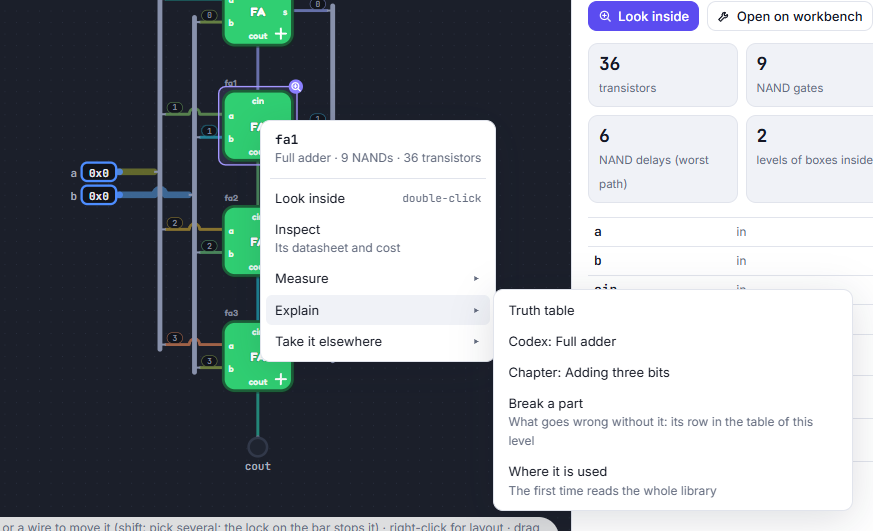

### Move parts and wires (layout)

1. Drag a part or a wire to move it. Shift-click or drag a box around several parts to move them together. **Ctrl Z**
   undoes and **Ctrl Y** redoes. Your arrangement is kept for that part on this computer.
2. **Layout** (the four arrows) opens a menu. Before you have moved anything it only explains how to move parts; once
   you have, it offers **Undo** (**Ctrl Z**) and **Reset layout**, which puts this level back as it was first drawn
   (wire colours you picked stay).
3. **Lock the layout** (the padlock) stops drags from moving anything: a drag then moves the view.

Moving parts changes only the drawing, never the circuit.

### Save an image or share a link

1. Click **Share** (the picture icon) on the bar.
   - **Image as SVG**: this level, whole, as drawn in your current theme.
   - **Image as PNG**: the same at 2× resolution.
   - **Copy link to this view**: a link that reopens this part with the same opened level, inputs, probes and clock
     cycles.

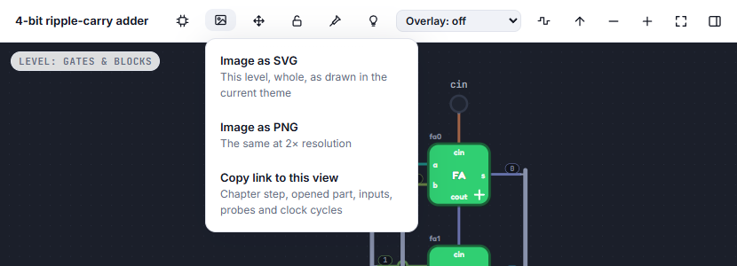

### Open a copy in the Sandbox

Click **Open in Sandbox** (the chip icon, first on the bar). An editable copy of the circuit on screen opens in the
Sandbox as one of your own chips. Change it there; the workbench's part stays as it was.

### Read the inspector: cost, power, relays and tubes, where it is used

Under **Info**:
- **Transistors**, **NAND gates**, **NAND delays (worst path)** and **levels of boxes inside** are counted from the
  part's own circuit.
- Each pin with its direction and current value.
- **Power (estimate)**: the energy it switches, measured on the running circuit or on random inputs.
- **In relays and tubes**: what the same part would take built from relays or vacuum tubes (devices, worst path,
  power, size, mass), with **Where the numbers come from**.
- **Where it is used**: the parts that place it, how many times, and its copies in the chapters' processors.
- **Open on workbench** (when you are inside another part) makes the part you are looking at the workbench's own.

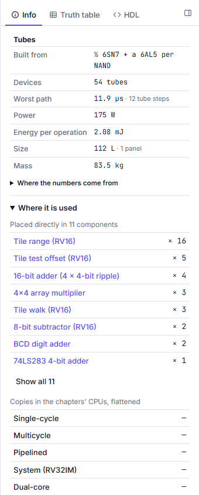

### Read or copy its HDL

1. Click **HDL** in the inspector.
2. **Structural source (generated from this schematic)** is the part's netlist as Verilog, or click **VHDL**. Click a
   line to light its part on the circuit, or select a part to find its lines. **Copy** puts it on the clipboard.
3. Under it, some parts also have a hand-written **SystemVerilog** version, with its own **Copy**.
4. To save the part with every module under it in one file, use the buttons under **Download the whole hierarchy**:
   **Exact structure** (gate for gate, as drawn), **Synthesizable** (for synthesis tools) or **VHDL**. With
   **testbench** ticked (it is, to begin with), a self-checking testbench comes with it.

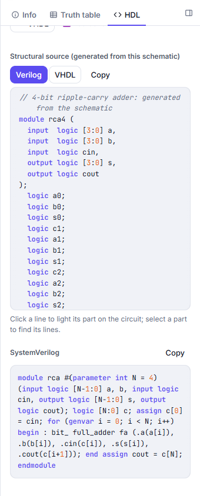

### Compare every part (Statistics)

Click **Statistics** in the left pane. **Hardware statistics** lists every part:
- its category;
- transistors;
- NAND gates;
- depth in NAND delays;
- clock period;
- levels;
- boxes inside.

Use the tabs to see it built in **CMOS**, **Relays** or **Tubes**. Click a column heading to sort by it; the table
starts sorted by **NAND gates**. Click a name to open that part on the workbench.

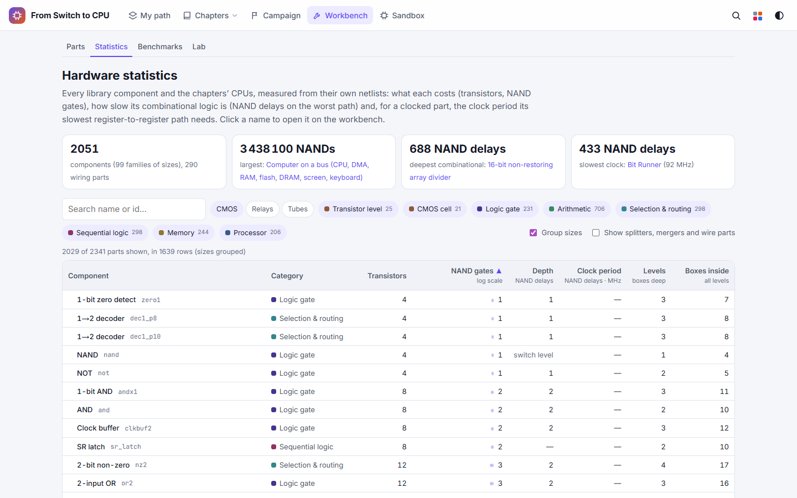

### Compare the processors (Benchmarks)

Click **Benchmarks**.
- **Speed against cost** plots every processor in the site: its mean time on the same programs (Fibonacci, insertion
  sort, matrix multiply and more) against its size in NAND gates. Down and left is better.
- The **Cost** and **Energy** switches above it change what the plot shows.
- The table below gives each processor's NAND gates, clock period and its result on each program.

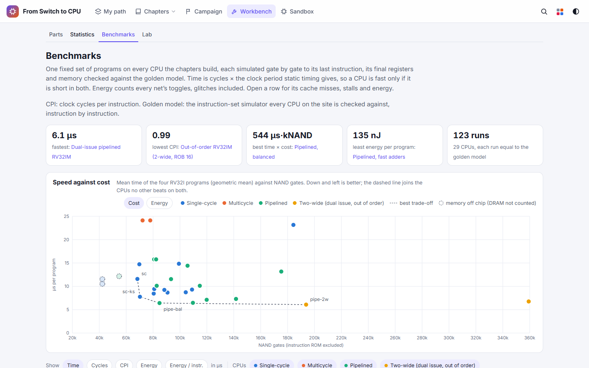

### Design an out-of-order core (Lab)

Click **Lab**.
1. Start from a preset: **Our core**, **1 wide**, **In order**, **4 wide**, **Perfect prediction**, **Recover at
   resolve** or **No return stack**.
2. Change the knobs:
   - fetch and commit width;
   - the execution ports (**+ add a port**);
   - issue order and port binding;
   - the reorder buffer, issue queue and store queue;
   - the predictor, the BTB and the return stack;
   - when to recover;
   - latencies;
   - the divider.
3. Run it on **The benchmark set**, on one program, or on your own assembly or Python. Read the cycles per
   instruction and what each lost slot waited for.
4. **Keep for comparison** keeps a design beside the next one.

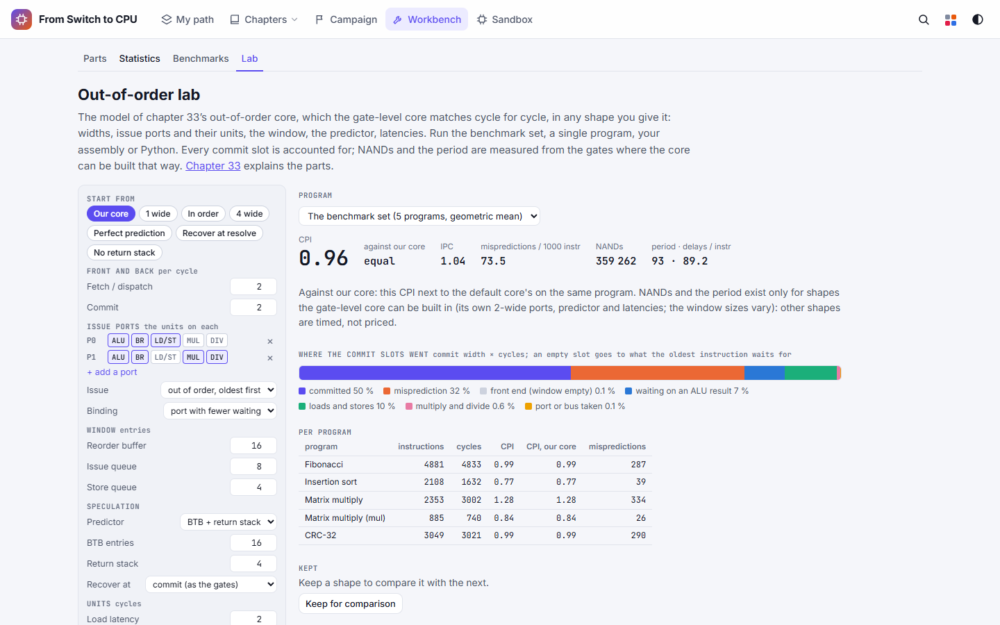

## Keys and gestures

Press **?** on the page for the full list. On the circuit (click it first, or press **S**):

| Key | Does |
|---|---|
| **P** | probe mode: click wires to record them |
| **W** | Why? mode: click a wire to trace its value |
| **O** · **Shift O** | next overlay · overlay off |
| **F** | focus mode: fold every panel for the circuit alone; again to bring them back |
| **Esc** · **Backspace** | leave probe or Why? mode, close the open block, else up one level |
| **←** **→** **↑** **↓** | move the cursor to the nearest part or pin that way |
| **Home** · **End** | cursor to the first input · the first output |
| **Enter** | an input toggles (a number: edit it), a part opens, an output is read out |
| **Space** | toggle the input under the cursor |
| **Ctrl Enter** | run / pause the clock |
| **.** | one clock cycle (Pulse) |
| **>** | one gate delay (Step) |
| **,** | back one step |
| **+** · **−** · **0** | zoom in (with Open blocks as you zoom, the part opens) · zoom out · fit the circuit |
| **Ctrl Z** · **Ctrl Y** | undo · redo moving parts |
| **Menu** · **Shift F10** | the menu of the selected part or wire |
| **Ctrl K** or **/** | search everything |

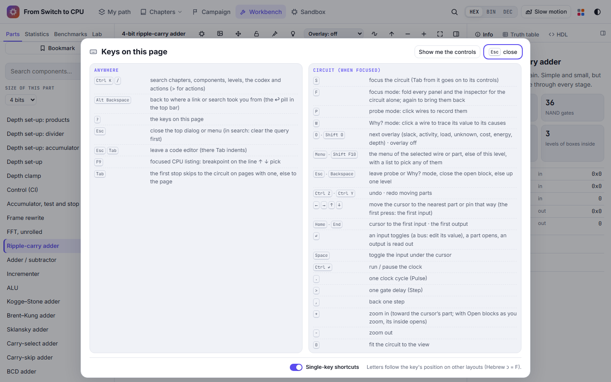

Mouse:
- The wheel or a trackpad pinch zooms toward the pointer.
- Drag empty space to move the view (drag a part to move the part).
- Double-click to open.
- Right-click for the menu.

On a touch screen:
- Pinch to zoom.
- Drag with one finger to move the view.
- **Double-tap** a part to open it.
- Tap a switch to flip it.
- Press and hold for the menu.

On a phone the page stacks up:
- The parts list becomes the **Components** menu at the top. Tap it to pick a part.
- The circuit's tools are behind **More tools** (**⋯**) on its bar.
- The inputs, outputs and the step controls follow under the circuit.

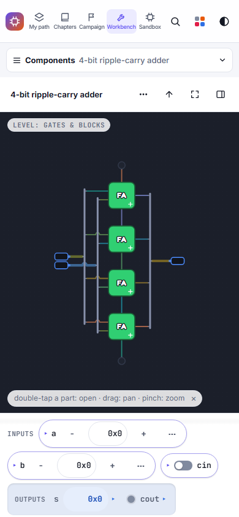

## If something looks wrong

- **Zooming opened a box I did not mean to open.** That is **Open blocks as you zoom**. Zoom out and the box closes.
  To open boxes only by double-clicking, turn the option off in View options on the top bar.
- **Step back is greyed out.** There is nothing to undo yet: it becomes active after an input change, a step or a
  clock cycle.
- **The counter does not count.** Its **en** input is off. A clocked part runs by itself, but a counter only counts
  while **en** is on.
- **The circuit is too small or off screen.** Press **0** or click **Fit to screen**. **Hide the side panes** gives
  the circuit the whole width.
- **I moved parts and want the original drawing back.** Click **Layout**, then **Reset layout**. **Ctrl Z** undoes one
  move.
- **I zoomed in, stepped into a block, and zooming out does not bring me back.** Zooming out closes opened blocks
  but does not leave the level you stepped into. Press **Esc**, or click a name in the path above the circuit.

Next: [The sandbox](sandbox.md)
